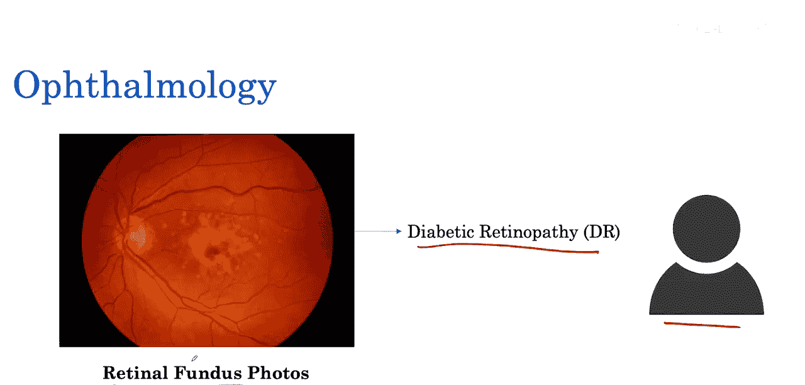
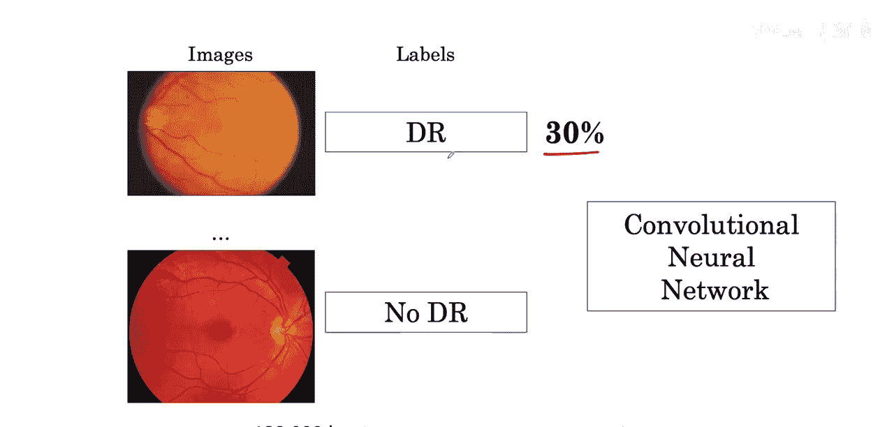
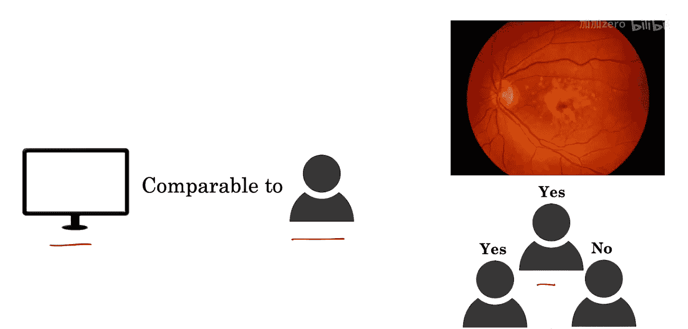
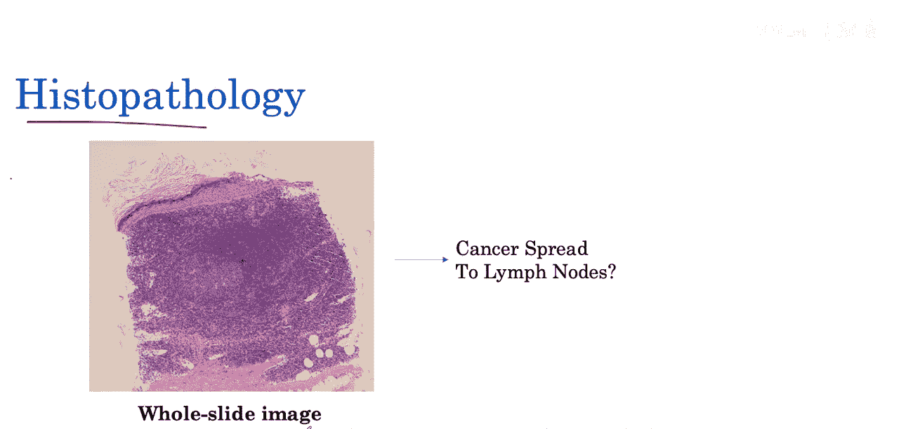

# deeplearningai【中英⚡AI 医学诊断｜AI for Medical Diagnosis】 p05 P5 02_眼部疾病与癌症诊断 [BV1kyYbzDEJk_p5]

Our second example is an ophthalmology， which deals with the diagnosis and treatment of eye disorders。

 One well known study in 2016 looked at retinal fundus images。

 which photographed the back of the eye。One disease or pathology to look at here is diabetic retinopathy。

 which is damaged to the retina caused by diabetes and is a major cause of blindness。Currently。

 detecting DR is a time consuming and manual process that requires a trained clinician to examine these photos。

In this study， an algorithm was developed to determine whether patients had diabetic retinopathy by looking at such photos。

This study used over 1 hundred28000 images， of which only 30 per cent had diabetic retinopathy。

 We'll look at this data imbalance problem， which is prominent in medicine and in many other fields。

 with real world data， and we'll see some methods for tackling this challenge。

Similar to the previous study， this study showed that the performance of the resulting algorithm was comparable to ophthalmologists。

In the study， a majority vote of multiple ophthalmologists was used to set the reference standard or ground truthop。

 which is a group of experts best guess of the right answer later this week in the course we'll look at how ground truth can be set in such medical AI studies。

Our third example is in histopathology， a medical specialty involving examination of tissues under the microscope。

 One of the tasks that pathologists do is look at scanned microscopic images of tissue called whole slide images。

