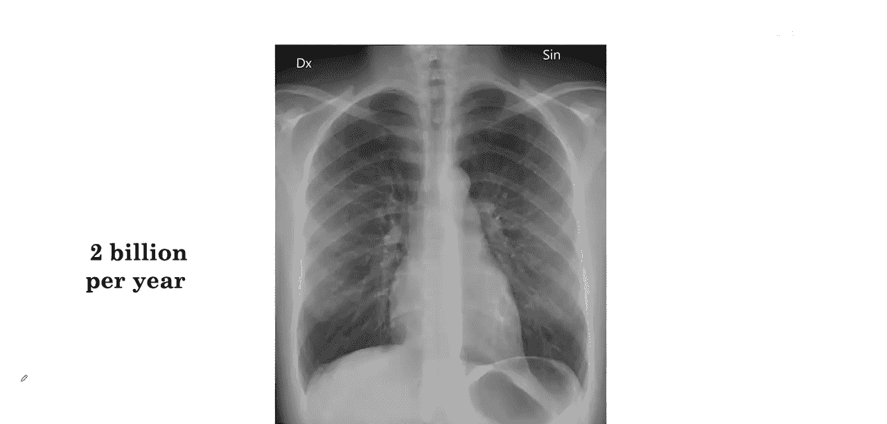
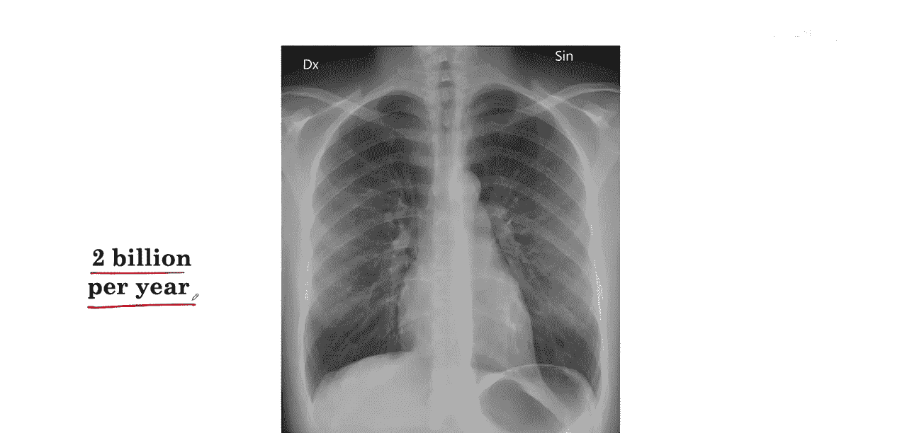
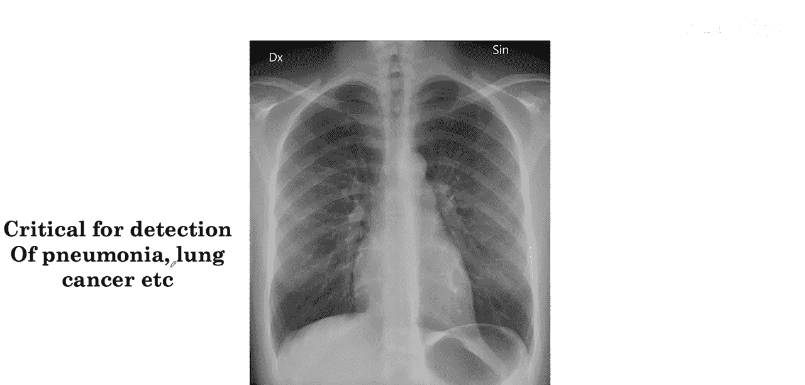
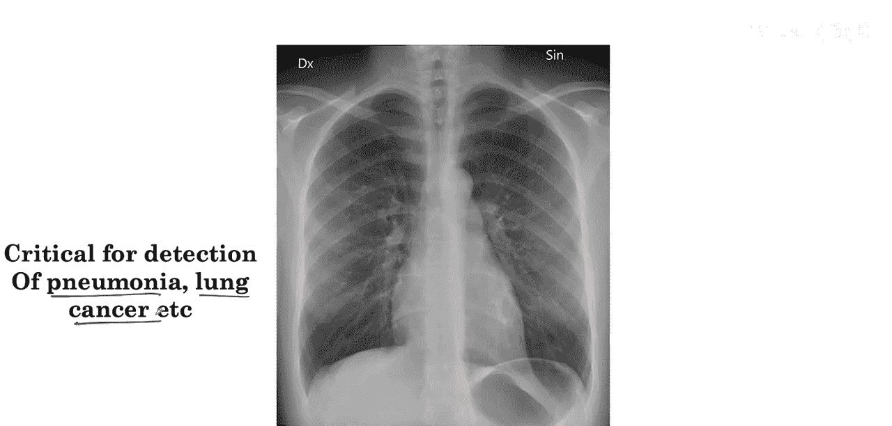
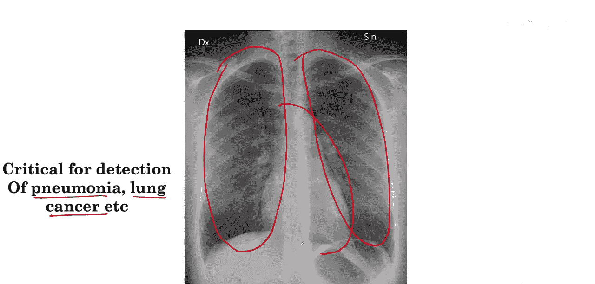
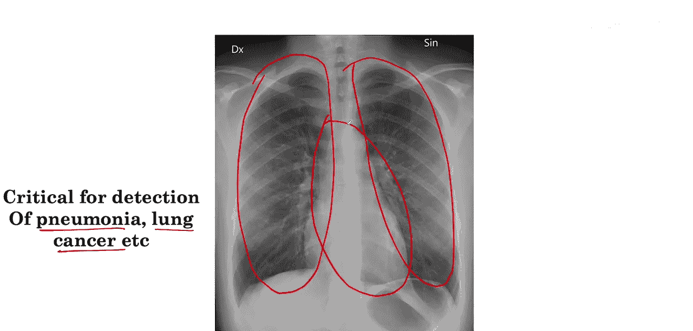

# deeplearningai【中英⚡AI 医学诊断｜AI for Medical Diagnosis】 p06 P6 01_构建并训练医学诊断模型 [BV1kyYbzDEJk_p6]

Now that you've seen some of the cutting edge applications of deep learning to medical image classification problems。

 will'll look at how you can build your own deep learning model for the medical imaging task of using chest X rays to detect multiple diseases with a single model We'll walk through the process of training a model for chest X ray interpretation and look at the key challenges that you will face in this process and how you can go about successfully tackling them。

 We'll start by looking at the task of chest X ray interpretation。😊。

The chest X ray is one of the most common diagnostic imaging procedures in medicine with about 2 billion chest x rays that are taken per year。

Chest X ray interpretation is critical for the detection of many diseases。

 including pneumonia and lung cancer， which affect millions of people worldwide each year。

Now， a radiologist who is trained in the interpretation of chest sex rays looks at the chest sex ray。

 looking at the lungs。

The heart。

And other regions to look for clues that might suggest if a patient has pneumonia or lung cancer or another condition。

Let's look at what one abnormality。Called a mass looks like。

 And I'm not going to first define what a mass is。But let's look at three chest x rays that contain a mass and three chest x rays that are normal。

I can then show you a new chest X ray here and ask you to identify whether there is a mass。

You might be able to correctly identify that this chess X ray contains a mass。

 And here's the mass that might look similar to things that you see in these images。

But not similar to anything that you see in these images。

The way you're learning is very similar to how we're going to teach an algorithm to detect mass。

For our own reference， a mass is defined as a lesion or in other words damage of tissue seen on a chest x ray as greater than  three centimeters in diameter。

Let's see how we can train our algorithm to identify masses。

