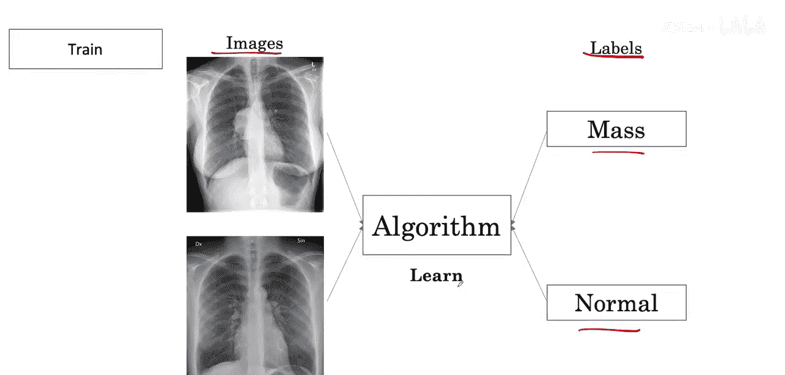
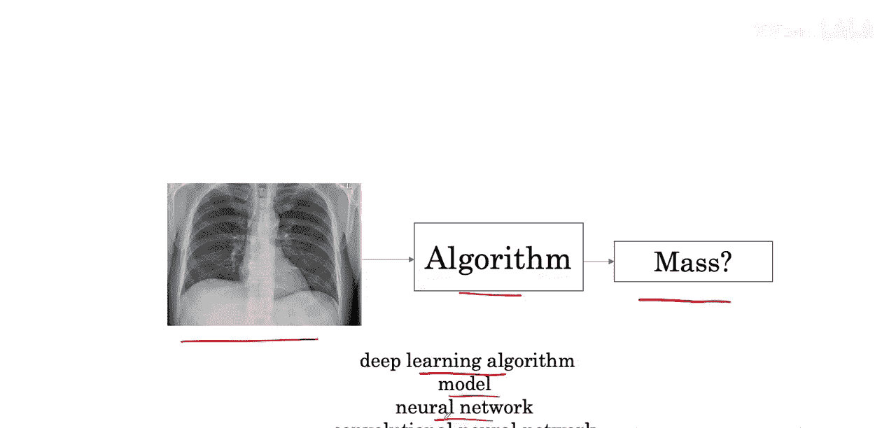
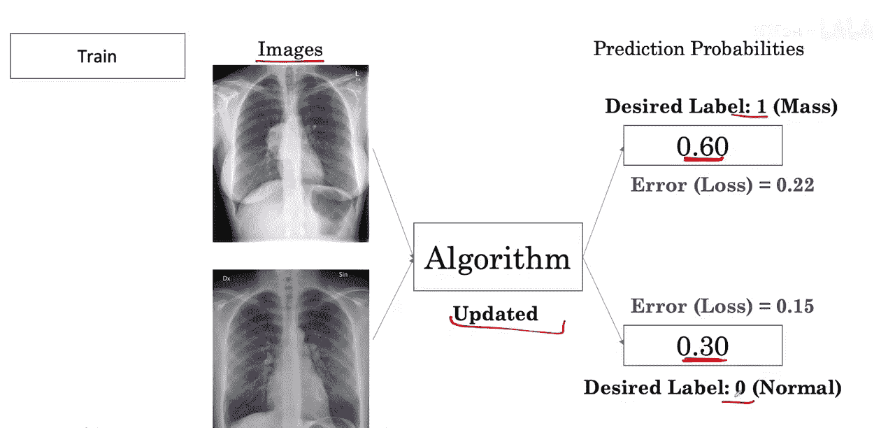

# deeplearningai【中英⚡AI 医学诊断｜AI for Medical Diagnosis】 p07 P7 02_训练、预测与损失 [BV1kyYbzDEJk_p7]

During training， an algorithm has shown images of chest x rays labeled with whether they contain a mass or not。

The algorithm learns using these images and labels。

The algorithm eventually learns to go from H S X ray input to produce the output of whether the X ray contains a mass。

 And this algorithm can go by different names。 You may have heard of the terms deep learning algorithm or model or neural network or convolutional neural network。

The algorithm produces an output in the form of scores。

 which are probabilities that the image contains a mass to the probability that this image contains a mass is outputted to be 0。

48， and the probability for this image is outputted to be 0。51。 When training has not started。

These scores， these probability outputs， are not going to match the desired label。

Let's say the desired label for mass is one and for normal is 0。 And you can see that 0。

48 is far off from 1 and 0。51 is far off from the desired label of 0。

And we can measure this error by computing a loss function。

 A loss function measures the error between our output probability and the desired label。

 We'll look at how this loss is computed， soon enough。

Then a new set of images and desired labels is presented to the algorithm as it learns to produce scores that are closer to the desired labels over time。

 Notice how this output probability is getting closer to 1 and this output probability is getting closer to 0。

😊。

