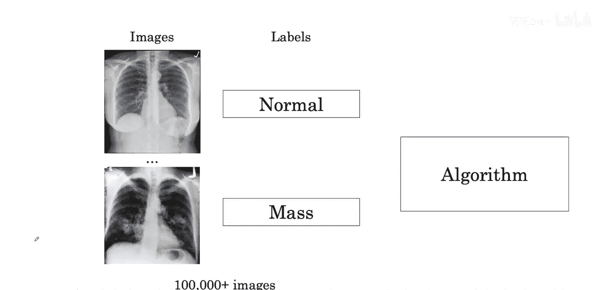
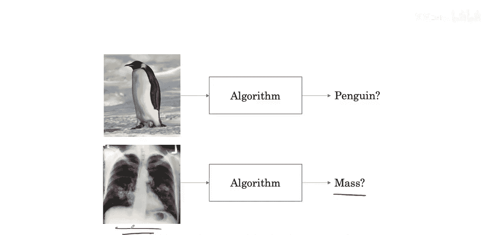
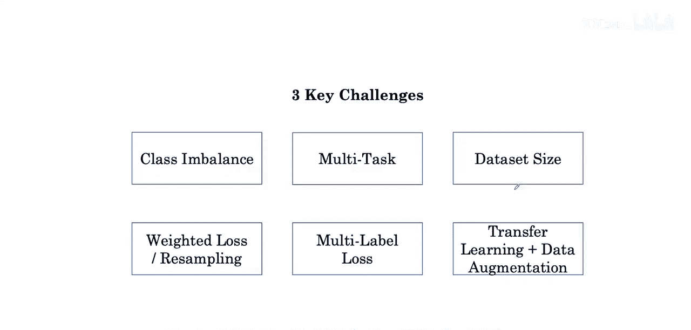
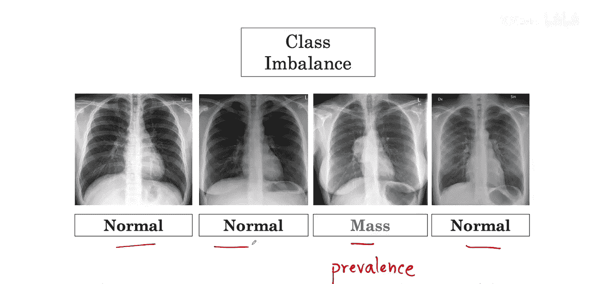

# deeplearningai【中英⚡AI 医学诊断｜AI for Medical Diagnosis】 p08 P8 03_图像分类与类别不平衡 [BV1kyYbzDEJk_p8]

Typically， in the medical AI examples we've seen in previous videos。

 hundreds of thousands of images are shown to the algorithm。

This is a typical setup for image classification， which is a core task in the computer vision field where a natural image is input to an image classification algorithm which says what is the object contained in the image you may have seen deep learning algorithms that can do this。

Our example of chest X ray classification is similar in many ways to the image classification setup。

 There are few additional challenges which make training medical image classification algorithms more challenging。

 which we'll cover next。

We'll talk about three key challenges for training algorithms on medical images。

 the class imbalance Cha， the multitask Cha， and the dataset set size Cha。

For each challenge we' cover one or two techniques to tackle them。

Let's start with a class imbalance challenge。 So here's the challenge。

 There's not an equal number of examples of non diseaseise and disease in medical data sets。

 This is a reflection of the prevalence or the frequency of disease in the real world。

 where we see that there are a lot more examples of normals than of mass。

 especially if we're looking at x rays of a healthy population。 in a medical data set。

 you might see hundred times as many normal examples as mass examples。

