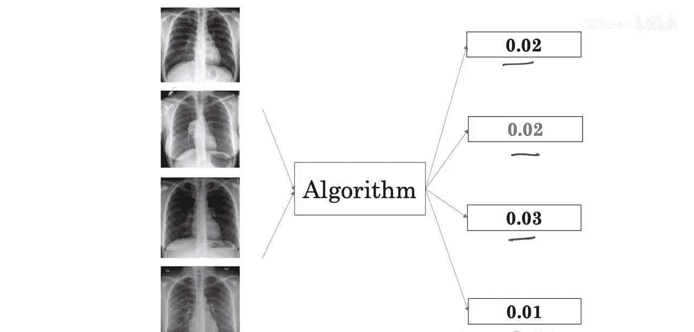
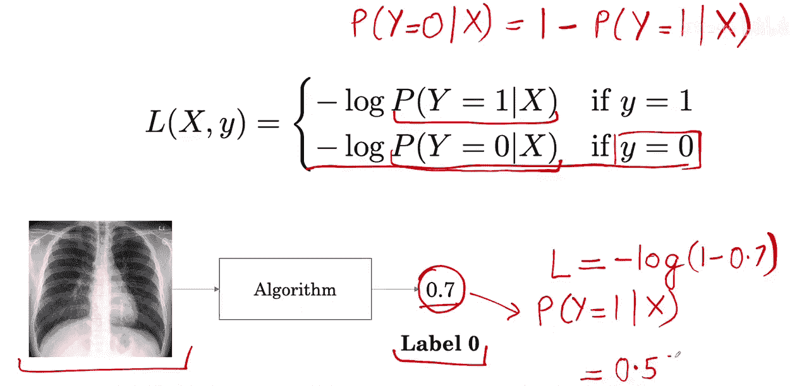

# deeplearningai【中英⚡AI 医学诊断｜AI for Medical Diagnosis】 p09 P9 04_二元交叉熵损失函数 [BV1kyYbzDEJk_p9]

This creates a problem for the learning algorithm which seize mostly normal examples。

This yields a model that starts to predict a very low probability of disease for everybody and won't be able to identify when an example has a disease。

Let's see how we can trace this problem to the loss function that we use to train the algorithm。

 We'll also see how we can modify this loss function in the presence of imbalanced data。

This loss over here is called the binary cross entropy loss。

 And this measures the performance of a classification model whose output is between 0 and 1。

Let's look at an example to see how this loss function evaluates。

Here we have an example of a chesttic ray that contains a mass so it gets a label of one and the algorithm outputs of probability of 0。

2。Now the 0。2 here is the probability according to the algorithm。Of y being equal to one。

 the probability that this example is a mass。And so now we can apply the loss function to compute the loss on this example。

The loss L。Is going to be Now， notice that our label is one。 So we're going to use the first term。

 Our loss is negative。Log。And then we're going to take the algorithm output。0。2。

And so this evaluates to 0。70。 So this is the loss that the algorithm gets on this particular example。

Let's look at another example。 This time， a non mass example， which would have a label of 0。

 Our algorithm outputs a probability of 0。7。 Now， this time， we're going to use。

This term of the loss right here， because y equals 0。So now the loss。I's going to be negative log。

Of the term py equals0 given x， we can get py equals0 given x。Using。P， F Y equals。One， give an X。

And the way we can compute。This quantity from that one。

Is by recognizing that the probability that an example is 0 is 1 minus the probability that it's one。

An example is either mass or not。And so if the algorithm says 70% probability that something is mass。

 then there's 30% probability。 It's not。 And so here we're going to plug in 1-0。7。

 that is going to come out to 0。3， and this expression evaluates to 0。52。

