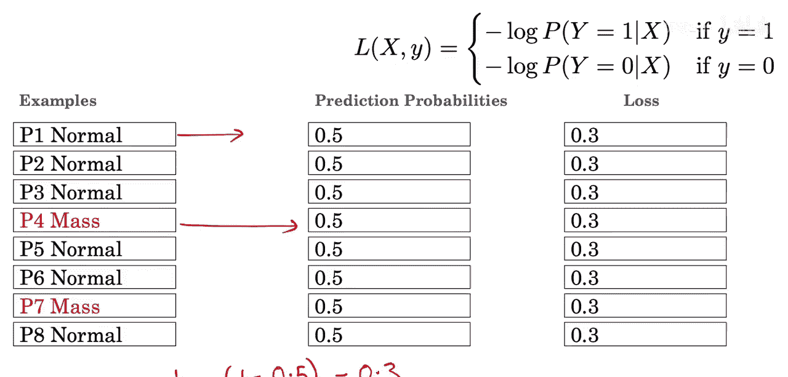
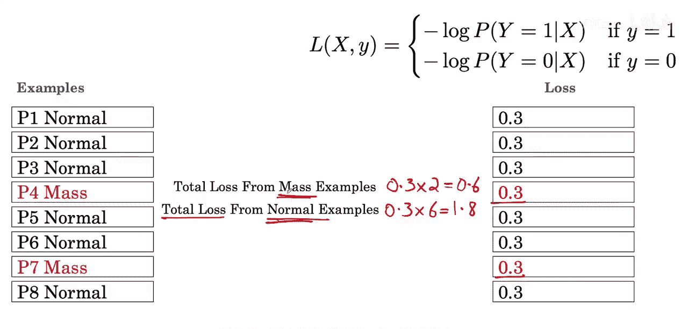
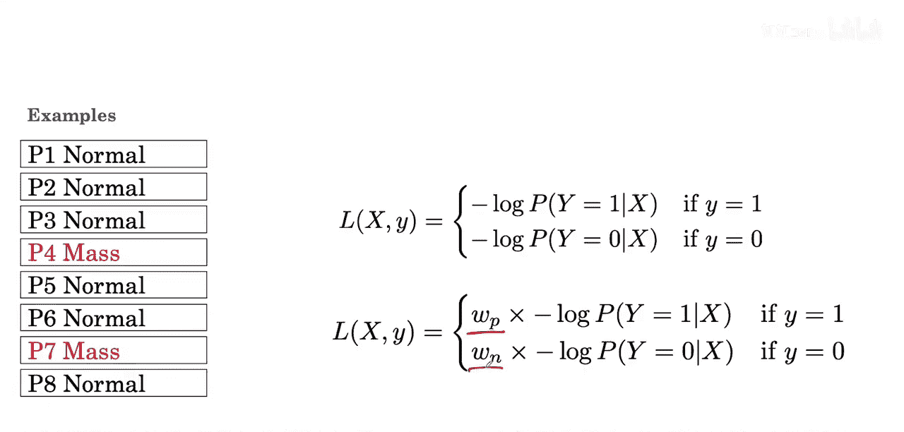
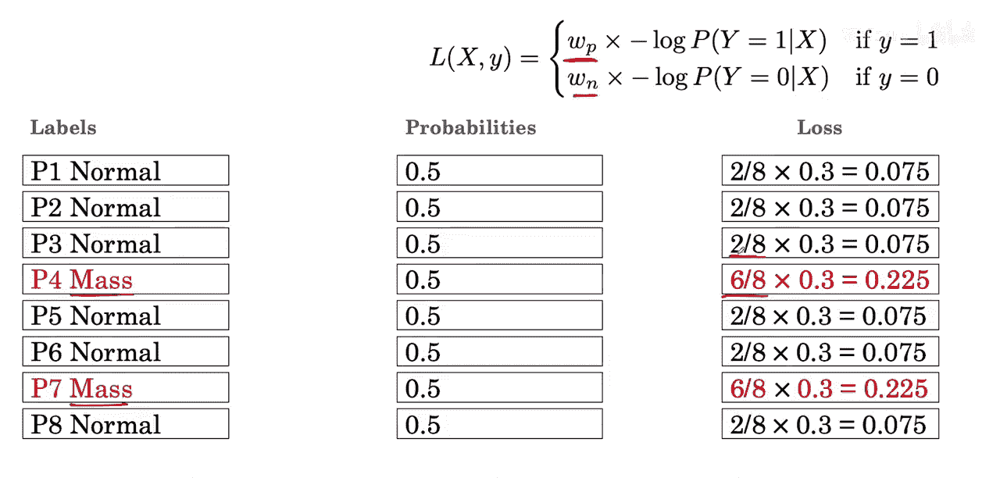
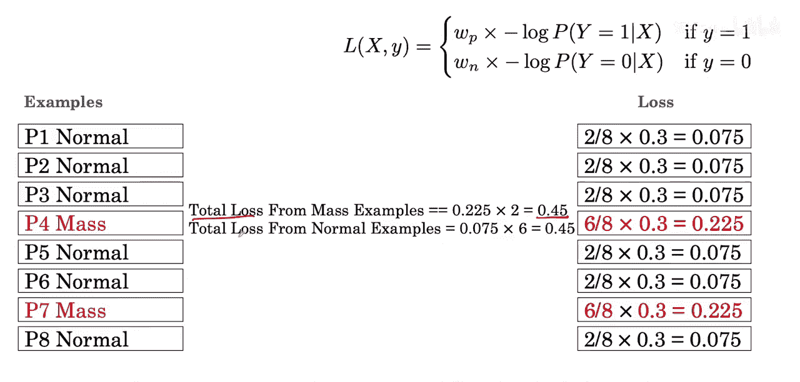
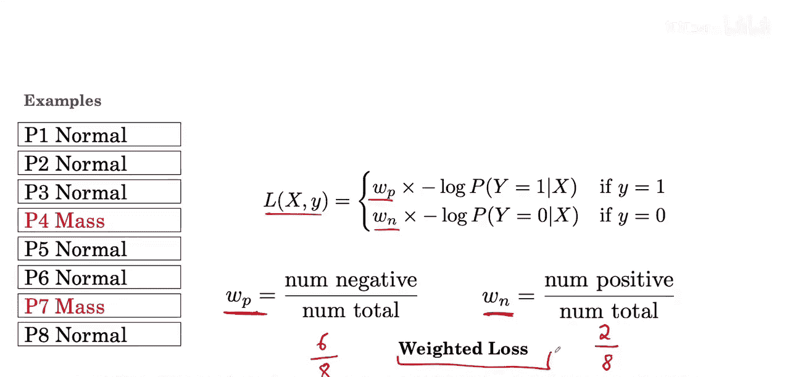

# deeplearningai【中英⚡AI 医学诊断｜AI for Medical Diagnosis】 p10 P10 05_类别不平衡对损失计算的影响 [BV1kyYbzDEJk_p10]

We've seen how the loss is applied to a single example。

 let's see how it applies to a bunch of examples。 Here we have six examples that are normal and two examples that are mass。

Note that P2， P3， P4 here are the patient Is。 When the training hasn't started。

 let's say the algorithm produces an output probability of 0。5 for all of the examples。

The loss can then be computed for each of the examples for a normal example。

 we're going to use negative log of 1 minus 0。5， which is going to come out to 0。3。

 and for a mass example， we're going to use negative log of 0。5。

 which is also going to come out to 0。3。

The total contribution to the loss from the mass examples comes out to 0。3。Times 2， which is 0。6。

 While the total loss from the normal example comes out to 0。3 times the  six normal examples。

 which is 1。8。 So notice how most of a contribution to the loss is coming from the normal examples rather than from the mass examples。

 So the algorithm is optimizing its updates to get the normal examples right。

 and not giving much relative weight to the mass examples。 In practice。

 this doesn't produce a very good classifier。 This is the class imbalance problem。

The solution to the class and balance problem is to modify the loss function to weight the normal and the math classes differently。

WP will be the weight we assign to the positive or to the mass examples and W N to the negative or normal examples。

Let's see what happens when we weight the positive examples more。

 We want to weight the mass examples more， such that they can have an equal contribution over all to the loss as the normal examples。

 Let's pick 6 over 8 as the weight we have on the mass examples and 2 over 8 as the weight we have on the normal examples。

😊。

Then you can see that if you sum up the total loss from the mass example， we get 0。45。

 and this is equal to the total loss from the normal examples here。

In the general case， the weight will put on the positive class will be the number of negative examples over the total number of examples。

 In our case， this is six normal examples over8 total examples。

The weight will put on the negative class will be the number of positive examples over the total number of examples。

 which is 2 over 8。 With this setting of W， P And W N， we can have over all of the examples。

 the loss contributions from the positive and the negative class to be the same。

 So this is the idea of modifying the loss using weights in this method that's called a weighted loss to tackle the class imbalance problem。

