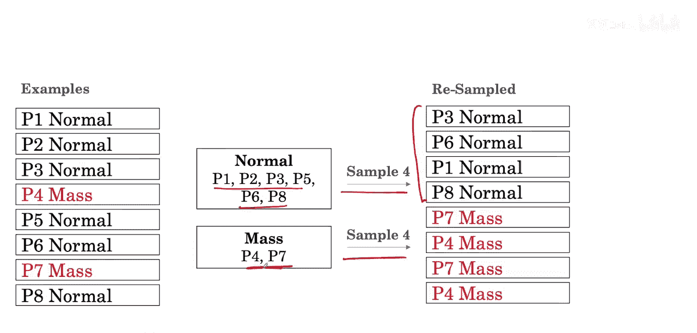
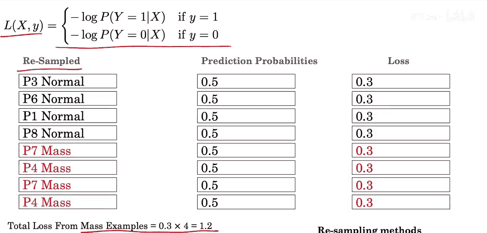

# deeplearningai【中英⚡AI 医学诊断｜AI for Medical Diagnosis】 p11 P11 06_重采样实现类别平衡 [BV1kyYbzDEJk_p11]

Let's discuss another procedure that we can use to tackle the class andbalance problem。

 which is reampling。 The basic idea here is to reample the data set such that we have an equal number of normal and mass examples。

 Let's see how we can achieve this。First， we group the normal and the mass examples together。

 notice that the normal group has six examples， and the mass has two examples。Now， from these groups。

 we will sample the images such that there is an equal number of positive and negative samples。

 We can do this by sampling half of the examples from the positive or mass class and half of the examples from the negative or normal class。

 Note that this means we may not be able to include all of the normal examples in our resample。

 Furthermore， we may have more than one copy of the mass examples in our resample data set。😊。

With this resampled data set， if we now compute the loss in the same way that we did before。

 we can see that even without the weights， this is just our standard binary cross entropy loss。

 We see there is an equal contribution to the loss from the mass examples and from the normal examples。

There are many variations of this approach， like under sampling the normal class or over sampling the mass class。

 these approaches fall under the category of re samplingling methods。

 which we can use to combat the data and balance problem。

