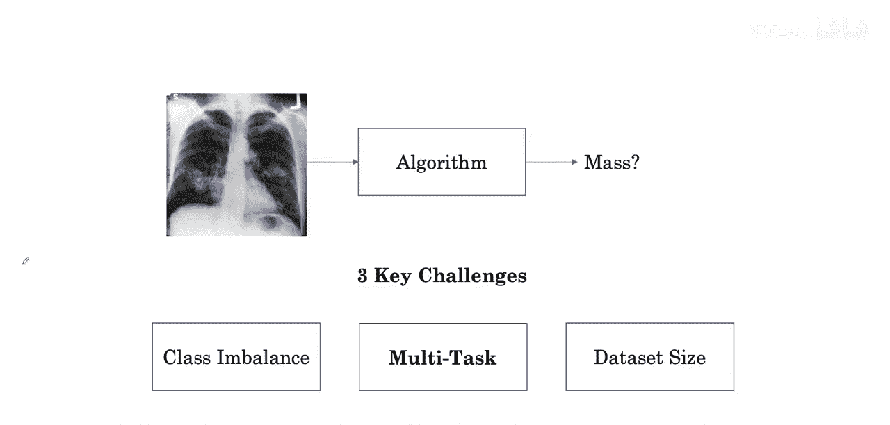
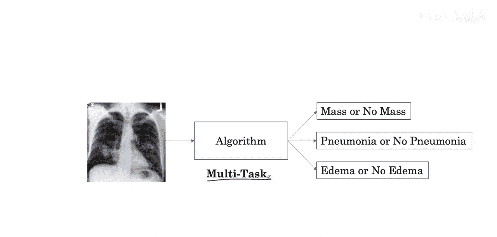
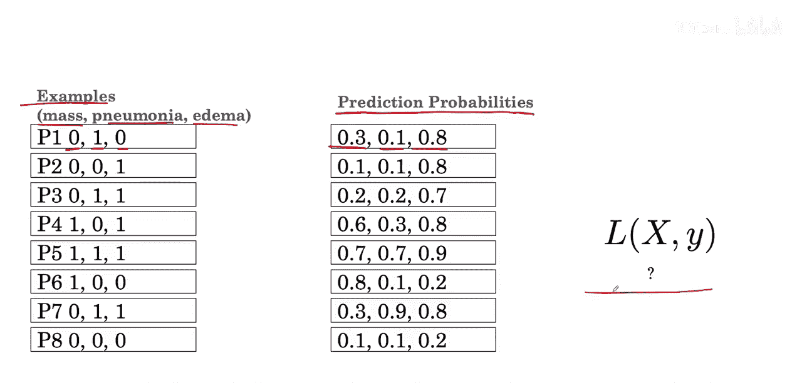

# deeplearningai【中英⚡AI 医学诊断｜AI for Medical Diagnosis】 p12 P12 07_多任务 [BV1kyYbzDEJk_p12]

Let's chat about another challenge that we encounter in the medical image classification setting。

 which is the multitask challenge。

Thus far， we have looked at binary classification， where we care about classifying whether an example is a mass or not a mass。

However， in the real world， we care about classifying the presence or absence of many such diseases。

 Now， one simple way to do this is to have models that each learn one of these tasks。However。

 maybe we can learn to do all of the tasks using one model。

 An advantage of this is that we can learn features that are common to identifying more than one disease。

 allowing us to use our existing data more efficiently。This is a setup of multitask learning。

Let's look at how we can train the algorithm to learn all these tasks at the same time。

So instead of the examples having one label， they now have one label for every disease in the example where 0 denotes the absence of that disease and one denotes the presence of that disease。

 So for the first one， we have an absence of mass， a presence of pneumonia and an absence of another disease。

 Edema， which is excess fluid in the lungs。Instead of having one output from the model。

 the model now has three different outputs denoting the probability of the three different diseases。

To train such an algorithm algorithm， we also need to make the modification to the loss function from the binary task to the multitask setting。

 Let's look at how we can do that。

