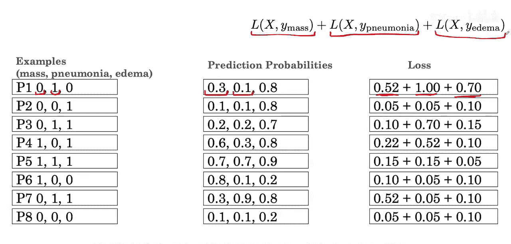
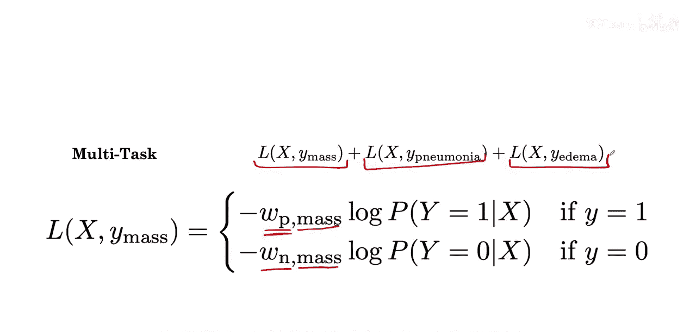
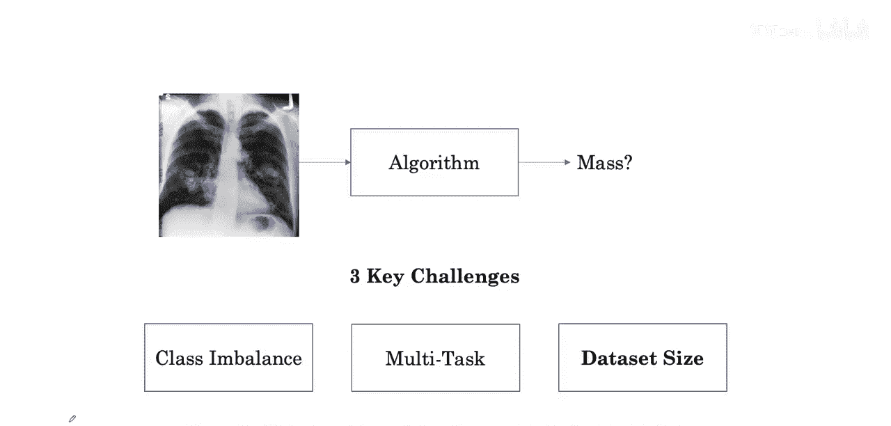
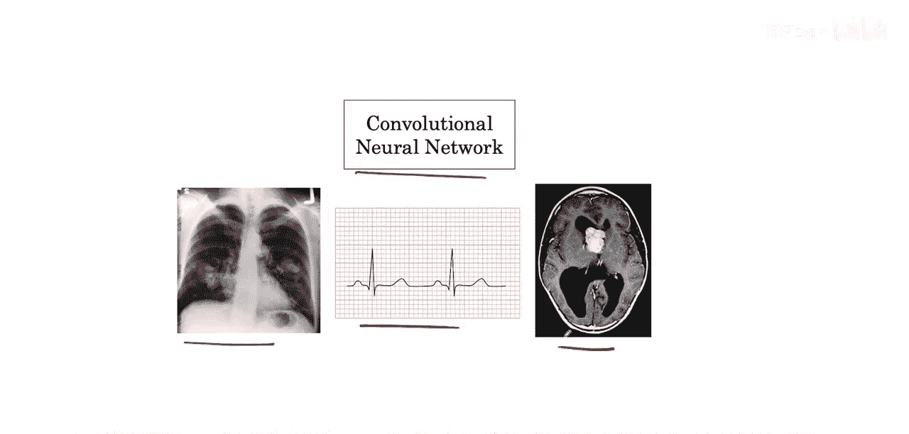
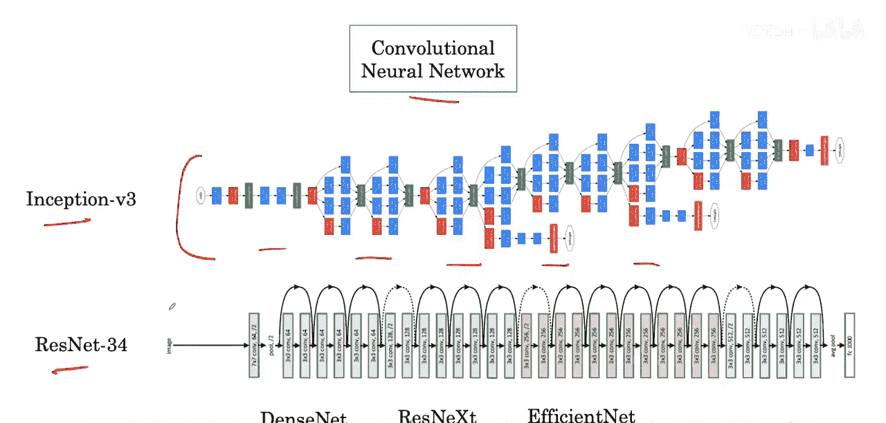

# deeplearningai【中英⚡AI 医学诊断｜AI for Medical Diagnosis】 p13 P13 08_多任务损失、数据集规模与CNN架构 [BV1kyYbzDEJk_p13]

We modify the loss function such that we look at the error associated with each disease。

We can represent our new loss as the sum of the losses over the multiple diseases。

 This is called the multi label loss， or the multi task loss。In this case。

 here's the loss that we get for the eight examples。

 This first term over here represents the loss associated with the mass class using this prediction probability and using this label。

Similarly， here we have the loss associated with the pneumonia class coming with this model output and this label。

 And so we add up the three losses given to us by the individual loss function components。

One final consideration is how we can account for class imbalance in the multitask setting。

Once again， we can imply the weighted loss that we have covered earlier。This time。

 we not only have a weight associated with just the positive and the negative labels。

 but it's for the positive label associated with that particular class and the negative label associated with that particular task such that for mask。

 there'll be a different weight to the positive class than to pneumonia or to edema。

 And this covers our solution to the second challenge of multitask learning。😊。

Let's look at the third challenge， which is the data set size challenge。

For many medical imaging problems， the architecture of choice is the convolutional neural network also called a Connet or CNN。

These are designed to process 2D images like X rays。

 but variants of these are also well suited to medical signal processing or 3D medical images like CT scans。

 which we will look at in a future week。

Several convolutional neural network architectures， such as inception， resnet， Dnet。

 resacs and efficientnets， have been proposed and are widely popular in image classification。

These architectures are composed of various building blocks In medical problems。

 The standard is to try out multiple models on the desired tasks and see which ones work best。

