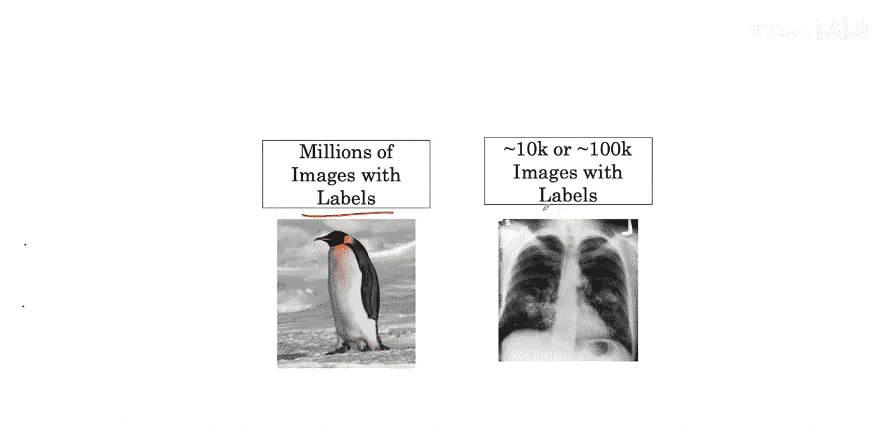
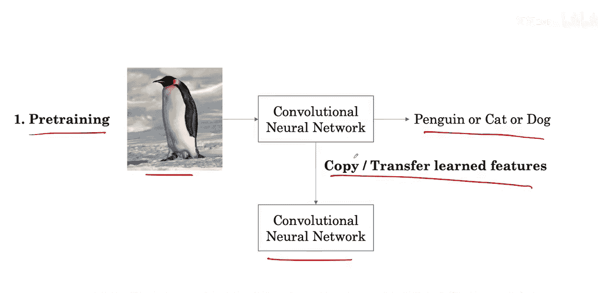
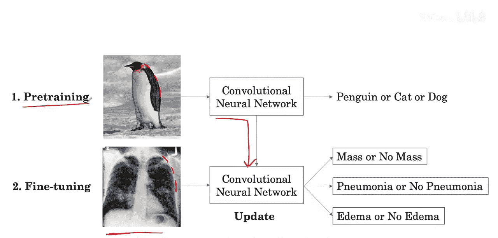
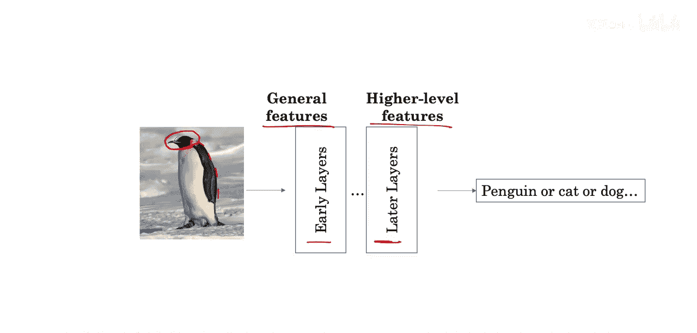
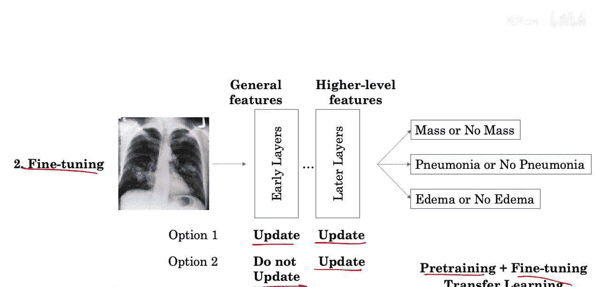

# deeplearningai【中英⚡AI 医学诊断｜AI for Medical Diagnosis】 p14 P14 09_小规模训练集下的工作方法 [BV1kyYbzDEJk_p14]

The challenge is that all of these architectures are data hungry and benefit from the millions of examples found in image classification dataset sets。

In medical problems， how can we still apply these techniques when we don't have millions of examples？

One solution is to pre train the network here， the idea is to first have the network。

 look at natural images and learn to identify objects such as penguins or cats or dogs。

Then use this network as a starting point for learning a medical imaging task by copying over the learned features。

The network can then further be trained to look at chest x rays and identify the presence and absence of diseases。

The idea of this process is that when we're learning our first task of identifying cats or dogs。

 the network will learn general features that will help its learning on the medical task。

 An example of this might be that the features that are useful to identify the edges on a penguin are also useful for identifying edges on a lung。

 which are then helpful to identify certain diseases。

Then when we transfer these features to our new network。

 the network can learn the new task of chess X ray interpretation with a better starting point。

 This first step is called pre training， and the second step is called fine tuning。

It is generally understood that the early layers of the network capture low level image features that are broadly generalizable。

 While the later layers capture details that are more high level or more specific to a task。 So。

 for instance， the early layer might learn about the edges of an object。

 and this might be useful for chest X ray interpretation later。

 but the later layers might learn how to identify the head of a penguin。

 and may not be useful for chest X ray interpretation。

So when we fine tune the network on chest X rays， instead of fine tuning all features we have transferred。

 we can freeze the features learned by the shallow layers and just fine tune the deeper layers。

In practice， two of the most common design choices are one to fine tune all of the layers。

 and two only fine tune， the later or the last layer and not fine tune the earlier layers。

This approach of pretrain and fine tuning is also called transfer learning and is an effective way to tackle the small dataset set size challenge。

