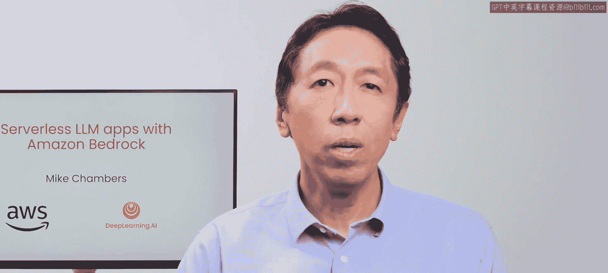
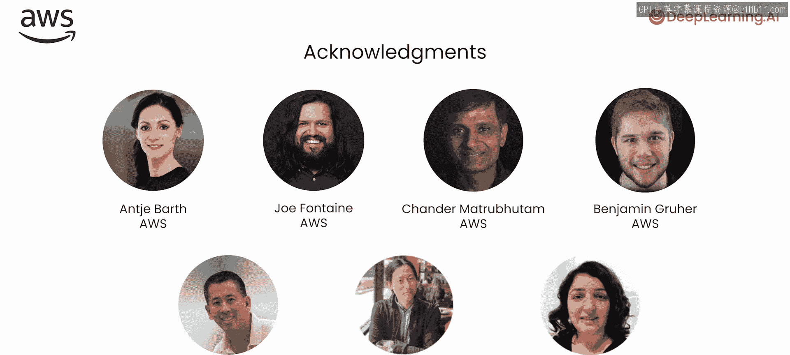

# 使用Amazon Bedrock构建无服务器LLM应用程序：L0：课程介绍 🎬

在本节课中，我们将要学习如何利用Amazon Bedrock和AWS的无服务器架构，构建一个能够自动处理音频、生成摘要的LLM应用程序。我们将从理解业务场景开始，逐步介绍如何将不同的人工智能服务连接成一个自动化的工作流。

---

假设你正在为一个客户服务部门开发一个原型服务，旨在总结客户的通话录音。这是一个许多公司都在实践的真实且常见的应用场景。

在构建初始原型时，你可能会手动执行以下步骤：首先，下载经过许可录制的通话音频文件；接着，运行自动语音识别软件将其转录为文本文件；然后，将文本发送给一个大语言模型进行总结；最后，将生成的摘要存储到一个可搜索的数据库中。

然而，手动连接所有这些步骤需要大量工作。同时，这是一个重复性过程，你可能希望将其自动化，以便每当有新的客户服务通话进来时，你的软件都能被自动触发运行，而不是每次有新通话时都手动重新运行代码。

为了将ASR这类AI服务连接到你的应用程序，并自动化整个工作流，你可以使用事件驱动的触发器。这样，每当有新的音频文件上传时，整个工作流就会自动运行，并部署为可以独立运行的系统。

---

上一节我们介绍了手动处理流程的局限性，本节中我们来看看本课程的核心目标。

在本课程中，你将学习如何将一个LLM与其他AI服务（在本例中是自动语音识别服务）连接起来，使LLM能够处理非文本数据，例如客户与客服代表之间的对话录音。你将使用无服务器架构来部署这个应用，而不是传统的基于服务器的架构。

通常，在构建应用之外，你还需要进行大量的部署和维护工作，例如启动机器、安装依赖项。之后，系统的持续维护（如添加安全补丁、更新依赖项等）会带来更多工作。

通过从无服务器架构开始，你可以在迭代应用时节省大量的时间和精力。

---

以下是本课程将使用的主要工具和服务：

*   **Amazon Bedrock**：提供对多种基础模型的访问。
*   **Amazon Transcribe**：自动语音识别服务。
*   **AWS Lambda**：用于触发和运行LLM逻辑的无服务器计算服务。
*   **Amazon S3**：云存储服务，作为工作流的触发起点。

音频总结用例只是一个例子，但你可以运用本课程中的工具和概念，将你的LLM与其他AI服务集成到一个管道中。这个管道基本上可以在输入数据传入时自动在云端运行。

---

许多人为本课程的实现做出了贡献。在此感谢AWS团队的Ana Baf、Joeill Fonine、Chandnda Matha Bruham和Benjamin Grwer；感谢协助Jupyter Notebook的Vcarium团队David Lyin；最后，感谢来自Deepleer AI的Eddie Shu和Dila Eadine对本课程的贡献。

---

在接下来的第一课中，你将开始学习如何使用Amazon Bedrock来提示LLM，并探索如何将其与其他AI服务集成。

这听起来很棒，让我们进入下一个视频，开始学习吧！

---

本节课中我们一起学习了构建无服务器LLM应用程序的动机和整体框架。我们了解了一个具体的客户通话总结场景，认识了手动流程的不足，并明确了通过事件驱动和无服务器架构实现自动化的目标。同时，我们也预览了本课程将使用的核心AWS服务。