# 使用Amazon Bedrock构建无服务器LLM应用程序：L1：使用Amazon Bedrock进行首次文本生成 🚀

在本节课中，我们将学习如何使用Amazon Bedrock来提示一个模型，并自定义其生成响应的方式。我们还将探索如何将大型语言模型与其他服务集成，以构建一个数据处理管道。


## 概述


我们将从设置环境开始，使用Python SDK（Boto3）连接到Amazon Bedrock服务。接着，我们会向模型发送一个简单的文本提示，并获取其生成的响应。然后，我们将学习如何通过配置参数（如最大令牌数和温度）来定制模型的生成行为。最后，我们会预览如何将音频文件转录为文本，并利用LLM从中提取摘要信息，从而了解构建数据处理管道的基本思路。

---

## 导入必要的库

首先，我们需要导入与AWS服务交互所需的Python SDK，即Boto3。运行以下代码单元格来加载它。

```python
import boto3
import json
```

---

## 连接到Amazon Bedrock运行时

上一节我们导入了必要的库，本节中我们来看看如何建立与Amazon Bedrock服务的连接。

我们需要创建一个客户端对象来与特定的AWS服务（这里是Bedrock运行时）进行通信。同时，必须指定支持Amazon Bedrock的AWS区域。

```python
bedrock_runtime = boto3.client(
    service_name='bedrock-runtime',
    region_name='us-west-2'  # 例如，俄勒冈区域
)
```

---

## 创建并发送第一个提示

现在我们已经建立了连接，接下来看看如何构建一个简单的文本提示并将其发送给模型。

首先，定义一个文本字符串作为我们的提示。

```python
prompt = "write a one sentence summary of Las Vegas"
```

为了将提示发送给模型，我们需要构建一个包含必要参数的请求体。以下是构建请求的关键步骤：

*   **模型ID**：指定要使用的基础模型，例如Amazon的Titan Text Lite。
*   **内容类型**：声明我们发送的数据格式（JSON）。
*   **接受类型**：声明我们愿意接收的数据格式。
*   **请求体**：一个JSON字符串，其中包含我们的输入提示。

```python
kwargs = {
    "modelId": "amazon.titan-text-lite-v1",
    "contentType": "application/json",
    "accept": "*/*",
    "body": json.dumps({
        "inputText": prompt
    })
}
```

构建好参数后，我们就可以调用模型并获取响应了。

```python
response = bedrock_runtime.invoke_model(**kwargs)
```

模型的响应是一个流式响应体，我们需要从中读取并解析JSON数据才能看到生成的文本。

```python
response_body = json.loads(response.get('body').read())
print(json.dumps(response_body, indent=2))
```

运行上述代码后，你将看到类似以下的输出，其中包含了生成的文本和有用的元数据（如输入/输出的令牌数量）：

```json
{
  "inputTextTokenCount": 9,
  "results": [
    {
      "tokenCount": 27,
      "outputText": "Las Vegas is the 29th most populated city in the United States and the most populated city in the state of Nevada.",
      "completionReason": "FINISHED"
    }
  ]
}
```

如果只想提取出生成的文本，可以这样做：

```python
generated_text = response_body['results'][0]['outputText']
print(generated_text)
```

---

## 配置生成参数

在上一节中，我们完成了基础的文本生成。本节中我们来看看如何通过配置参数来影响模型的生成行为，例如控制输出长度和创造性。

我们将使用功能更强大的`Titan Text Express`模型，并在请求中增加`textGenerationConfig`配置。

首先，定义一个新的提示。

```python
prompt = "write a summary of Las Vegas"
```

以下是构建包含生成配置的请求体的步骤。我们将设置最大令牌数、温度（控制随机性）和Top-p（控制候选词范围）等参数。

```python
kwargs = {
    "modelId": "amazon.titan-text-express-v1",
    "contentType": "application/json",
    "accept": "*/*",
    "body": json.dumps({
        "inputText": prompt,
        "textGenerationConfig": {
            "maxTokenCount": 100,
            "temperature": 0.7,
            "topP": 0.9
        }
    })
}
```

发送请求并获取响应的代码与之前类似。

```python
response = bedrock_runtime.invoke_model(**kwargs)
response_body = json.loads(response.get('body').read())
print(response_body['results'][0]['outputText'])
```

你可能会注意到输出在句子中间戛然而止。检查完整的响应体，会发现`completionReason`是`"LENGTH"`，这意味着生成因达到最大令牌数（100）而停止。

```python
print(json.dumps(response_body, indent=2))
# 输出中会包含："completionReason": "LENGTH"
```

为了解决这个问题，我们可以增加`maxTokenCount`的值（例如设为500），让模型有足够的空间完成生成。重新运行后，`completionReason`会变为`"FINISHED"`，表示模型已自然完成生成。

---

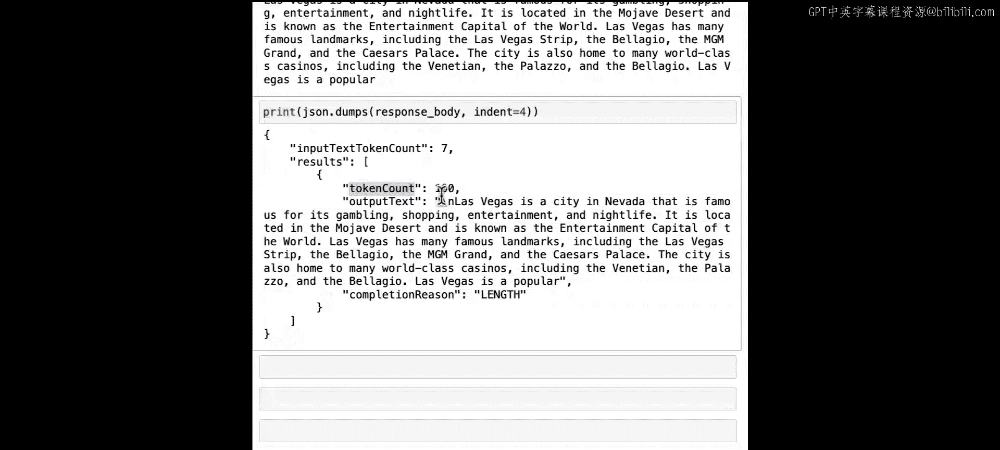

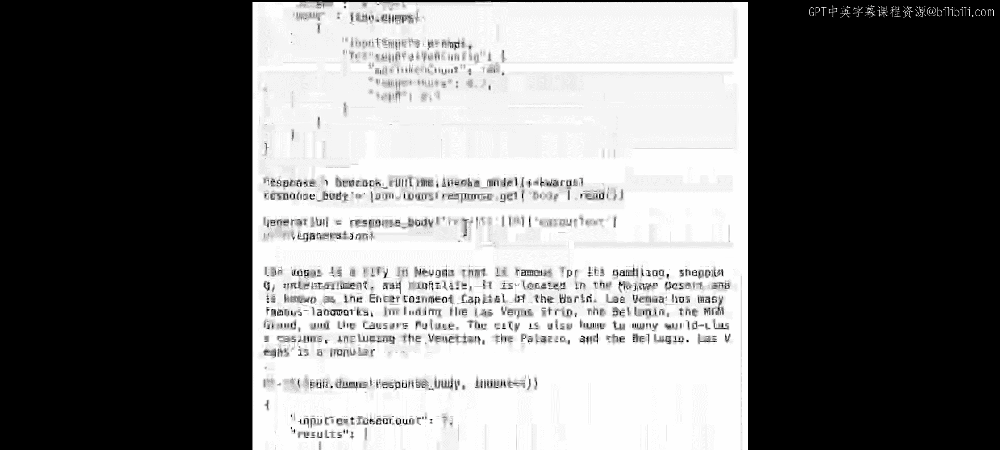

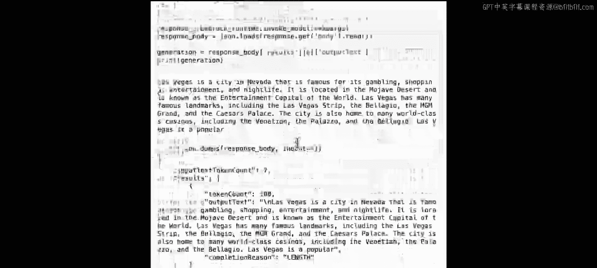

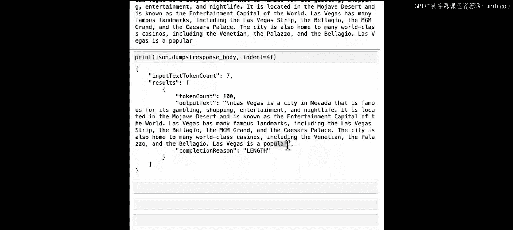

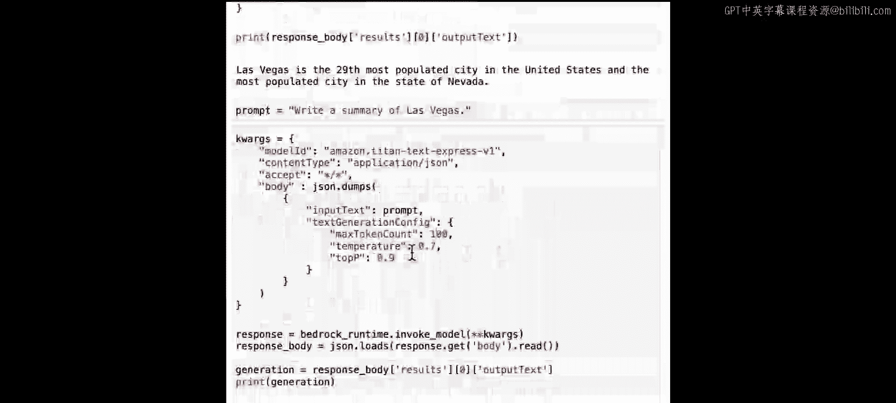

## 预览：构建数据处理管道

到目前为止，我们已经学会了如何直接与LLM交互。本节将预览如何将LLM作为更复杂的数据处理管道的一部分，例如处理音频转录。

假设我们有一段客户服务通话录音。我们的目标是：1) 将音频转录为文本；2) 使用LLM总结通话内容。

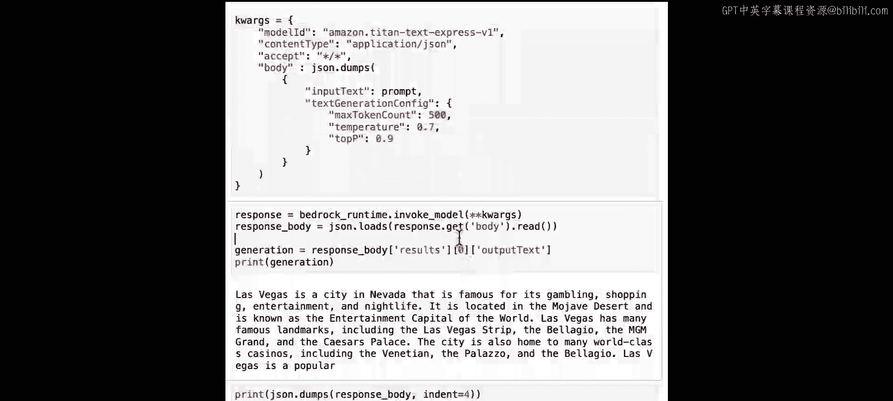

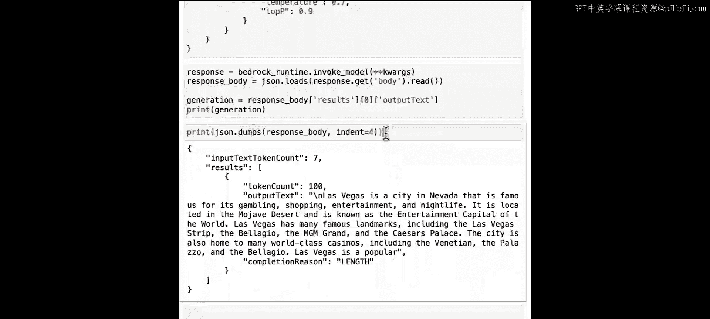

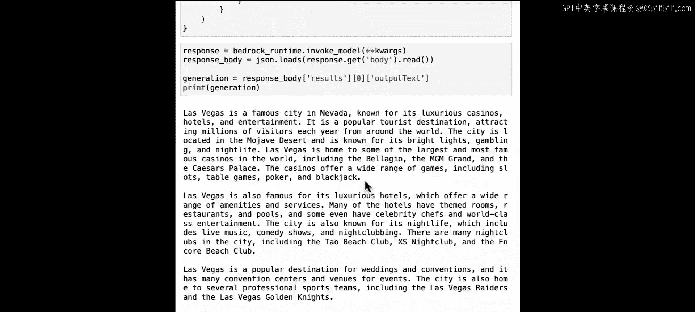

首先，在Jupyter Notebook环境中加载并播放音频文件（此处为示例代码）。

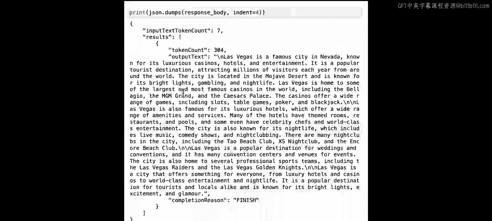

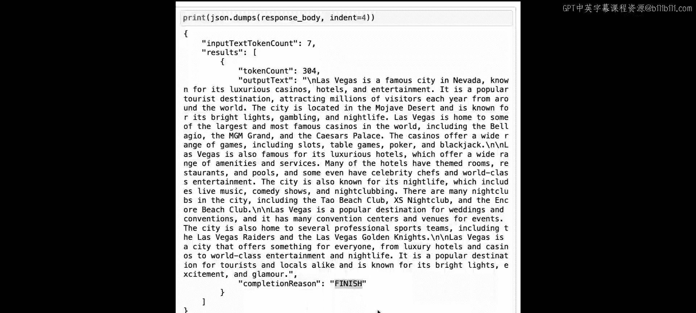

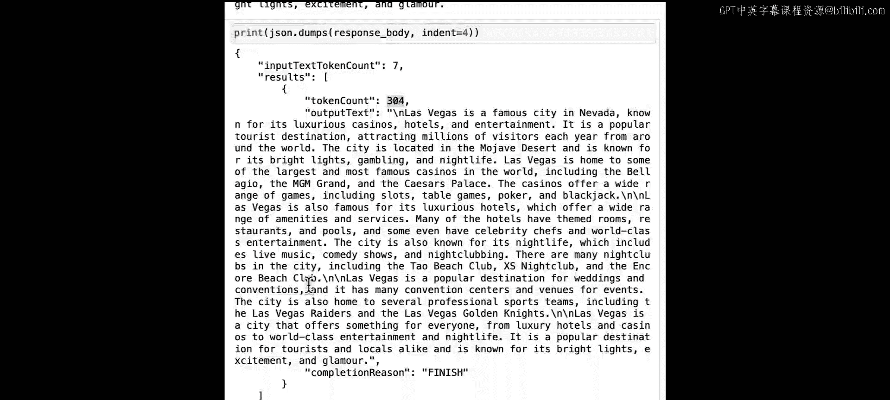

```python
from IPython.display import Audio, display

audio_file_name = "dial.mp3"
display(Audio(audio_file_name))
```

我们假设已经通过某个服务（如下一节课将介绍的Amazon Transcribe）将音频转录成了文本，并保存在`dialogue_text`变量中。

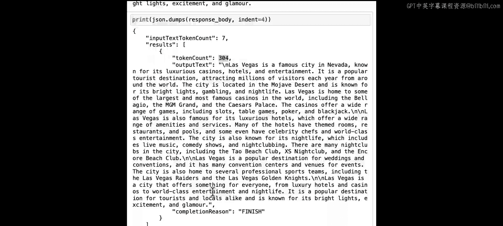

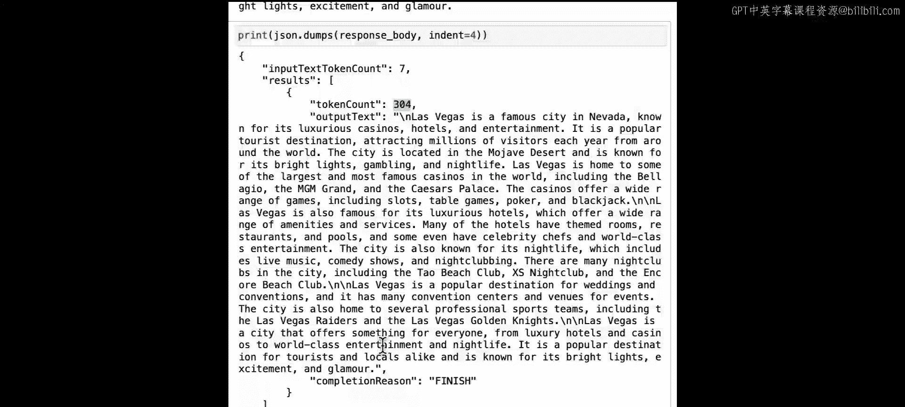


```python
# 假设这是从文件加载的转录文本
with open("dial.txt", "r") as f:
    dialogue_text = f.read()
print(dialogue_text[:500]) # 打印前500个字符预览
```

接下来，我们构建一个提示模板，将转录文本放入特定的XML风格标签中，并指示模型进行总结。这是一种有效的提示工程技术。

```python
prompt_template = """
The text between the <transcript> XML tags is a transcript of a conversation.
Write a short summary of the conversation.

<transcript>
{dialogue_text}
</transcript>

Here is a summary of the conversation in the transcript:
"""

prompt = prompt_template.format(dialogue_text=dialogue_text)
print(prompt[:300]) # 打印提示的开头部分预览
```

最后，将这个构建好的提示发送给Titan模型以生成摘要。

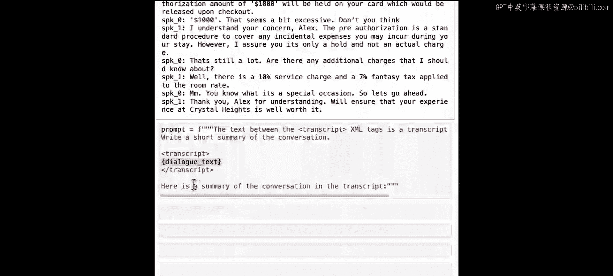

```python
kwargs = {
    "modelId": "amazon.titan-text-express-v1",
    "contentType": "application/json",
    "accept": "*/*",
    "body": json.dumps({
        "inputText": prompt,
        "textGenerationConfig": {
            "maxTokenCount": 300,
            "temperature": 0.5
        }
    })
}

response = bedrock_runtime.invoke_model(**kwargs)
response_body = json.loads(response.get('body').read())
summary = response_body['results'][0]['outputText']
print("生成的摘要：")
print(summary)
```

通过这个流程，我们展示了如何将原始数据（音频）通过多个步骤（转录 -> LLM处理）转化为有价值的信息（摘要）。

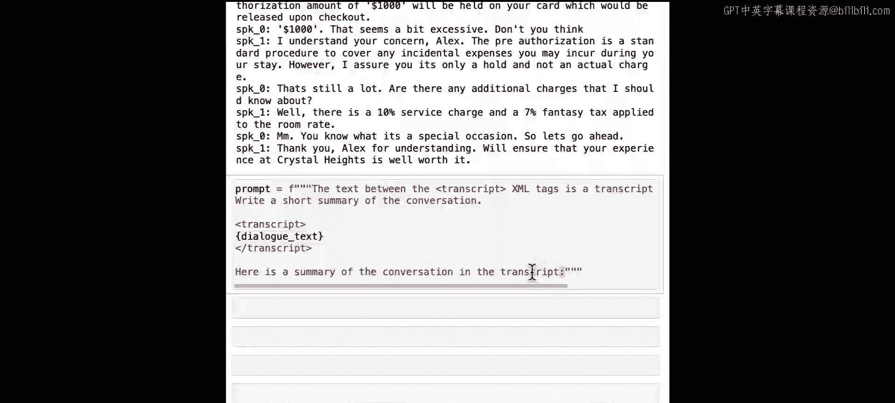

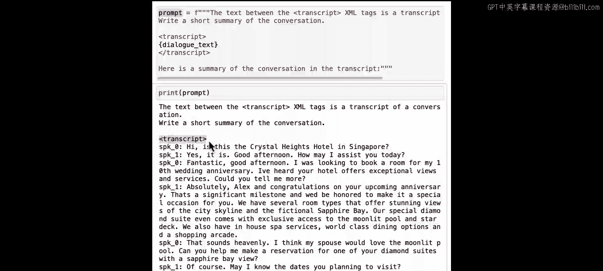

---

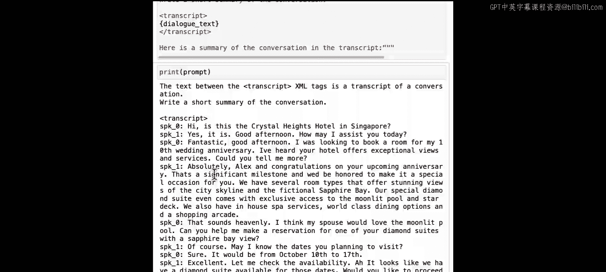

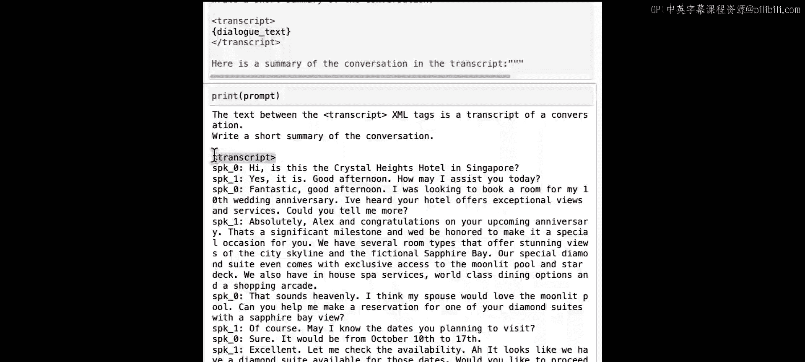

## 总结

在本节课中，我们一起学习了使用Amazon Bedrock进行文本生成的核心步骤。

1.  **环境设置与连接**：我们使用`boto3`库创建了与Amazon Bedrock运行时的连接。
2.  **基础文本生成**：我们构建了包含提示的JSON请求体，调用`invoke_model`方法，并解析响应以获取生成的文本。
3.  **高级生成控制**：我们探索了`textGenerationConfig`参数，如`maxTokenCount`、`temperature`和`topP`，用以控制输出的长度、创造性和多样性。
4.  **管道集成预览**：我们预览了如何将LLM集成到数据处理管道中，例如通过转录音频文件并使用LLM总结其内容，这为后续构建实际应用打下了基础。

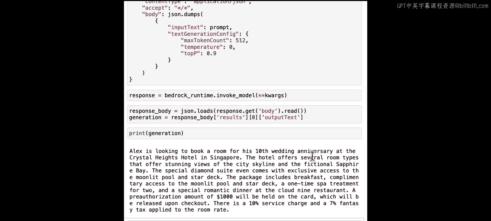

你可以尝试修改提示内容、调整生成参数，或使用不同的基础模型来进行实验。在下一节课中，我们将深入探讨如何自动化音频转录的步骤。