# 使用Amazon Bedrock构建无服务器LLM应用程序：L2：总结音频文件

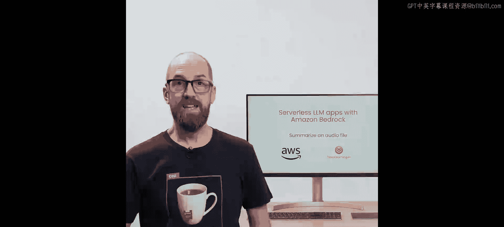

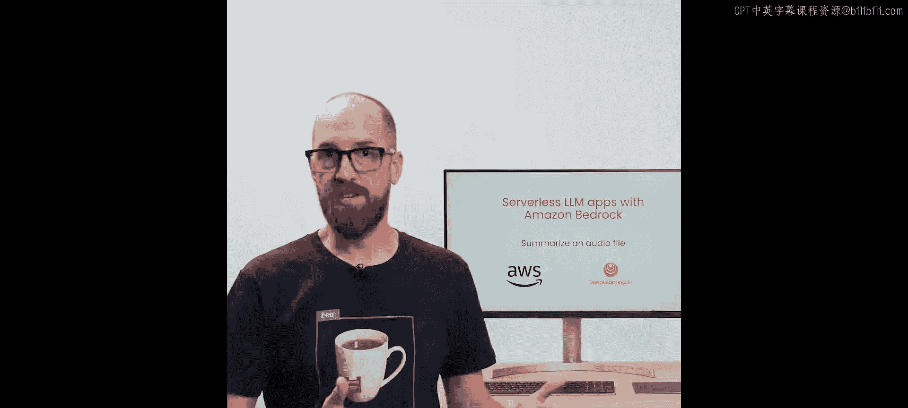

在本节课中，我们将学习如何将一段两人对话（例如客户与公司代表）的音频文件转录为文本，然后处理这份转录稿，并使用大语言模型来分析对话内容。这个架构可以适配其他音频源，例如会议或演示的录音，或者转录视频文件中的音频。

## 概述

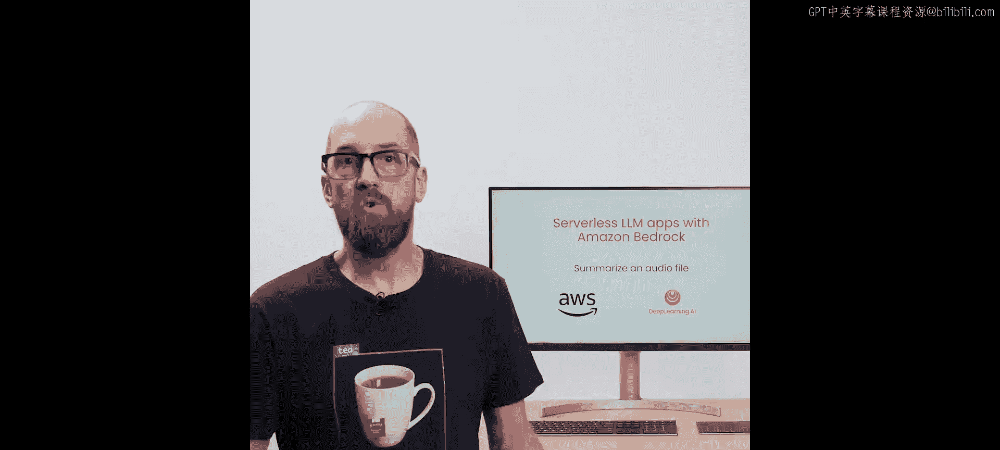

我们将使用Boto3库，并建立与几个不同AWS服务的连接。首先，我们会将音频文件上传到S3存储服务，然后使用Amazon Transcribe服务进行语音转文字。接着，我们会处理转录结果，将其格式化为适合输入到大语言模型的提示词，最后通过Amazon Bedrock服务调用Titan模型来生成对话摘要。

## 设置环境与上传音频

首先，我们需要导入必要的库并建立与AWS服务的连接。

```python
import boto3
import os
```

我们将创建两个客户端：一个用于S3服务来存储文件，另一个用于Transcribe服务来处理音频转文字。

```python
# 创建S3客户端
s3_client = boto3.client('s3', region_name='us-west-2')

# 创建Transcribe客户端
transcribe_client = boto3.client('transcribe', region_name='us-west-2')
```

接下来，我们从环境变量中获取S3存储桶的名称，并将本地的音频文件上传到该存储桶中。

```python
# 从环境变量获取存储桶名称
bucket_name = os.environ.get('RESOURCE_S3_BUCKET_NAME')

# 定义本地文件名和S3中的对象键
file_name = 'dialog.mp3'
s3_client.upload_file(file_name, bucket_name, file_name)
```

现在，我们的音频文件已经存储在云端，可以开始进行转录了。

## 使用Amazon Transcribe进行语音转文字

上一节我们完成了音频文件的上传，本节中我们来看看如何使用Amazon Transcribe服务将其转换为文本。

首先，我们需要为转录任务生成一个唯一的名称。

```python
import uuid

# 生成唯一的任务名称
job_name = f'transcription-job-{str(uuid.uuid4())}'
```

然后，我们调用Transcribe服务来启动转录任务。我们需要指定音频文件的位置、格式、语言以及输出设置。

```python
# 启动转录任务
response = transcribe_client.start_transcription_job(
    TranscriptionJobName=job_name,
    Media={'MediaFileUri': f's3://{bucket_name}/{file_name}'},
    MediaFormat='mp3',
    LanguageCode='en-US',
    OutputBucketName=bucket_name,
    Settings={
        'ShowSpeakerLabels': True,
        'MaxSpeakerLabels': 2
    }
)
```

启动任务后，它会在后台运行。我们需要编写一个循环来定期检查任务状态，直到它完成。

```python
import time

# 等待转录任务完成
while True:
    status = transcribe_client.get_transcription_job(TranscriptionJobName=job_name)
    job_status = status['TranscriptionJob']['TranscriptionJobStatus']
    if job_status in ['COMPLETED', 'FAILED']:
        break
    time.sleep(2)
```

任务完成后，我们可以从S3中获取转录结果的JSON文件，并从中提取出文本内容。

## 处理转录结果

上一节我们启动了转录任务并等待其完成，本节中我们来看看如何处理返回的JSON结果，并将其整理成易于阅读的对话格式。

首先，我们从S3中读取转录结果文件。

```python
import json

# 构建转录结果在S3中的键名
transcription_key = f'{job_name}.json'

# 从S3获取转录结果对象
response = s3_client.get_object(Bucket=bucket_name, Key=transcription_key)
transcript_json = json.loads(response['Body'].read().decode('utf-8'))
```

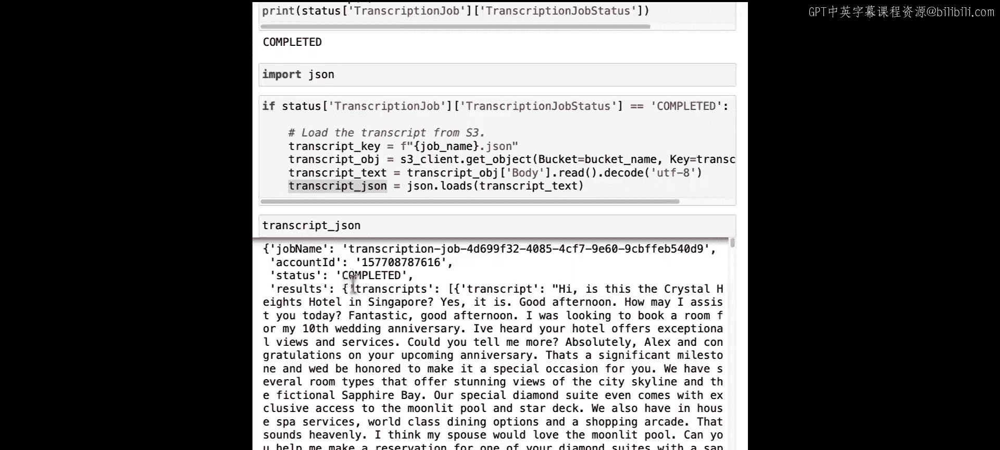

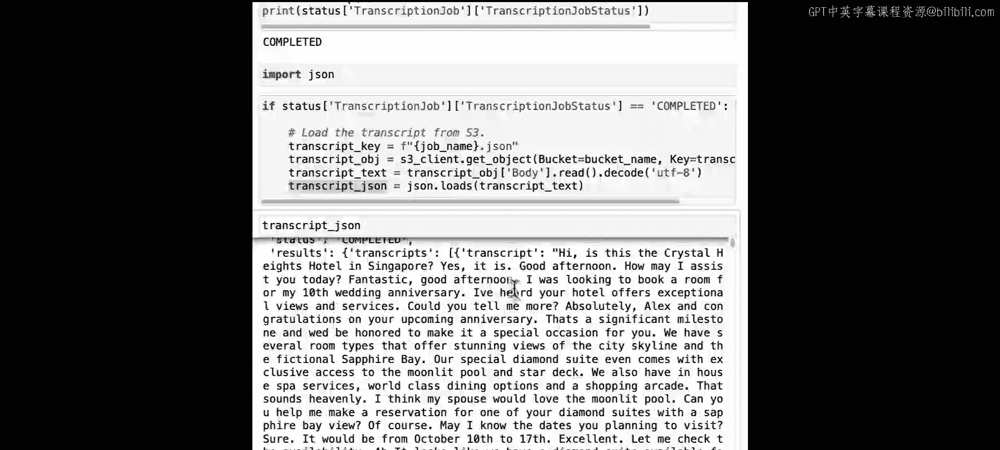

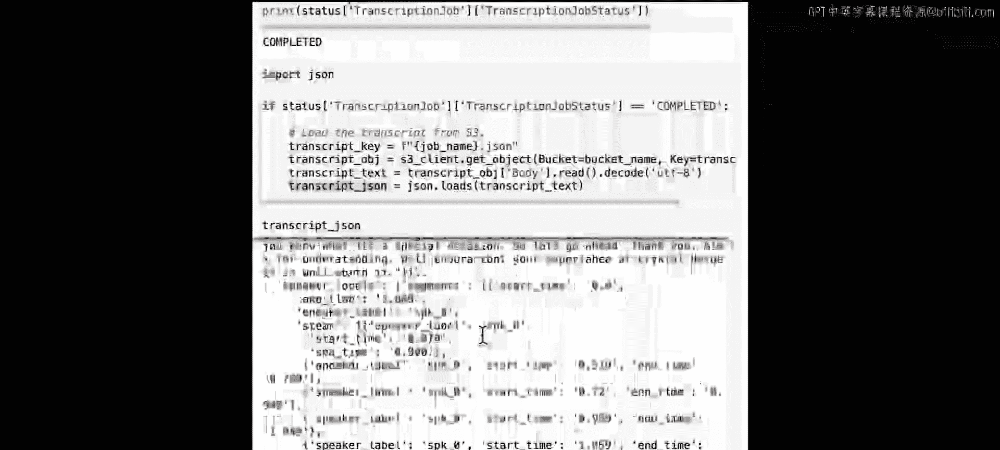

转录结果的JSON结构包含丰富的信息。我们主要关注 `results` -> `items` 部分，它包含了每个单词及其对应的说话人标签。

```python
# 提取items列表
items = transcript_json['results']['items']
```

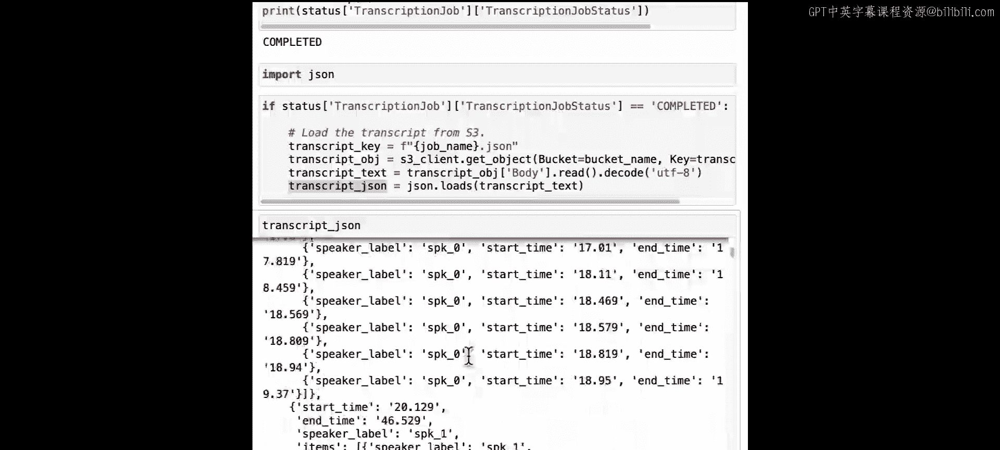

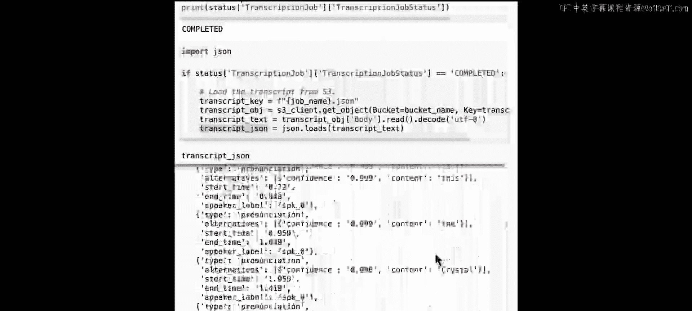

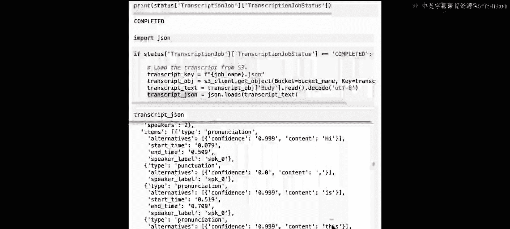

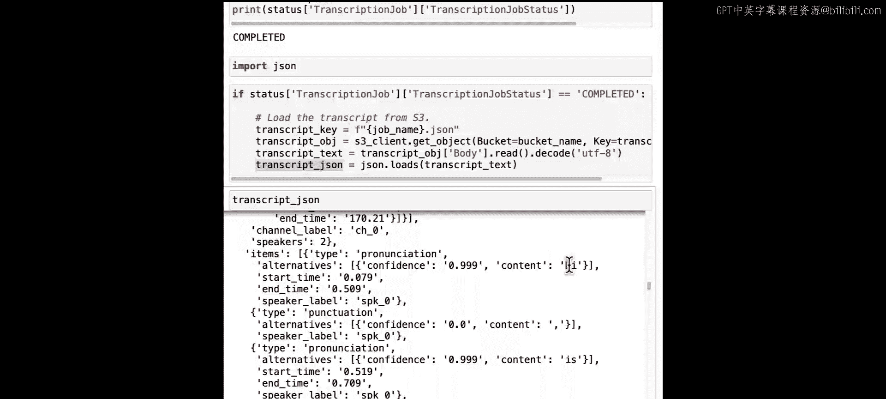

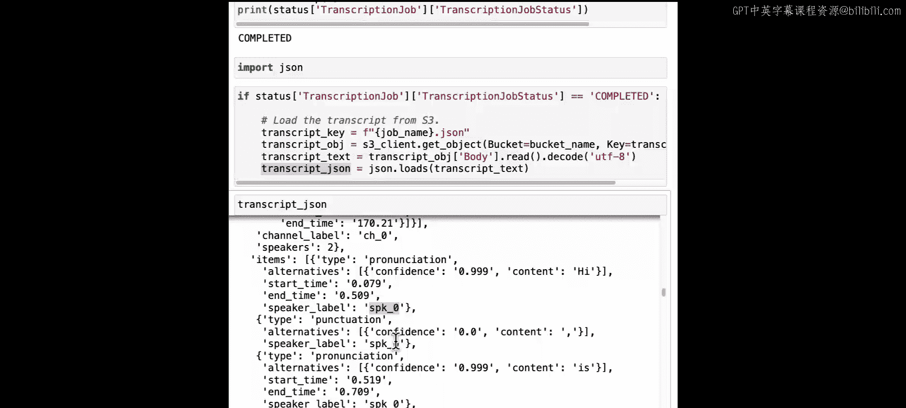

以下是处理items列表以生成格式化对话文本的步骤：

1.  初始化变量来存储最终文本和当前说话人。
2.  遍历每个item。
3.  如果检测到说话人变更，则开始新的一行并标注说话人。
4.  将单词内容拼接起来，并处理标点符号。

```python
output_text = ""
current_speaker = None

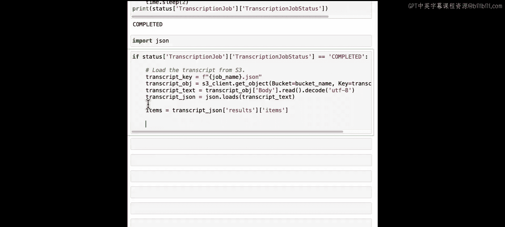

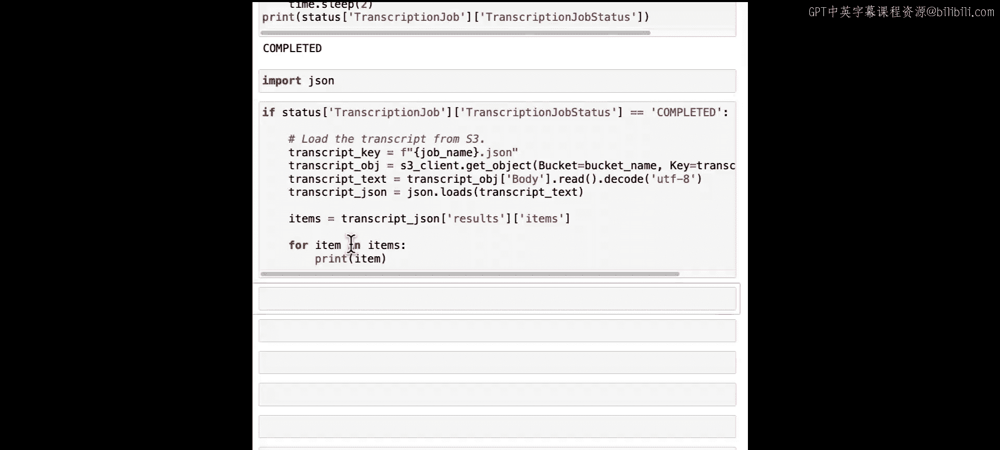

for item in items:
    speaker_label = item.get('speaker_label', 'UNKNOWN')
    content = item['alternatives'][0]['content']

    if speaker_label != current_speaker:
        current_speaker = speaker_label
        output_text += f"\n{speaker_label}: "
    output_text += content + " "

# 保存转录文本到本地文件
with open(f'{job_name}_transcript.txt', 'w') as f:
    f.write(output_text)
```

现在，我们得到了一份格式清晰的对话转录稿，可以用于后续的分析。

## 使用提示词模板与大语言模型生成摘要

上一节我们得到了格式化的对话文本，本节中我们将学习如何使用提示词模板，并通过Amazon Bedrock调用大语言模型来生成对话摘要。

首先，我们重新建立与Bedrock运行时服务的连接。

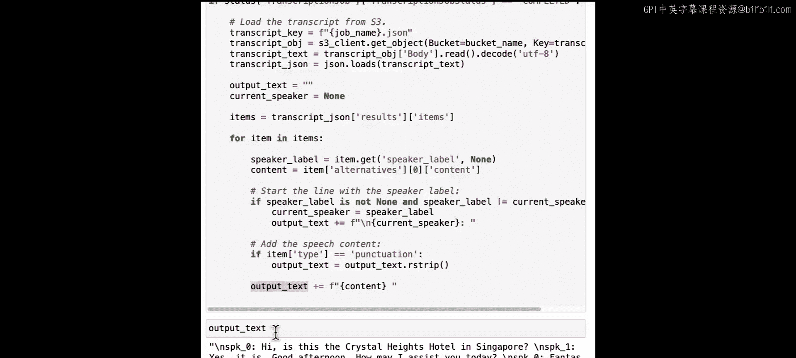

```python
# 创建Bedrock运行时客户端
bedrock_runtime = boto3.client('bedrock-runtime', region_name='us-west-2')
```

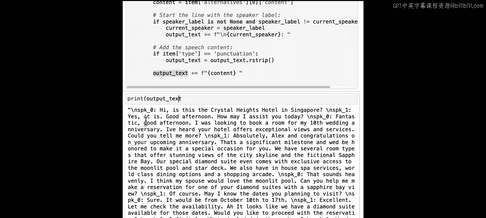

然后，我们读取之前保存的转录文本文件。

```python
# 读取转录文本
with open(f'{job_name}_transcript.txt', 'r') as f:
    transcript = f.read()
```

直接拼接字符串来构建复杂提示词可能难以维护。在生产环境中，更好的做法是将提示词模板定义在单独的文件中。这里我们使用Jinja2模板引擎。

首先，我们创建一个提示词模板文件。模板中定义了任务指令，并预留了插入转录文本的位置。

```python
%%writefile prompt_template.txt
我需要总结一段对话。
对话的转录稿如下：
<data>
{{ transcript }}
</data>
摘要必须包含一个词的情感分析，以及对话中出现的问题、摩擦或原因的列表。
输出必须采用以下示例所示的JSON格式：
{
  "sentiment": "positive",
  "issues": ["Issue 1", "Issue 2"]
}
请输出JSON，不要输出其他任何内容。
以下是JSON输出：
```

接下来，我们使用Jinja2库来加载模板并用我们的转录文本填充它。

```python
from jinja2 import Template

# 加载模板文件
with open('prompt_template.txt', 'r') as f:
    template_string = f.read()

# 创建模板对象
template = Template(template_string)

# 准备要插入模板的数据
data = {'transcript': transcript}

# 渲染模板，生成最终的提示词
prompt = template.render(data)
```

现在，`prompt` 变量包含了完整的、准备好发送给大语言模型的指令和文本。

## 调用模型并解析结果

上一节我们准备好了结构化的提示词，本节中我们将其发送给Amazon Bedrock上的Titan模型，并获取分析结果。

我们设置调用参数，其中将温度（`temperature`）设置为0，以确保模型输出稳定、格式正确的JSON。

```python
# 设置模型调用参数
kwargs = {
    "modelId": "amazon.titan-text-express-v1",
    "contentType": "application/json",
    "accept": "application/json",
    "body": json.dumps({
        "inputText": prompt,
        "textGenerationConfig": {
            "maxTokenCount": 512,
            "temperature": 0
        }
    })
}

# 调用模型
response = bedrock_runtime.invoke_model(**kwargs)
```

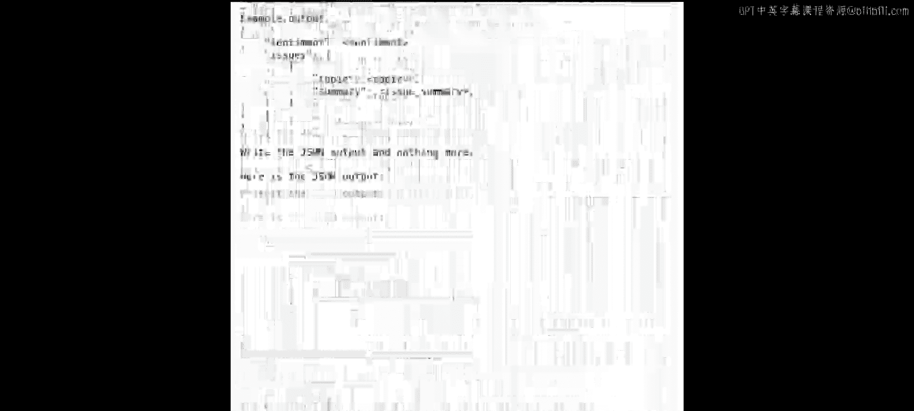

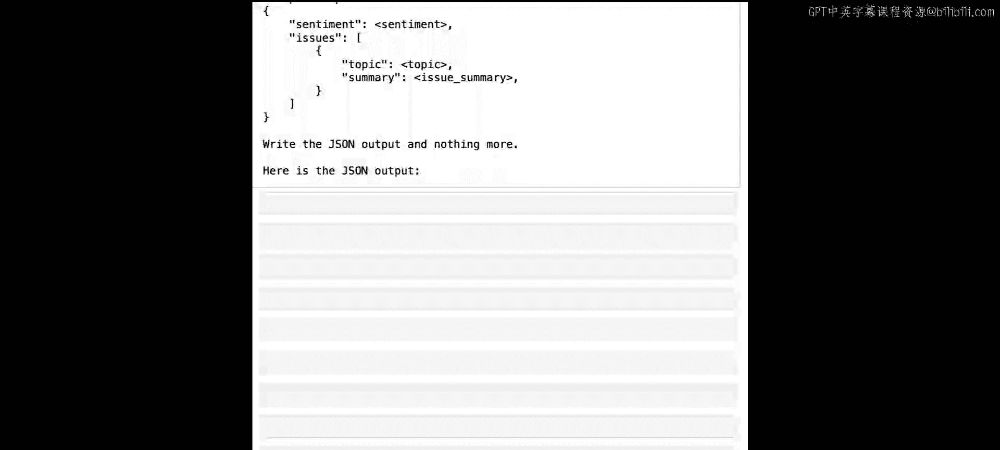

收到响应后，我们从中提取出模型生成的文本。

```python
# 解析模型响应
response_body = json.loads(response['body'].read())
generation = response_body['results'][0]['outputText']
print(generation)
```

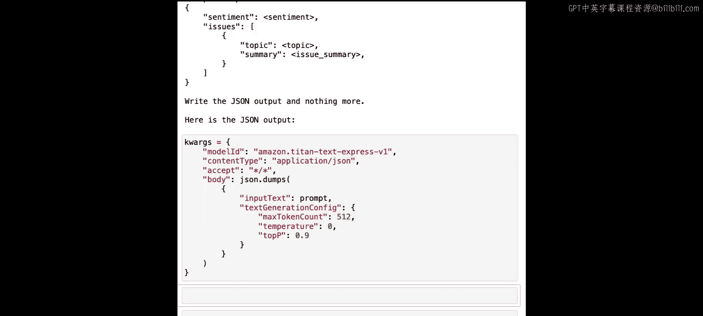

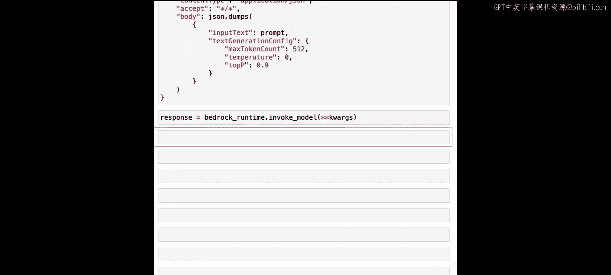

模型将返回一个JSON结构，其中包含对话的情感分析（如“positive”）和一个识别出的问题列表。这个结构化的输出易于被其他应用程序或系统进一步处理。

## 总结

在本节课中，我们一起学习了构建一个无服务器音频处理与分析的完整流程。

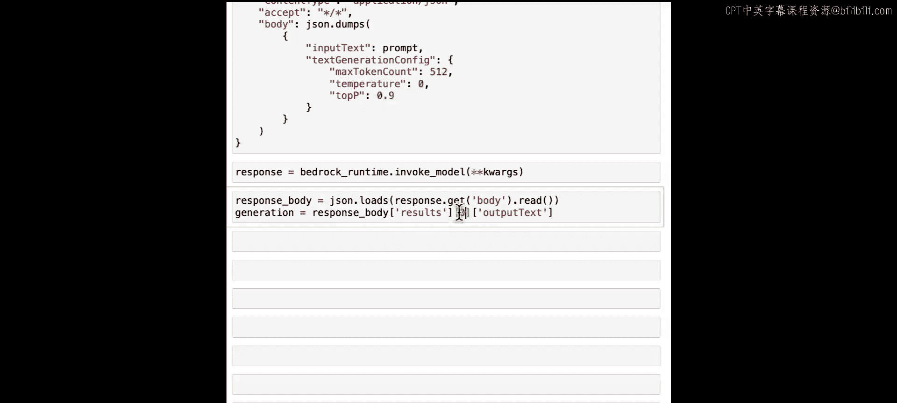

1.  **云端存储**：我们使用Amazon S3服务将音频文件上传至云端。
2.  **语音转文字**：利用Amazon Transcribe服务，我们实现了自动语音识别，将音频转换为带有说话人标签的文本。
3.  **数据处理**：我们编写代码处理原始的JSON转录结果，将其整理成清晰的对话格式。
4.  **提示词工程**：通过使用Jinja2模板引擎，我们将业务逻辑（提示词）与应用程序代码分离，使系统更易于维护和迭代。
5.  **智能分析**：最后，我们通过Amazon Bedrock服务调用Titan大语言模型，对对话内容进行情感分析和问题提取，并以结构化JSON格式输出结果。

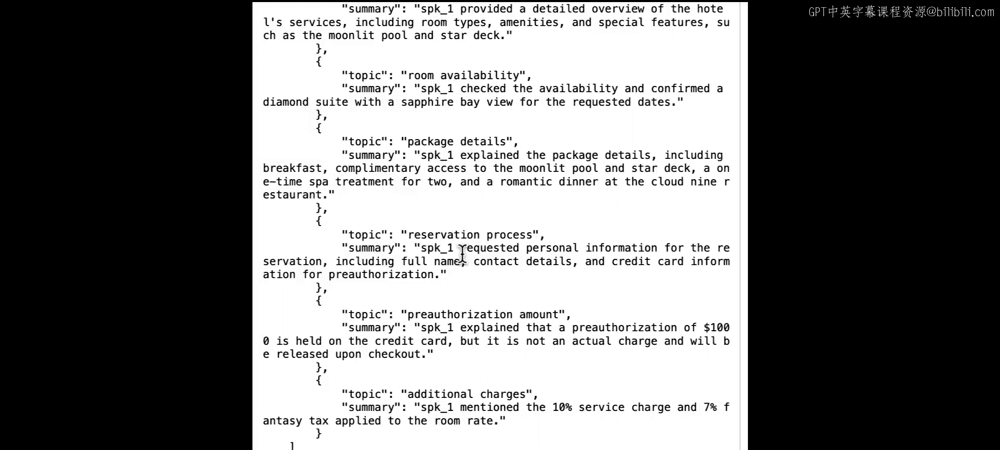

这个流程展示了如何将多个完全托管的、无服务器的AWS服务组合在一起，构建一个可扩展、低成本的数据处理管道。在接下来的课程中，我们将在此基础上，进一步探索如何使其自动化并融入事件驱动的架构。