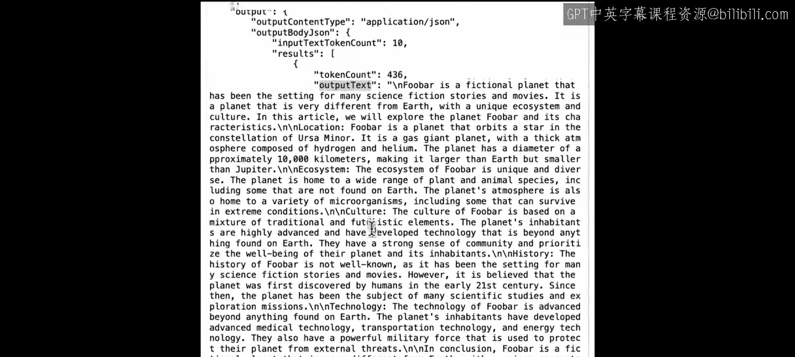
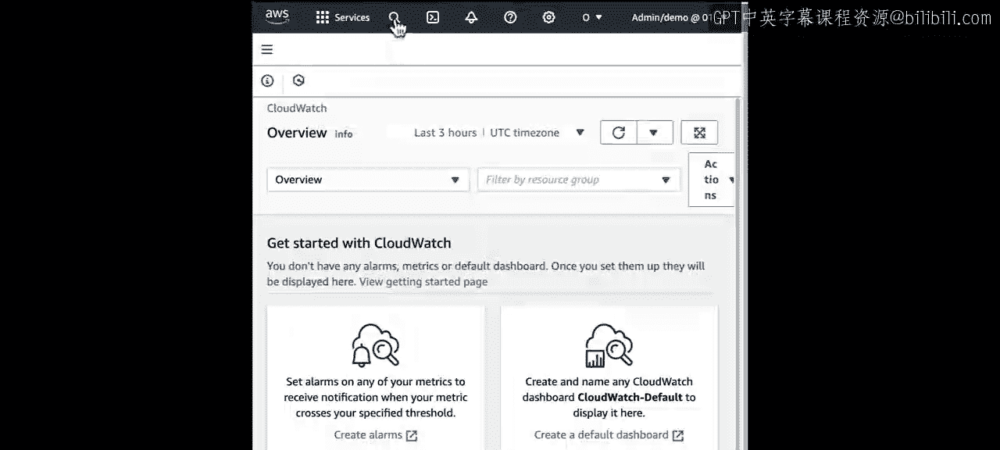
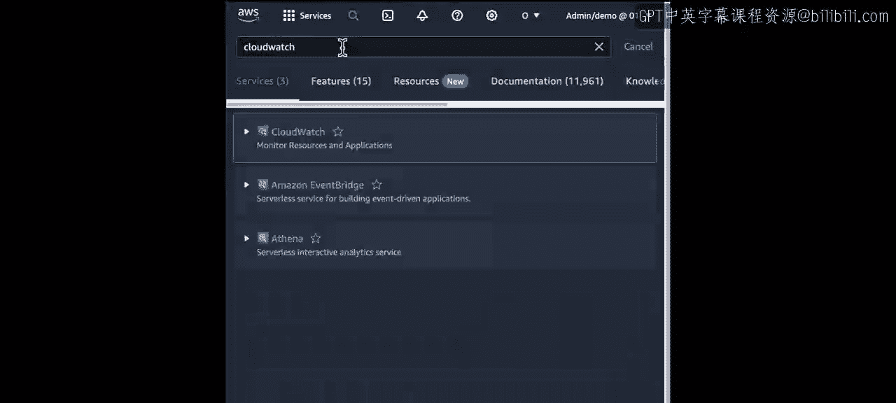
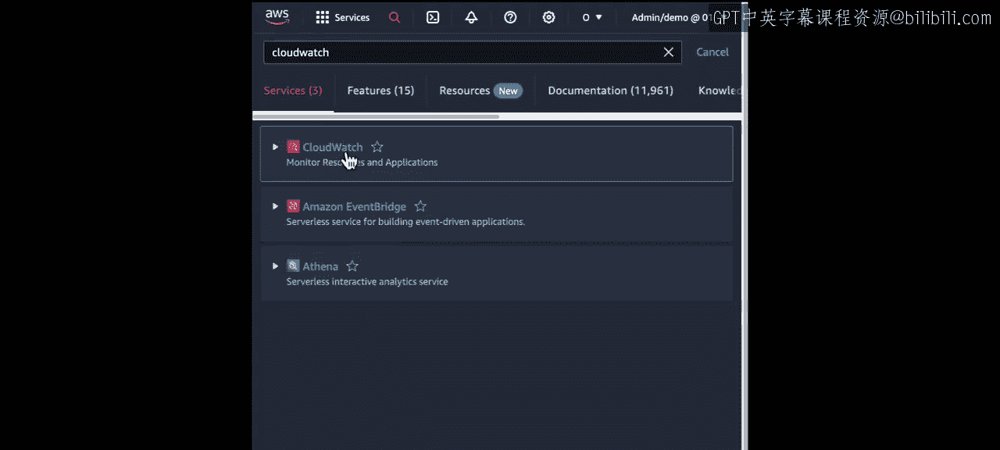
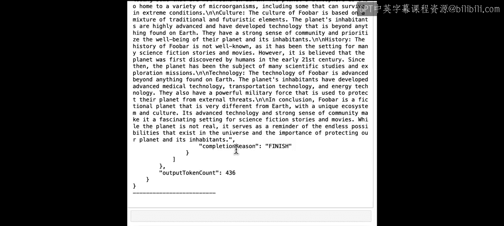

# 使用Amazon Bedrock构建无服务器LLM应用程序：P4：L3_启用日志记录 📝

在本节课中，我们将学习如何为所有对Amazon Bedrock内大型语言模型的调用启用日志记录，以及如何查看这些日志。这对于审计、合规性以及监控错误条件至关重要。

## 概述

到目前为止，本课程中我们已经开始集成LLM和其他AI功能。开发和管理已部署应用程序的一部分工作涉及处理安全、审计和合规性问题。而日志记录是用于审计和合规性的关键工具之一。

## 配置日志记录

上一节我们介绍了集成LLM的基础知识。本节中，我们来看看如何配置Amazon Bedrock，使其自动记录所有模型调用和响应，而无需在应用程序代码中手动添加大量日志记录代码。

首先，我们需要导入必要的库并设置环境。

```python
import boto3
import os

# 创建Bedrock客户端（非运行时客户端）
bedrock_client = boto3.client('bedrock')
```

接下来，我们需要定义一个日志组名称。CloudWatch日志使用日志组来组织日志流。

```python
log_group_name = 'my-amazon-bedrock-logs'
```

为了简化操作，我们使用一个辅助函数来创建CloudWatch日志组。

```python
# 假设cloudwatch_helper是一个已定义的辅助模块
from cloudwatch_helper import create_log_group

create_log_group(log_group_name)
```

## 设置IAM权限和日志配置

要使Amazon Bedrock服务能够将日志写入CloudWatch，需要配置适当的IAM（身份和访问管理）权限。这些权限允许Bedrock服务创建日志流和放入日志事件。

以下是权限策略的核心概念：

**权限策略示例（JSON）**:
```json
{
  "Effect": "Allow",
  "Action": [
    "logs:CreateLogStream",
    "logs:PutLogEvents"
  ],
  "Resource": "arn:aws:logs:*:*:log-group:my-amazon-bedrock-logs:*"
}
```

**信任策略示例**:
```json
{
  "Effect": "Allow",
  "Principal": {
    "Service": "bedrock.amazonaws.com"
  },
  "Action": "sts:AssumeRole"
}
```

现在，我们可以配置Bedrock的日志记录。以下是配置步骤：

首先，我们创建一个包含CloudWatch和S3配置的字典。

```python
logging_config = {
    'cloudWatchConfig': {
        'logGroupName': log_group_name,
        'roleArn': os.environ.get('BEDROCK_LOGGING_ROLE_ARN'),  # 从环境变量获取角色ARN
        'largeDataDeliveryS3Config': {
            'bucketName': os.environ.get('LOGGING_BUCKET_NAME'),
            'keyPrefix': 'amazon-bedrock-large-data-delivery/'
        }
    },
    's3Config': {
        'bucketName': os.environ.get('LOGGING_BUCKET_NAME'),
        'keyPrefix': 'amazon-bedrock-logs/'
    },
    'textDataDeliveryEnabled': True
}
```

然后，我们调用Bedrock客户端的方法来应用此配置。

```python
response = bedrock_client.put_model_invocation_logging_configuration(
    loggingConfig=logging_config
)
print(response)  # 响应状态码应为200
```

要验证配置，我们可以获取当前的日志记录配置。

```python
current_config = bedrock_client.get_model_invocation_logging_configuration()
print(current_config)
```

## 生成文本并查看日志

配置完成后，所有通过Bedrock进行的文本生成调用都将被自动记录。让我们进行一次调用以生成日志。

以下是进行模型调用的代码：

```python
bedrock_runtime = boto3.client('bedrock-runtime', region_name='us-west-2')

prompt = "写一篇关于虚构星球Fubar的文章"
kwargs = {
    "modelId": "amazon.titan-text-express-v1",
    "contentType": "application/json",
    "accept": "application/json",
    "body": json.dumps({
        "inputText": prompt,
        "textGenerationConfig": {
            "maxTokenCount": 512,
            "temperature": 0.7,
            "topP": 0.9
        }
    })
}

response = bedrock_runtime.invoke_model(**kwargs)
response_body = json.loads(response['body'].read())
generation = response_body['results'][0]['outputText']
print(generation)
```

调用完成后，我们可以使用辅助函数查看最近五分钟内的日志。

```python
from cloudwatch_helper import print_recent_logs

print_recent_logs(log_group_name)
```

日志条目将包含详细的JSON结构，例如输入的提示词、所有参数、输入/输出的令牌数量以及生成的文本。这对于调试和审计非常有价值。

## 在AWS控制台中查看日志




除了在代码中查看，我们还可以直接在AWS管理控制台的CloudWatch服务中查看日志。

以下是查看步骤：
1.  登录AWS管理控制台。
2.  在服务搜索栏中搜索并进入 **CloudWatch**。
3.  在左侧导航栏中，选择 **日志组**。
4.  在日志组列表中，找到并点击名为 **my-amazon-bedrock-logs** 的日志组。
5.  在日志流列表中，点击以 **aws-bedrock-model-invocations** 开头的日志流。
6.  在此处，您可以查看所有模型调用的原始日志事件，其内容与在代码中检索到的一致。

## 总结







本节课中我们一起学习了如何为Amazon Bedrock启用全局日志记录。我们配置了CloudWatch日志组和必要的IAM权限，设置了将日志同时发送到CloudWatch和S3的配置，并通过实际调用验证了日志记录功能。最后，我们了解了如何在代码中和AWS控制台中查看这些详细的日志，这对于应用程序的监控、调试以及满足审计和合规性要求至关重要。



在下一节课中，我们将回到事件驱动管道的构建，把在笔记本中编写的所有代码部署到云端无服务器托管服务中，构建一个完全自动化处理转录本的数据管道。