# 使用Amazon Bedrock构建无服务器LLM应用程序：P5：L4_Deploy_an_AWS_Lambda_function

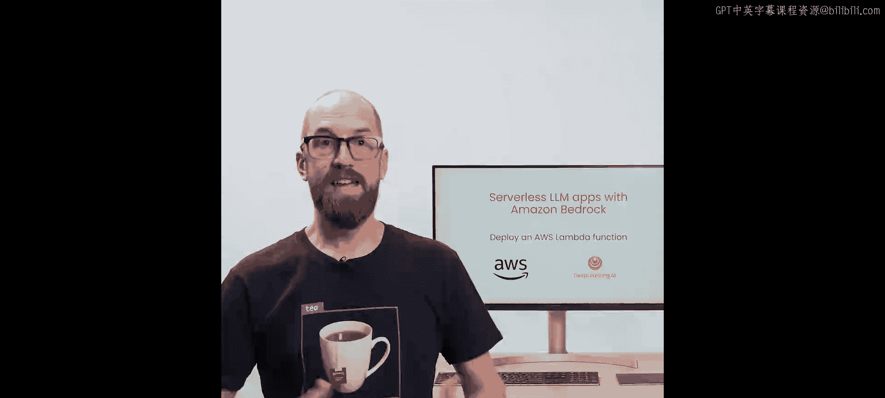

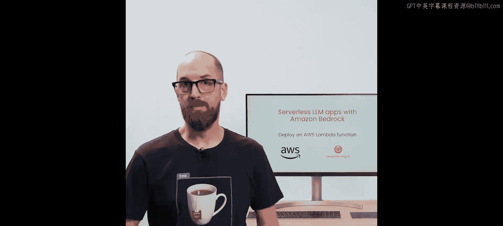

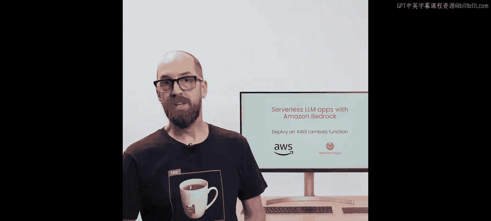

在本节课中，我们将学习AWS Lambda函数。这是一种无服务器计算类型，也是管理代码最简单的方式之一。你将看到如何使用它们来运行由LLM驱动的工作负载。

## 概述

本节课内容较多，我们将分步进行。首先，我们会查看一些可用的辅助函数，它们能帮助我们更快地完成某些任务。接着，我们将查看要部署到Lambda函数中的数据，包括提示词和提示词模板的设置。然后，我们将重点构建Lambda函数本身，这是本节课的核心部分。我们将逐段分析代码，理解其工作原理和结构。定义好Lambda函数后，我们将部署它并进行测试，验证其功能。最后，我们会为下一节课的完整流程打下基础。

以下是本节课的主要内容列表，你可以根据需要跳转到特定部分，或者稍后返回继续学习：

*   查看辅助函数。
*   查看要部署的数据（提示词模板）。
*   构建并理解Lambda函数代码。
*   部署Lambda函数。
*   测试Lambda函数。

所有代码都已包含在提供的笔记本中，你可以随时运行相关单元格来快速推进。

## 辅助函数与环境设置

首先，我们需要导入必要的库并设置一些辅助工具，以简化在Jupyter笔记本环境中的部署工作。

```python
import boto3
import os
```

接下来，导入并实例化我们编写的辅助类。这些类封装了与AWS服务交互的常见操作，让我们能更专注于核心逻辑。

```python
# Lambda辅助类，用于部署Lambda函数和添加触发器
lambda_helper = LambdaHelper()

# S3辅助类，用于上传、下载和列出S3中的对象
s3_helper = S3Helper()

# 显示辅助类，用于在Jupyter笔记本中更好地显示大型文本或JSON文件
display_helper = DisplayHelper()
```

最后，获取为本实验环境预先创建的S3存储桶名称。每个S3存储桶的名称在全局必须是唯一的。

```python
bucket_name = os.environ.get(‘learn_ai_s3_bucket_name_text‘)
```

## 创建提示词模板

现在，我们来创建将用于总结通话记录的提示词模板。我们将使用Jinja2模板引擎，它允许我们动态插入变量。

我们将创建一个文本文件来保存这个模板。

```python
%%writefile prompt_template.txt
我需要总结一段对话。
对话的转录文本位于<transcript>XML标签之间。
以下是转录文本：
<transcript>
{{ transcript }}
</transcript>

请分析对话并提取以下信息：
- 整体对话的情感（积极、消极或中性）。
- 检测到的任何问题列表，特别是与以下主题相关的问题：

  - {{ topic }}


请以JSON格式输出，仅包含“sentiment”和“issues”键。
“issues”应是一个字符串列表。
以下是示例输出：
{
  "sentiment": "positive",
  "issues": ["提到了关于费用的问题", "对位置可用性有疑问"]
}

请严格遵循此JSON格式，不要添加任何其他解释。
这是JSON输出：
```

这个模板定义了我们希望LLM执行的任务：分析转录文本，判断整体情感，并列出与指定主题相关的问题。`{{ transcript }}`和``是Jinja2的占位符，将在运行时被实际数据替换。

我们可以使用显示辅助函数来确认文件已成功创建。

```python
display_helper.text_file(‘prompt_template.txt‘)
```

## 构建Lambda函数

上一节我们创建了提示词模板，本节中我们来看看如何构建处理核心逻辑的AWS Lambda函数。我们将创建一个Python文件，其中包含Lambda函数的入口点`lambda_handler`。

首先，写入函数的基本结构和必要的导入。

```python
%%writefile lambda_function.py
import json
import os
import boto3
from jinja2 import Template

# 初始化AWS服务的客户端，这些客户端将在Lambda函数的所有执行中复用
s3_client = boto3.client(‘s3‘)
bedrock_runtime = boto3.client(‘bedrock-runtime‘, region_name=‘us-east-1‘) # 请根据你的Bedrock服务区域修改

def lambda_handler(event, context):
    """
    Lambda函数的入口点。
    event参数包含了触发此函数的事件信息（例如，S3上传事件详情）。
    context参数提供了运行时信息，本例中较少使用。
    """
    # 1. 从S3事件中解析出存储桶和对象键（文件名）
    try:
        bucket = event[‘Records‘][0][‘s3‘][‘bucket‘][‘name‘]
        key = event[‘Records‘][0][‘s3‘][‘object‘][‘key‘]
    except KeyError as e:
        print(f“无法从事件中解析S3信息: {e}“)
        return {‘statusCode‘: 400, ‘body‘: json.dumps(‘Invalid event data‘)}

    # 2. 安全检查：只处理以‘-transcript.json‘结尾的文件，避免循环触发
    if not key.endswith(‘-transcript.json‘):
        print(f“忽略非转录文件: {key}“)
        return {‘statusCode‘: 200, ‘body‘: json.dumps(‘Skipped non-transcript file‘)}

    try:
        # 3. 从S3下载转录JSON文件
        response = s3_client.get_object(Bucket=bucket, Key=key)
        file_content = response[‘Body‘].read().decode(‘utf-8‘)

        # 4. 从原始JSON中提取可读的对话文本
        transcript_text = extract_transcript_from_text(file_content)
        print(“转录文本提取完成。“)
        # 注意：在生产环境中，应谨慎记录可能包含敏感信息的日志
        # print(f“转录文本: {transcript_text[:500]}...“) # 示例：只打印前500字符

        # 5. 调用Bedrock进行总结分析
        summary = bedrock_summarization(transcript_text)
        print(“Bedrock总结完成。“)

        # 6. 将总结结果保存回S3
        # 生成输出文件名，例如将‘xxx-transcript.json‘改为‘xxx-results.txt‘
        output_key = key.replace(‘-transcript.json‘, ‘-results.txt‘)
        s3_client.put_object(
            Bucket=bucket,
            Key=output_key,
            Body=summary,
            ContentType=‘text/plain‘
        )
        print(f“结果已保存至: s3://{bucket}/{output_key}“)

        return {
            ‘statusCode‘: 200,
            ‘body‘: json.dumps(‘Processing completed successfully‘)
        }

    except Exception as e:
        print(f“处理过程中发生错误: {e}“)
        return {
            ‘statusCode‘: 500,
            ‘body‘: json.dumps(f‘Error: {str(e)}‘)
        }
```

以上代码定义了Lambda函数的主干。它响应S3上传事件，下载文件，并计划调用几个关键的子函数。接下来，我们需要定义这些子函数。

第一个子函数`extract_transcript_from_text`负责从Amazon Transcribe服务的原始JSON输出中，提取出格式化的对话文本。

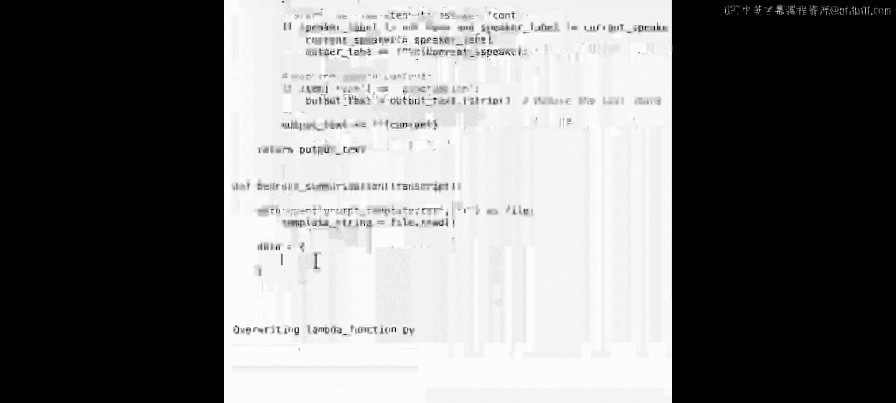

```python
def extract_transcript_from_text(file_content):
    """
    从Transcribe的JSON响应中提取并格式化对话文本。
    格式为：说话人1: 说的话
            说话人2: 说的话
    """
    transcript_json = json.loads(file_content)
    output_text = ““

    # 遍历JSON结构中的每个‘item‘（通常是单词或短语）
    items = transcript_json.get(‘results‘, {}).get(‘items‘, [])
    current_speaker = None
    current_line = []

    for item in items:
        speaker_label = item.get(‘speaker_label‘, ‘spk_0‘) # 默认为‘spk_0‘
        content = item[‘alternatives‘][0][‘content‘]

        # 如果说话人改变或遇到标点（表示一句话结束），则换行
        if speaker_label != current_speaker or item.get(‘type‘) == ‘punctuation‘:
            if current_line:
                output_text += f“{current_speaker}: {‘ ‘.join(current_line)}\n“
                current_line = []
            current_speaker = speaker_label
        if item.get(‘type‘) != ‘punctuation‘:
            current_line.append(content)

    # 添加最后一行
    if current_line:
        output_text += f“{current_speaker}: {‘ ‘.join(current_line)}\n“

    return output_text
```

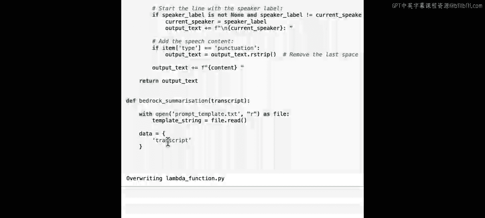

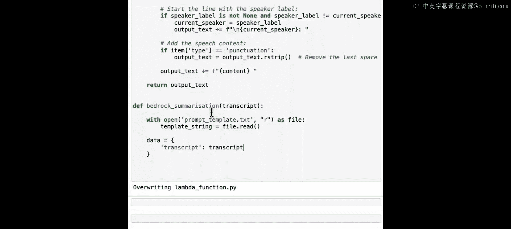

第二个子函数`bedrock_summarization`是核心，它使用Jinja2模板和Bedrock模型来生成总结。

```python
def bedrock_summarization(transcript):
    """
    使用Bedrock模型和Jinja2模板总结对话。
    """
    # 1. 读取提示词模板
    with open(‘prompt_template.txt‘, ‘r‘, encoding=‘utf-8‘) as f:
        template_string = f.read()

    # 2. 准备要插入模板的数据
    data = {
        ‘transcript‘: transcript,
        ‘topics‘: [‘费用‘, ‘位置‘, ‘可用性‘] # 可以动态配置或从外部获取
    }

    # 3. 使用Jinja2渲染模板，生成最终提示词
    template = Template(template_string)
    prompt = template.render(**data)
    # print(f“生成的提示词: {prompt}“) # 调试用

    # 4. 调用Bedrock模型（此处使用Titan Text Express）
    kwargs = {
        ‘modelId‘: ‘amazon.titan-text-express-v1‘,
        ‘contentType‘: ‘application/json‘,
        ‘accept‘: ‘application/json‘,
        ‘body‘: json.dumps({
            ‘inputText‘: prompt,
            ‘textGenerationConfig‘: {
                ‘maxTokenCount‘: 500,
                ‘stopSequences‘: [],
                ‘temperature‘: 0, # 低温度使输出更一致
                ‘topP‘: 0.9
            }
        })
    }

    response = bedrock_runtime.invoke_model(**kwargs)
    response_body = json.loads(response[‘body‘].read())
    summary = response_body[‘results‘][0][‘outputText‘]

    return summary
```

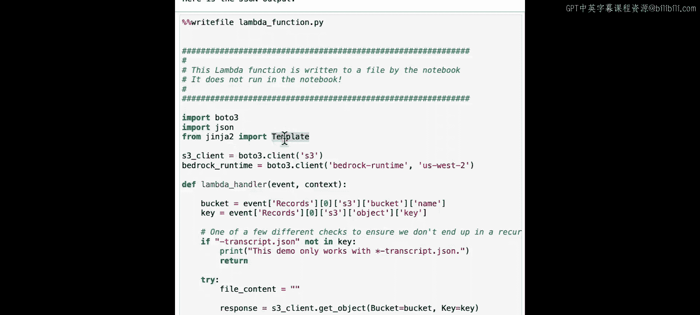

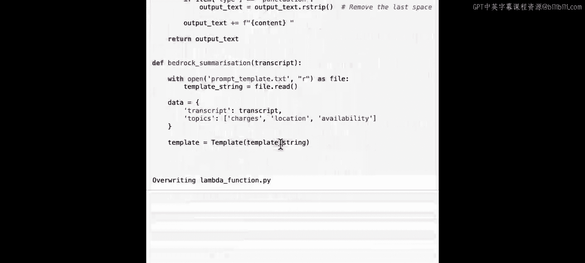

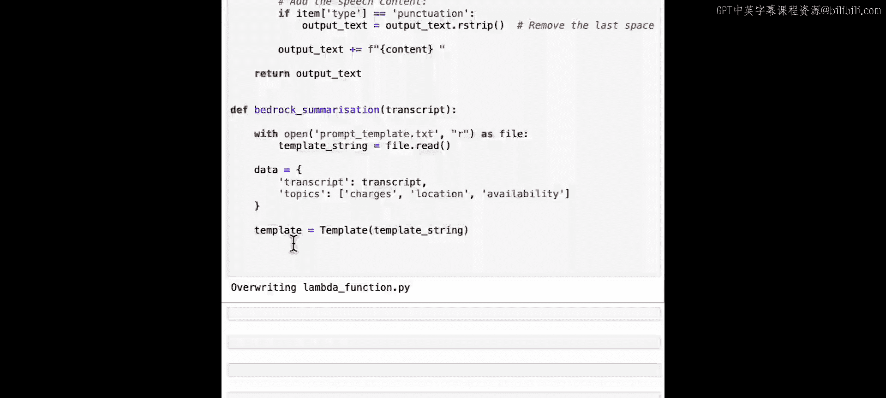

现在，完整的Lambda函数代码已经定义完毕。运行这个单元格会将代码写入`lambda_function.py`文件。

## 部署与配置Lambda函数

我们已经构建了Lambda函数的代码，本节中我们来看看如何将其部署到AWS并配置触发器。

我们将使用之前实例化的`lambda_helper`来部署函数。它会自动将`lambda_function.py`和`prompt_template.txt`打包成ZIP文件并上传。

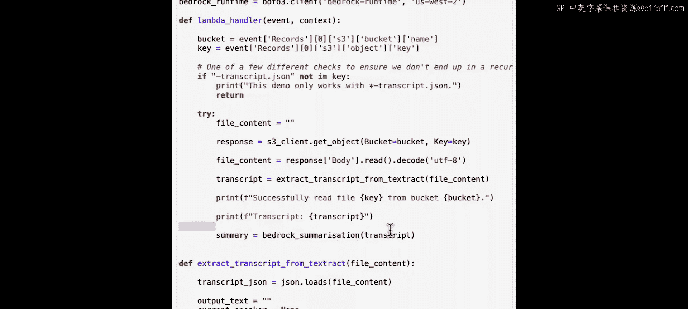

```python
# 部署Lambda函数
lambda_helper.deploy_function(
    files=[‘lambda_function.py‘, ‘prompt_template.txt‘],
    function_name=‘summarize-transcription‘
)
```

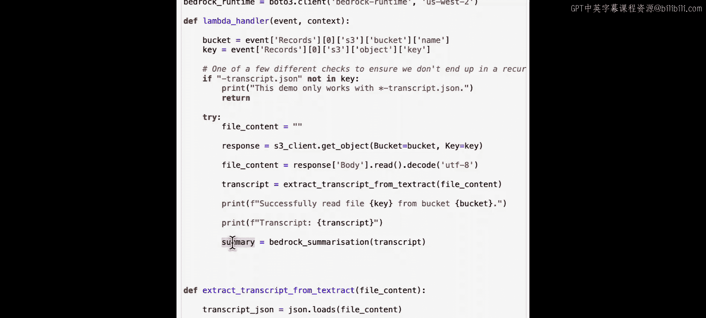

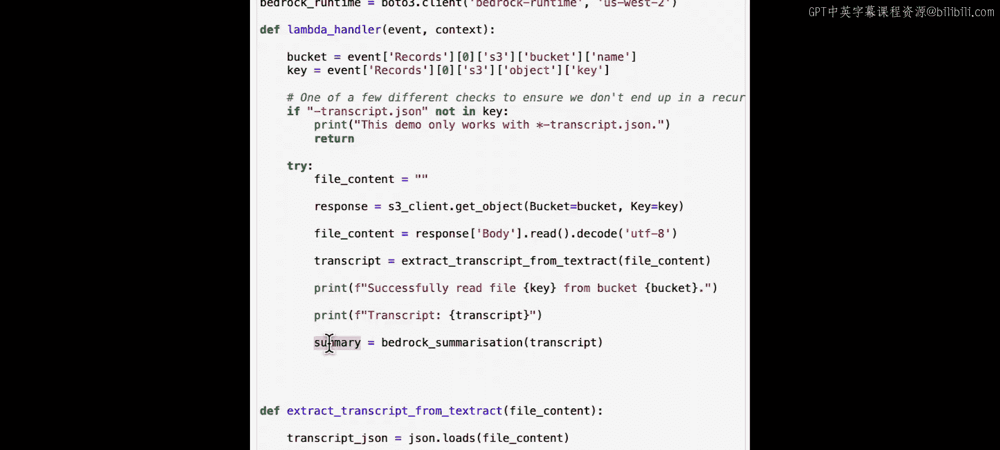

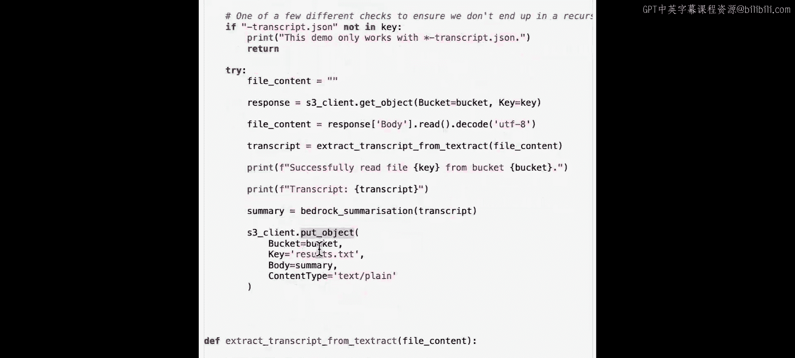

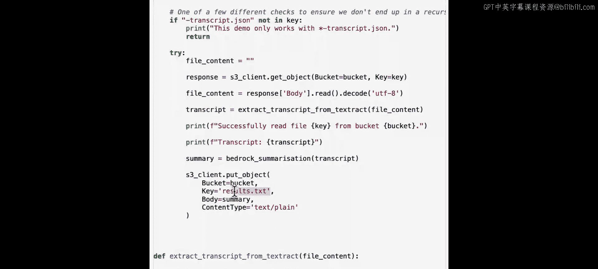

部署成功后，需要为Lambda函数添加一个触发器，使其在特定S3存储桶中有新的JSON文件上传时自动运行。我们配置触发器只对以`.json`结尾的文件生效，以避免函数输出新文件时再次触发自身（循环）。

```python
# 为Lambda函数添加S3触发器
lambda_helper.add_lambda_trigger(
    bucket_name=bucket_name,
    filter_rules_suffix=‘.json‘ # 仅当上传.json文件时触发
)
```

## 测试Lambda函数

现在，Lambda函数已部署并配置好触发器。为了验证其功能，我们将一个示例的转录JSON文件上传到S3存储桶，触发整个流程。

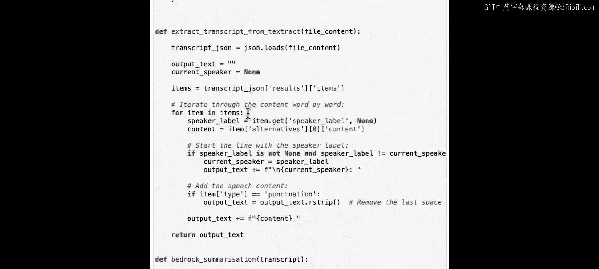

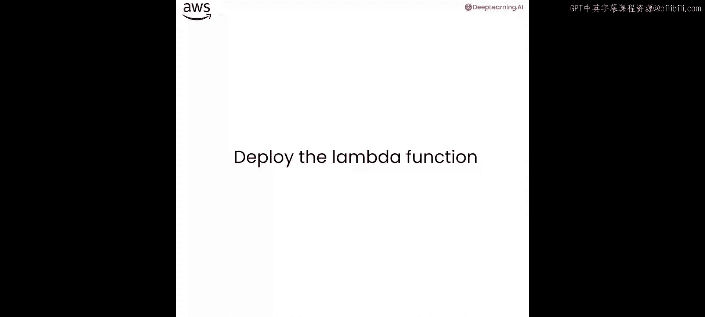

首先，使用S3辅助函数上传示例文件。

```python
# 上传示例转录文件到S3
s3_helper.upload_file(
    bucket=bucket_name,
    file_name=‘demo-transcript.json‘
)
```

上传操作会触发Lambda函数。我们可以列出S3存储桶中的对象，查看是否生成了结果文件。

```python
# 列出S3存储桶中的对象，检查结果文件是否出现
objects = s3_helper.list_objects(bucket_name)
print(“S3存储桶中的对象:“)
for obj in objects:
    print(f“  - {obj}“)
```

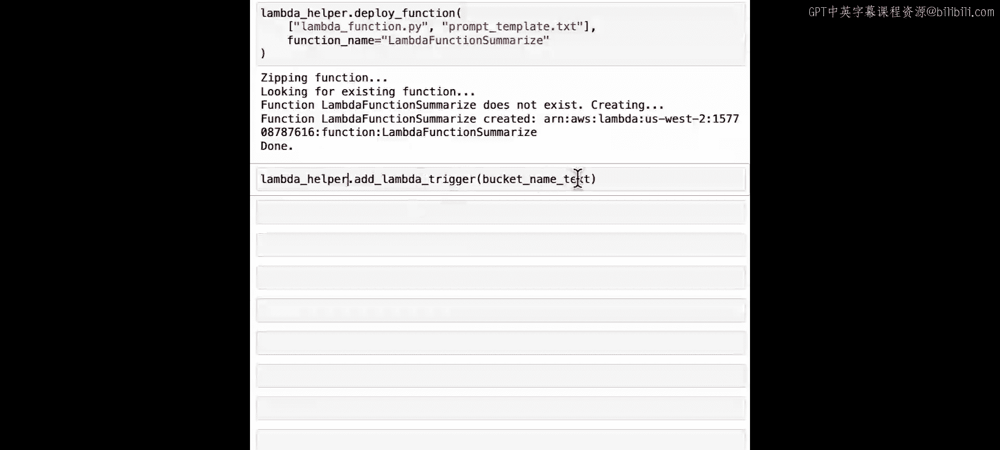

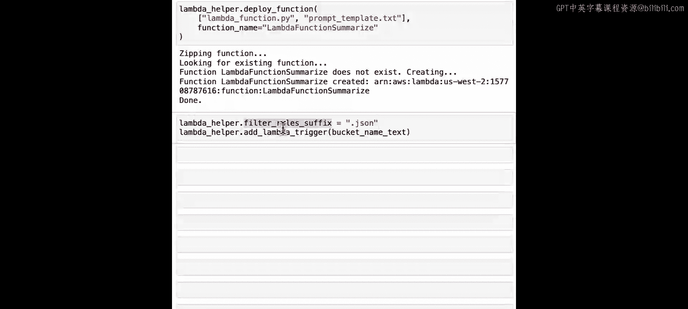

如果看到类似`demo-transcript-results.txt`的文件，说明Lambda函数执行成功。接下来，我们下载并查看这个结果文件。

```python
# 下载生成的结果文件
s3_helper.download_object(
    bucket=bucket_name,
    key=‘demo-transcript-results.txt‘,
    file_name=‘results.txt‘
)

# 使用显示辅助函数查看结果内容
display_helper.text_file(‘results.txt‘)
```

输出应该是一个结构化的JSON，包含了对话的情感分析和检测到的问题列表，例如：

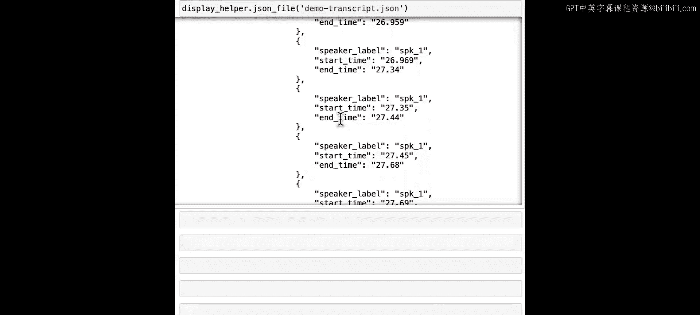

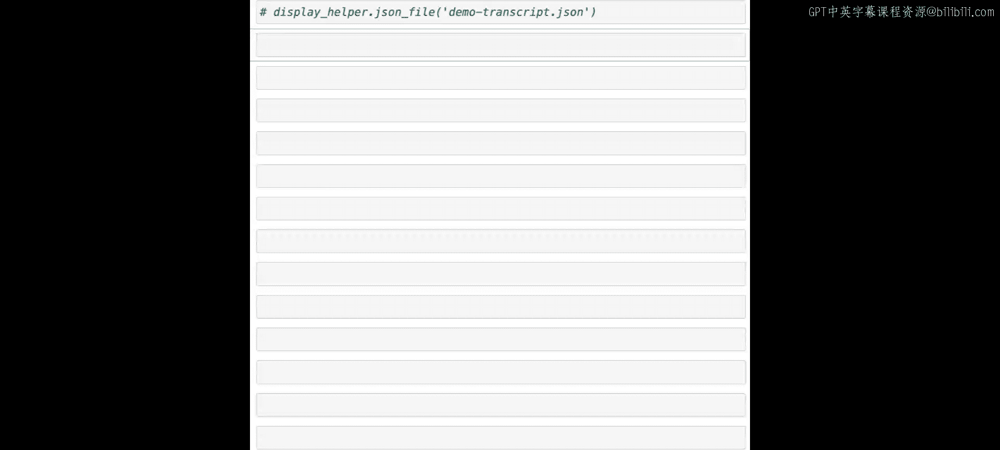

```json
{
  "sentiment": "positive",
  "issues": ["客户询问了预授权费用的性质，这属于‘费用‘主题。", "对话中未提及‘位置‘或‘可用性‘的具体问题。"]
}
```

## 总结

本节课中我们一起学习了如何构建和部署一个与Amazon Bedrock集成的AWS Lambda函数。我们首先设置了辅助工具和环境，然后创建了一个使用Jinja2模板的动态提示词。接着，我们逐步构建了Lambda函数，包括从S3事件解析数据、处理原始转录JSON、调用Bedrock API进行总结分析，以及将结果写回S3。最后，我们部署了函数，配置了S3触发器，并通过上传测试文件验证了整个流程的成功运行。

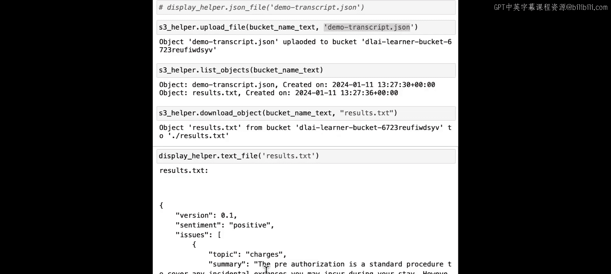

这构成了我们自动化处理流水线的核心处理环节。在下一节课中，我们将把转录服务与这个Lambda函数连接起来，构建一个从音频上传到分析结果输出的完整、端到端的无服务器应用程序。