# 使用Amazon Bedrock构建无服务器LLM应用程序：P6：L5_Event-driven_generation 🚀

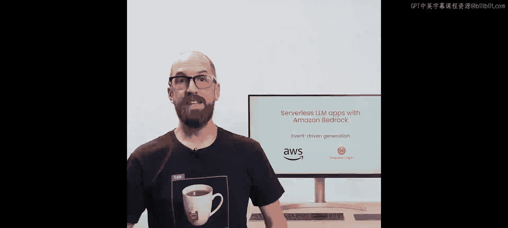

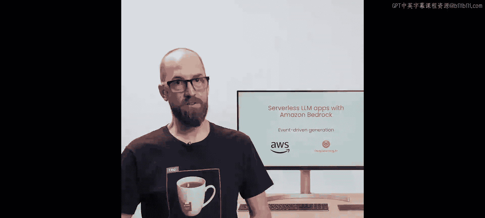

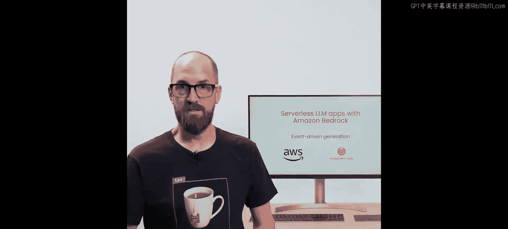

在本节课中，我们将学习如何构建一个事件驱动的架构，以实现从音频文件上传到文本摘要的端到端自动化流程。我们将设置一个Lambda函数，使其在音频文件上传至S3存储桶时自动触发，并调用Amazon Transcribe服务进行转录。

---

## 概述 📋

我们已经将代码部署到Lambda函数中，以便在音频文件上传时自动触发。现在，我们将建立一个事件驱动的架构，将音频转录和文本摘要流程完全自动化。通过本节课的学习，你将了解如何连接不同的AWS服务，构建一个无服务器、可扩展的应用程序。

---

## 导入必要的库 📚

首先，我们需要导入必要的Python库，以便在Lambda环境中运行我们的代码。这些库包括用于访问环境变量的`os`，用于与S3交互的`boto3`，以及用于生成唯一标识符的`uuid`。

```python
import json
import boto3
import os
import uuid
```

---

## 设置环境变量 🔧

为了确保S3存储桶名称的唯一性，我们需要从环境变量中获取存储桶名称。这样，我们可以在实验环境中创建具有标准名称的存储桶，并在代码中引用它们。

```python
audio_bucket_name = os.environ.get('AUDIO_BUCKET_NAME')
text_bucket_name = os.environ.get('TEXT_BUCKET_NAME')
```

运行上述代码后，我们已经成功设置了环境变量。接下来，我们将开始部署Lambda函数。

---

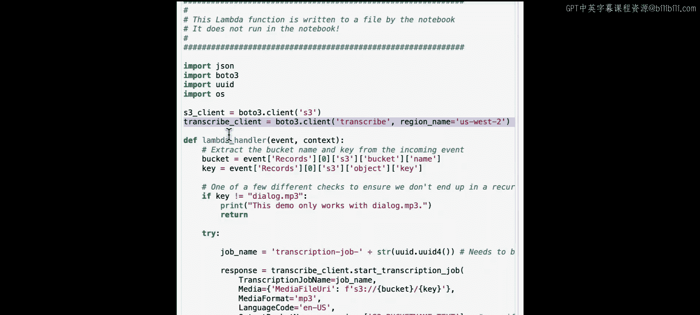

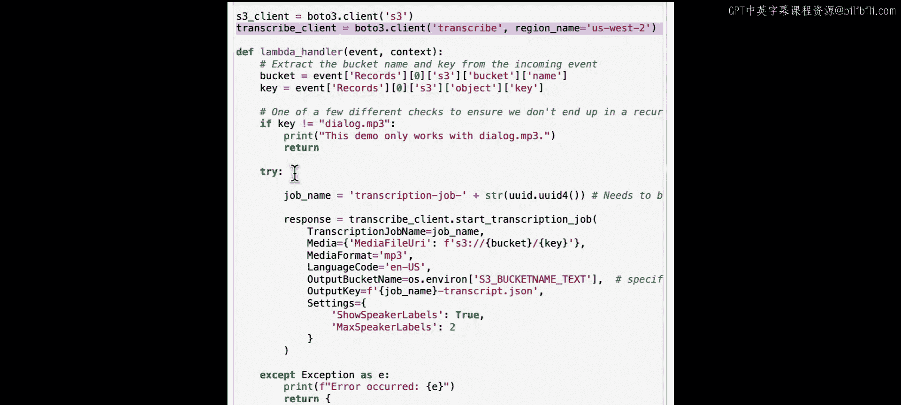

## 部署Lambda函数进行音频转录 🎙️

上一节我们介绍了如何设置环境变量，本节中我们来看看如何编写并部署一个用于音频转录的Lambda函数。该函数将在音频文件上传到S3存储桶时被触发，并调用Amazon Transcribe服务。

以下是Lambda函数的核心代码：

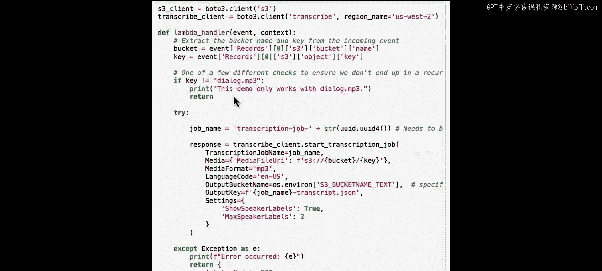

```python
def lambda_handler(event, context):
    # 从事件中获取上传文件的存储桶和键名
    bucket = event['Records'][0]['s3']['bucket']['name']
    key = event['Records'][0]['s3']['object']['key']
    
    # 仅处理名为 'dialog.mp3' 的音频文件
    if key == 'dialog.mp3':
        # 创建唯一的转录任务名称
        job_name = f'transcription-job-{str(uuid.uuid4())}'
        
        # 初始化Transcribe客户端
        transcribe_client = boto3.client('transcribe')
        
        # 开始转录任务
        transcribe_client.start_transcription_job(
            TranscriptionJobName=job_name,
            Media={'MediaFileUri': f's3://{bucket}/{key}'},
            MediaFormat='mp3',
            LanguageCode='en-US',
            OutputBucketName=text_bucket_name,
            OutputKey=f'{job_name}-transcript.json',
            Settings={'ShowSpeakerLabels': True, 'MaxSpeakerLabels': 2}
        )
        
        return {
            'statusCode': 200,
            'body': json.dumps('Transcription job started successfully.')
        }
    else:
        return {
            'statusCode': 400,
            'body': json.dumps('Invalid file name. Expected dialog.mp3.')
        }
```

---

## 配置Lambda环境变量与触发器 ⚙️

现在我们已经编写了Lambda函数代码，接下来需要配置环境变量并设置S3触发器，以便在音频文件上传时自动执行该函数。

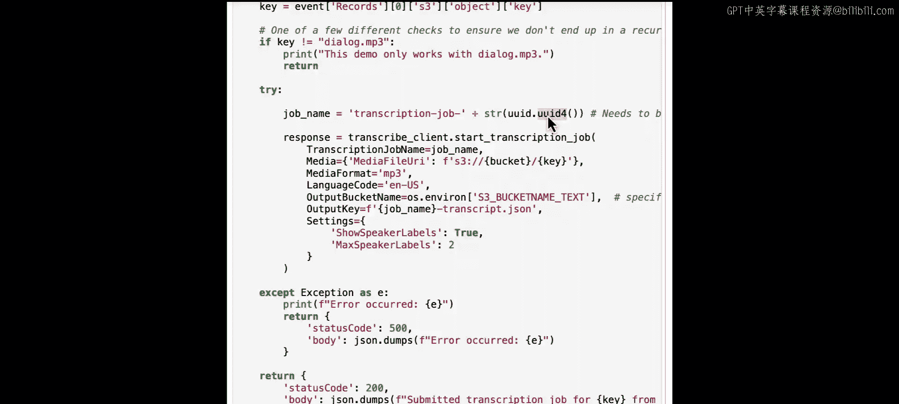

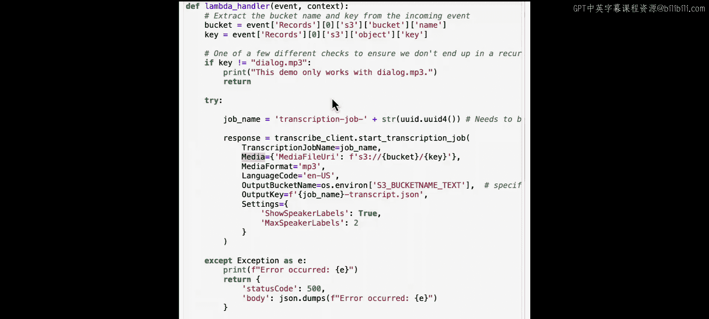

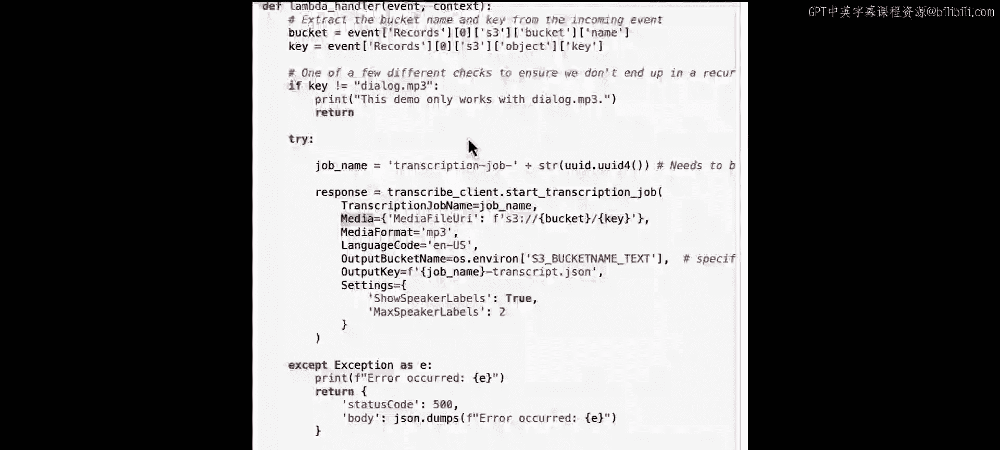

首先，我们使用Lambda助手设置环境变量：

```python
lambda_helper.set_environment_variable('TEXT_BUCKET_NAME', text_bucket_name)
```

然后，我们部署Lambda函数：

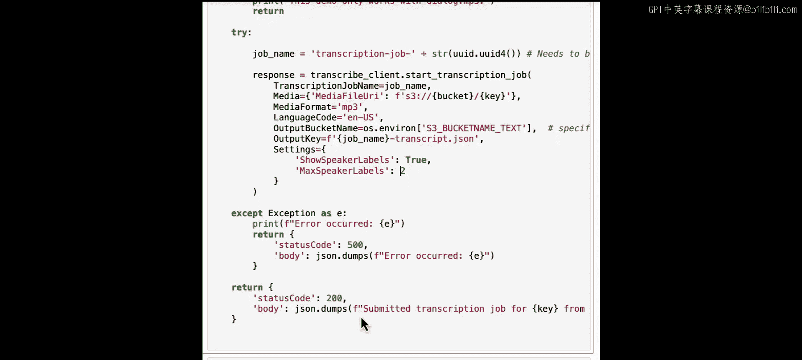

```python
lambda_helper.deploy_function(
    files=['lambda_function.py'],
    function_name='transcribe_audio'
)
```

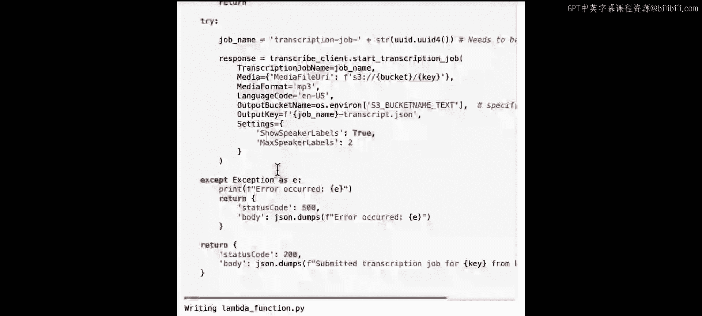

最后，我们为音频存储桶添加触发器，仅当上传的文件是MP3格式时才触发Lambda函数：

```python
lambda_helper.add_lambda_trigger(
    bucket=audio_bucket_name,
    function_name='transcribe_audio',
    filter_rules=[{'Name': 'suffix', 'Value': '.mp3'}]
)
```

---

## 测试端到端流程 🔄

一切设置完成后，我们可以测试整个流程。首先，上传一个MP3音频文件到音频存储桶：

```python
s3_helper.upload_file('dialog.mp3', audio_bucket_name, 'dialog.mp3')
```

上传成功后，Lambda函数会自动触发，调用Amazon Transcribe服务。转录完成后，结果JSON文件会被保存到文本存储桶中。随后，我们在上一课中部署的摘要Lambda函数会被触发，处理转录文本并生成摘要。

我们可以列出文本存储桶中的文件，以验证流程是否成功：

```python
objects = s3_helper.list_objects(text_bucket_name)
print(objects)
```

如果一切正常，你将看到转录的JSON文件和生成的摘要文本文件。

---

## 查看生成结果 📄

最后，我们可以下载并查看生成的摘要文本文件，以确认整个流程运行正确。

```python
s3_helper.download_file(text_bucket_name, 'results.txt', 'results.txt')
with open('results.txt', 'r') as file:
    summary = file.read()
print(summary)
```

---

## 总结 🎉

在本节课中，我们一起学习了如何构建一个完整的事件驱动无服务器应用程序。我们从音频文件上传开始，通过S3触发器自动调用Lambda函数，使用Amazon Transcribe服务进行音频转录，并最终利用上一课的摘要Lambda函数生成文本摘要。这个架构展示了如何将多个AWS服务无缝集成，实现自动化、可扩展的解决方案。

通过这个示例，你可以根据自己的业务需求扩展和修改此架构，例如处理不同类型的音频文件、添加额外的处理步骤或集成其他AI服务。AWS提供了丰富的工具和服务，帮助你构建强大的无服务器应用程序。

---

## 扩展资源 🔗

如果你想进一步探索Amazon Bedrock和其他AWS AI服务，可以参考以下资源：
- [Amazon Bedrock官方文档](https://docs.aws.amazon.com/bedrock/)
- [AWS Lambda开发者指南](https://docs.aws.amazon.com/lambda/)
- [Amazon Transcribe入门](https://docs.aws.amazon.com/transcribe/)

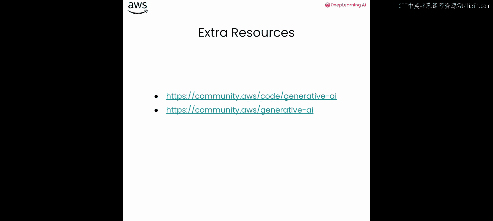

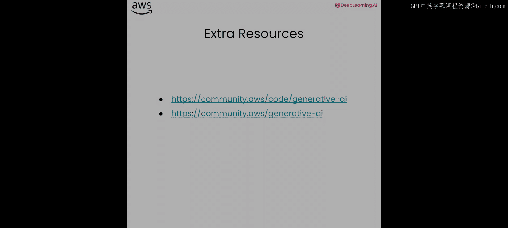

恭喜你完成了本节课的学习！接下来，请继续观看下一节视频，深入了解如何优化和扩展你的无服务器LLM应用程序。