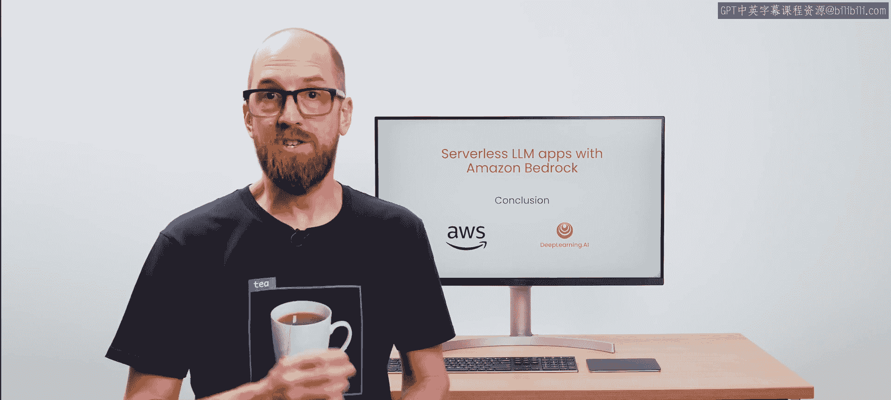
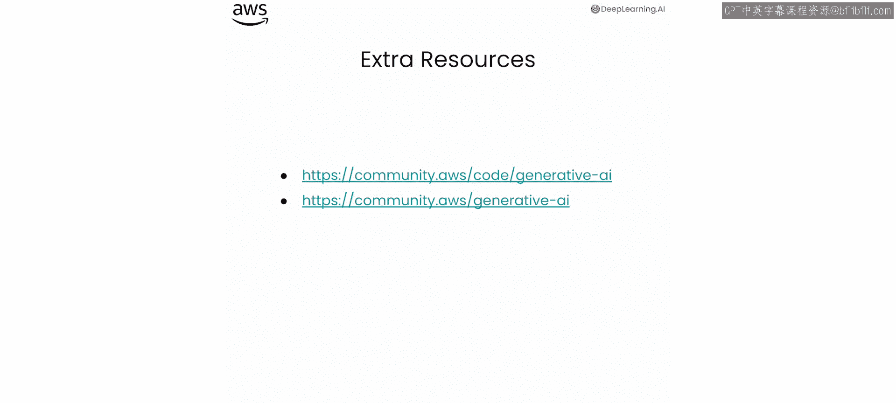

# 使用Amazon Bedrock构建无服务器LLM应用程序：P7：L6：课程总结与展望 🎯

在本节课中，我们将回顾整个课程的核心内容，并探讨如何将所学架构进行扩展与适配，以满足更复杂的业务需求。

## 课程回顾

在本课程中，你已经学习了如何利用一个简单而强大的**事件驱动管道**，结合Amazon Bedrock来使用大语言模型处理客户互动的录音。

这个架构可以通过多种方式进行扩展和调整，以适应你的特定需求。

## 架构的扩展潜力

上一节我们介绍了基础的事件驱动架构，本节中我们来看看其强大的扩展性。

目前我们所探讨的内容，仅仅是Amazon Bedrock强大功能的冰山一角。

### 构建智能体

你可以部署更复杂的架构，例如**智能体**。

以下是智能体的核心概念：
*   **智能体**允许由LLM驱动的应用程序与外部系统交互，例如你的其他应用程序和第三方服务。
*   你可以扩展本课程中的架构，使得由LLM驱动的智能体能够自动更新客户关系管理系统中的客户记录，或向管理层发送升级处理的电子邮件。

Amazon Bedrock使你能够在**Lambda函数**中构建智能体，就像我们在本课程中看到的那样。这意味着智能体的工作流全部托管在云端，并且能够大规模运行。

### 检索增强生成

Amazon Bedrock还支持**检索增强生成**，通常简称为**RAG**。这通过一项名为“知识库”的服务实现。

你只需点击几下即可设置RAG。通过将客户支持文档集成到应用程序中，RAG能使大语言模型快速找到相关且最新的信息。

## 深入学习资源

若想了解更多关于这些架构以及Amazon Bedrock的详细信息，请查阅上一课末尾提供的资源。

## 致谢与结语

最后，我要感谢所有参与制作本课程的团队成员，包括Amazon的优秀团队、DeepLearning.AI，当然还有花费时间与我一同学习的你。

我迫不及待想看到你运用这项技术和Amazon Bedrock所构建的作品。请随时联系并告诉我你的成果。

感谢观看，再见。

---

“太好了，你确定不来点茶吗？”
“那就来点吧。你也来点，我们俩都来点。”

---

**本节课总结**：我们一起回顾了如何利用Amazon Bedrock和事件驱动架构处理音频数据，并深入探讨了通过**智能体**和**检索增强生成**技术来扩展应用功能的可能性。这些工具为你构建强大、可扩展的无服务器LLM应用程序奠定了坚实的基础。