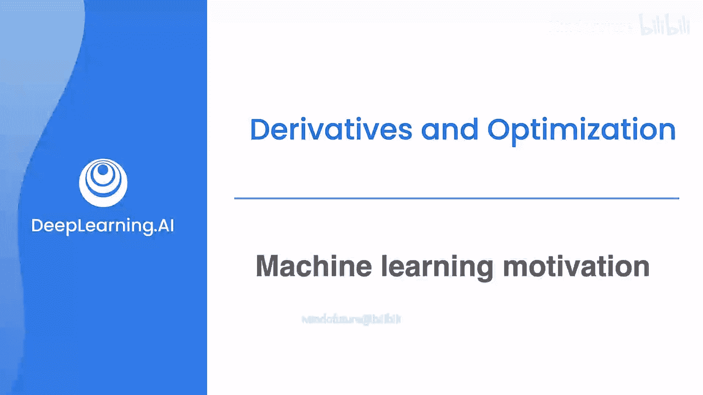
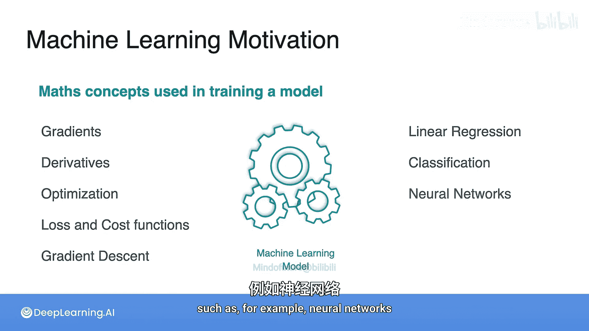

# 【Deeplearning】吴恩达：机器学习和数据科学微积分2 ｜ Machine Learning Calculus p03 P03_机器学习动机_01_01_05 -BV19M6LBeEkZ_p3-

Welcome to week1 and this week you're going to learn the intuition behind the concept of the derivative。

What's a derivative， well my favorite example of a derivative is velocity。

 so the first example you're going to learn is a speeddoome example。

Then you're going to see several very important and very basic functions in mathematics。

 such as a constant function， linear functions， quadratics， polynomials。

 exponential functions and logarithmic functions， and you're going to learn the derivative of those functions。

Now， in order to find derivatives of more complicated functions。

 we're going to use several rules such as the sum rule， the product rule， the chain rule。

 and multiplication by scalers。But here's a question。

 why are derivatives and calculus so important in machine learning？

And one of these reasons is that derivatives are used to optimize functions in particular。

 to maximize them and minimize them that means finding the maximum value or the minimum value of a function。

And this is very important in machine learning， the reason is that when you want to find the model that fits your data in the best possible way。

 you do this by calculating a loss function and minimizing it。

So we're going to see several examples of minimizing functions。

 the first example is going to use an example of temperature。

And then we're going to see other examples that actually will introduce you to two of the most important loss functions in machine learning。

 the square loss and the log loss。So let's begin by considering this problem。

 you have the following houses， each one has a different number of bedrooms。

 the first one has one bedroom and the second one has two bedrooms。Now， the first house costs $150。

000 and the second one， $250，000。And in this problem。

 you would like to be able to predict the price of a house using the number of bedrooms it has。

So luckily you have a lot more data about the pricing of a house given the number of bedrooms。

 as is shown on this table， See in this table， you have houses with1，2，3，5，6，7。

8 and 10 bedrooms with their prices， and then there is this nine bedroom house that is still missing its price。

So you decide to build a machine learning model to help you predict the price of the house with nine bedrooms。

Now to make this easier， let's plot the data。In the following graph。

 the horizontal axis represents the number of bedrooms and the vertical axis the price of the house。

And you can see that the houses are here represented by dots。

Now the idea is that the machine learning model takes in all the input data of the house prices and begins a process called model training。

You can think of this phase model training as the most important part of running a car。

 the engine model training is what's under the hood of any AI experiment， and in this case。

 in fact it's a smart engine always looking for ways to optimize in order to produce the best possible result。

So when I say model， in this case， what I mean is simply a line that goes as close as possible to all the points。

And this line would represent the predicted price。So when model training begins。

 it starts with any random line， and the idea is that it tweaks the results in order to optimize the best possible prediction for the existing data points。

And once training is done， the model is able to give you a good prediction for the house with nine bedrooms。

 so in this case， the house with nine bedrooms is predicted to have a price of $950，000。

This problem is called a linear regression problem。Now， how does training work under the hood。

 well you'll find out soon enough。But let's actually consider another example。

 let's say that you travel to a distant planet and you're lucky enough to meet some alien life。

And you're able to interact with them so the first alien says the following， act a a。

And let's say that you have enough information to know that this alien is in a happy mood。

Then let's say the R alien says beep， beep。And you know that this alien is sad。

And let's have more data points。An alien says act be act， and that alien is happy。

And then it says Act B P Bep， and it's set。So the idea is that you don't necessarily want to learn the alien language because it may be too hard。

 but you want to be able to tell if an alien is happy or sad。So let's look at the data set。

 so these are the four sentences， act act act， be peep， act beep， act and act be peep peep。

For each one of them。You're going to collect a number of times。

The word act appears and the wordbeep appears。And now you're also going to collect the mood of the alien。

 so this is going to be a classification problem， why。

 because given any sentence the idea is to classify it as happy or sad and because you're classifying it as happy or sad。

 this is called a sentiment analysis model。But everything works nicer with a plot。

 so let's make a plot of each of the sentences in the horizontal axis you have the number of times the word a appears and in the vertical axis you have the number of timesBep appears。

And what's a model this time well again it's going to be a line， let's say this line。

 well this line doesn't do very well， the idea of the model is to be able to classify or to split apart the happy points and the sad points。

So for example， here's a better model and as you train the model let's say it gets to an ideal point here and this ideal point here splits the plane into two regions。

 the sad region here is shown in green and the happy region here shown in orange and the idea is that if a new sentence comes in depending on which area it is。

 the model will predict if the sentence is happier set， the model may make mistakes。

 but for the most part itll do well， at least based on how it did on this dataset set。So again。

 how does the model do this？Well it turns out that there's a lot of mathematics driving the process of your model。

 the training process， some of the math concepts involved are gradients， derivatives， optimization。

 loss and cost functions， grading descent and many。

 many more so in this course you are going to learn about model training optimization and how it works at the core with mathematics and in a senior sample we use several models we use linear regression。

 classification examples to motivate the problem but the techniques and concepts you're going to learn here can be applied to a wide range of other machine learning algorithms such as for example neural networks。

