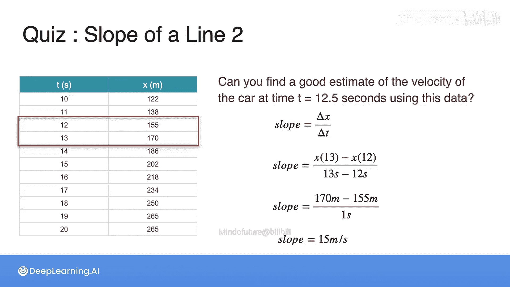

# 【Deeplearning】吴恩达：机器学习和数据科学微积分2 ｜ Machine Learning Calculus p04 P04_导数动机第一部分_01_01_06 -BV19M6LBeEkZ_p4-

When I think of a derivative the first thing that comes to my mind is velocity so let's say for example that you're in a car and you go 100 kilometers in one hour W your average velocity was 100 kilometers per hour however maybe you start fast then you went slow then you stopped then you went really fast then maybe when reverse at some point so this velocity is not constant and so the question is at a given instant what is the velocity at that instant and so that's called the instantaneous velocity and that is precisely what a derivative is a derivative is the instantaneous rate of change of a function and in this case the function is distance and its derivative is velocity。

Let's add some numbers to this example to understand the concept of the derivative more clearly。

 Imagine here that you are in the car traveling on a straight road。

And you have a speed armor that tells you the velocity Now remember from physics that speed equals distance travel divided by the time elapsed。

Unfortunately， this speedometer breaks。But now you have an app that tells you the distance you have traveled and you also happen to have a calculator in your hand。

So you drive for one minute and you're able to generate a table of values showing the distance you traveled every5 seconds for one minute Now here is the first qui。

The question is， is the car moving at constant speed？And the hint is。

 take a look at the distance values in the table。The car is not moving at constant speed you can see that between 10 and 15 seconds。

 which is a5 second interval， the car traveled 80 meters。

 but between 15 and 20 seconds which is also a5 second interval， the car traveled 63 meters。

This tells us that from 10 to 15 seconds， the car was traveling at a faster average velocity than it was between 15 and 20 seconds。

So we can also conclude that the speed of the car is not constant across the one minute interval。

Great， so you determined that the car is not moving at constant speed now here is the second quiz。

 can you use this information to tell you your velocity at time 12。5 seconds？

And the hint is that velocity equals distance traveled divided by time taken。So again， the quiz is。

 can you or can you not use this information to determine the exact velocity at 12。5 seconds？

So the answer is no， you cannot find the velocity at time， 12。

5 seconds with the data given on this table， you can find the average velocity in the interval from 10 to 15。

 but you don't know what happened within that interval at 12。5， maybe you were going faster。

 maybe you going slower than the average velocity。However， there is one thing you can find。

 you can find the average velocity in the interval from 10 to 15 seconds， so that is the next quiz。

What was the average velocity of the car in the interval from 10 to 15 seconds？

So let's draw a graph for the points in the table to observe what's going on and let's zoom specifically to the points 10。

122 and 15，202 to find this slope at a point because the slope is going to be the average velocity。

So here is the graph and here is the interval。So the average velocity between the time interval 10 seconds to 15 seconds is also the slope of the line that joins the two points in the graph。

Now velocity is calculated with a formula distance over time。

 this is synonymous to the formula for calculating slope， which is rise overrun。This is the rise。

 and this is the run。In this case， the rise is the change in distance and the run is the change in time。

 this is because distance is on the vertical axis and time in the horizontal axis。

The distance traveled at 15 seconds is 202 meters， and the distance traveled at 10 seconds is 122 meters。

 so the length of the time interval is 5 and the length of the distance interval is 80。

Using the formula for slope or velocity， we get 80 divided by 5 equals 16 meters per second；

 the slope on the line that passes these two points is 16。

 which also translates to the velocity of the car between those two points 16 meters per second。Now。

 while the average velocity between 10 to 15 seconds was a good estimate for the velocity at T equals 12。

5 seconds， could we do better？Well， yes we can if we had more data about the distances of time close to t equals 12。

5 seconds， and so let's say that we take more refined measurements， one every second。

And here you have a lot more data about the distances you traveled every second and the specific distance you covered from time t equals 10。

 all the way to t equals 20。And the data is shown in this table over here。So here is another quiz。

 can you find a better estimate of the velocity of the car at time t equals 12。

5 seconds using this data？So once again we are not able to find the exact velocity of the car at 12。

5 seconds， however， we have a way of making an even better guess than the previous one for what this velocity is by taking the average velocity between the interval of time between 12 seconds and 13 seconds and how do we calculate this？

Well， if the slope is the change in distance over the change in time。

 that's the velocity of the interval， then this is the distance of 13 minus the distance of 12。

 divided by the time of 13 minus the time of 12。Distance at 13 is 170。

 distance at 12 is 155 and the time difference between 13 and 12 is1 second。

 so we get a slope of 15 meters per second that's the velocity for that interval and that is a much better estimate for the instant velocity at t equals 12。

5。Now notice that we still don't have the estimate of the velocity at 12。5。

 what would you do to find this estimate？Well， you can just take finer and finer intervals。

And the finer the intervals， the better the estimate is。

And that leads to the derivative， which is coming next。

