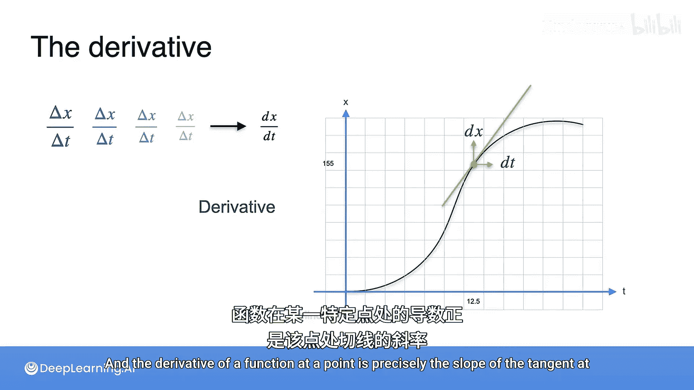

# 【Deeplearning】吴恩达：机器学习和数据科学微积分2 ｜ Machine Learning Calculus p05 P05_导数与切线_01_01_07 -BV19M6LBeEkZ_p5-

In the previous video， you learn how to calculate the average velocity over an interval。

 but what is the instantaneous velocity at a point， let's look at the point T equals 12。

5 that you were looking at before。Calculating the instantaneous velocity here may be hard。

 but estimating it is possible， for example， let's take another point to the right of t equals 12。

5 and calculate the average velocity over that interval that is the slope of this line over here。

Which is exactly Delta x， the change in distance divided by Delta T， the change in time。

But that is not the instantaneous velocity at t equals 12。5。

 however you can get closer to it by making this interval smaller， for example。

 take now this point over here closer to t equals 12。

5 and the average velocity over that interval is the new delta x over the new delta t which is the slope of this new line。

And now let's put the point even closer to 12。5 and even closer， and now imagine putting it so， so。

 so close that you can even tell the distance between the two。So you get the limit。

 which is dx over Dt， and that is precisely the tangent line to the curve at t equals 12。5。

So this measure of how fast the distance is changing with respect to time is called the instantaneous rate of change and it is the slope of that tangent line。

 more generally the instantaneous rate of change is a measure of how fast relation between two variables is changing at any point。

In other words， imagine that you move a tiny， tiny distance dx in a tiny， tiny interval of time dt。

 this is an instantaneous rate of change， and it's also called the derivative。

And the derivative of a function at a point is precisely the slope of the tangent at that particular point。

