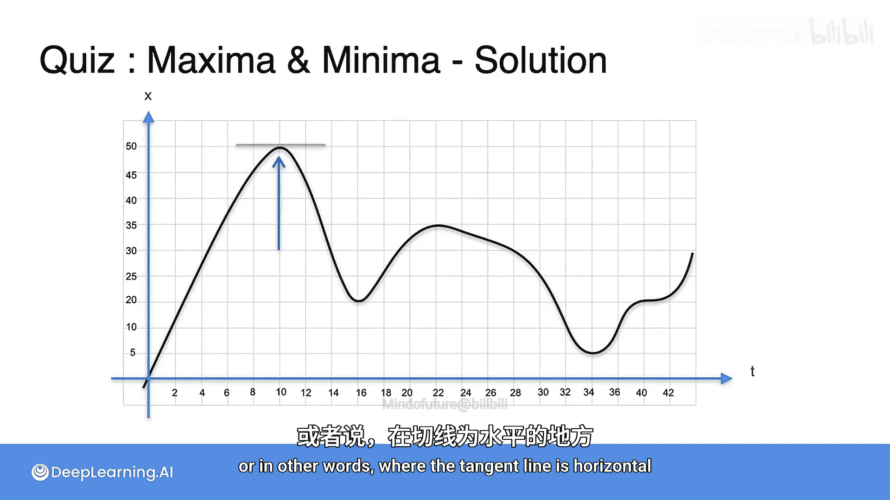

# 【Deeplearning】吴恩达：机器学习和数据科学微积分2 ｜ Machine Learning Calculus p06 P06_斜率、最大值与最小值_01_01_08 -BV19M6LBeEkZ_p6-

So now that you know what a derivative is， let me show you a very interesting property of it。

 let's go back to the table， but just as this little piece between 19 seconds and 20 seconds。

Notice that the distance at 19 is 265 and the distance at 20 is 265。

The distance is the same at both points， it hints that perhaps the car didn't move in that interval。

 maybe it moved and then came back， but let's assume that it didn't move at all。

So this is how the interval between 19 and 20 looks。

The line between these points is a horizontal line and a horizontal line has a slope of0。

Here's the calculation， the slope is the change in X over the change in T。

And the change in x is the distance at 20 minus distance of 19。And that is 265 minus 265。

 Now the change in T is one second， so the slope is 0 over 1 because there is no rise in distance。

 distance doesn't change。Therefore， the slope is0 me per second。

So now let's look at a trajectory of the car。 We're going to plot it on the right。

 So first the car go forward。Then it stops， then it goes backwards， then it stops。

 goes forward again， then backwards again， and then forwards again。

So here is a quiz question for you， given this trajectory， where was the velocity of the car zero？

So if you said that at any of the points where the tangent is horizontal。

 therefore the tangent has slope 0， you were correct， those are the points where the car was stopped。

And in total， there are five points。Now let me ask you another course question。

At what time was the car farthest from its starting point？

And the answer is over here because this is when the distance was 50 and that's the highest distance that you can find in this graph。

Now notice something interesting。The point where the distance was the farthest is coincidentally one of the points where the car was stopped。

 and this is no coincidence because if the car is moving， then it could just go further。

So the point where the car is the farthest is a point where the car is not moving， that means。

If you want to find the maximum or the minimum in a function。

 it occurs at one of the points where the derivative is0。Or in other words。

 where the tangent line is horizontal。

