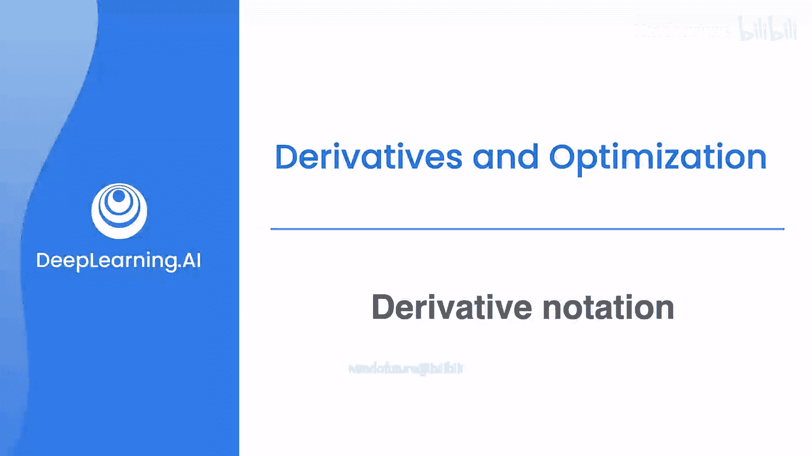
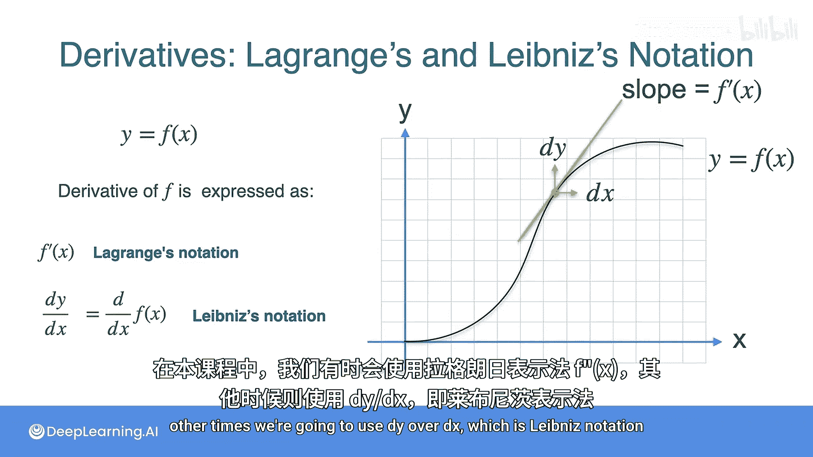

# 【Deeplearning】吴恩达：机器学习和数据科学微积分2 ｜ Machine Learning Calculus p07 P07_导数及其表示法_01_01_10 -BV19M6LBeEkZ_p7-

Like any language mathematics has its way of expressing concepts in this video I'm going to show you two ways to express the derivative。

 the first one is Lightn's notation and the second one is LaGrange notation。

Let me show you how they work。So first recall that the slope was calculated as the change in distance over the change in time。

 that's delta x over delta T， and that the slope of aent at a point was called dx over Dt and what was this dx and this Dt？

Well， in order to calculate the slope， you first started with a big interval。

 calculated delta x over delta T， that's the slope of that second and then made the interval smaller and smaller。

 always calculating deelta x over delta T until the interval is so tiny that you get the tangent line。

And this slope was called dx over Dt and Dx over dt represent infinitesimal changes in the x direction and in the T direction。

So that's one way of writing the derivative as dx over Dt Now in general。

 we're going to have x as the horizontal axis and y as the vertical axis。

 so the derivative is going to be called dy over dx instead。So here's some notation。

 let's say that your function is called F of x and that's y， so y is F of x。

Now the derivative of S can be expressed in two ways， one is as f prime of x。

 so recall the function is f and at the point x， the slope of the line is f prime of x that is LaGrangee's notation。

And the other one is the one you just saw， which is dy over dx that can also be expressed as d over dx of f of x。

 in this case， d over dx。Can be think thought of as an operator。

 something that when you apply to F of x， you get something else。And this is live means notation。

So sometimes in this course， we're going to use La Grs notation F prime of x。

 and other times we're going to use dy over dx， which is Liin notation。

And we're normally just going to pick the one that's more convenient。

