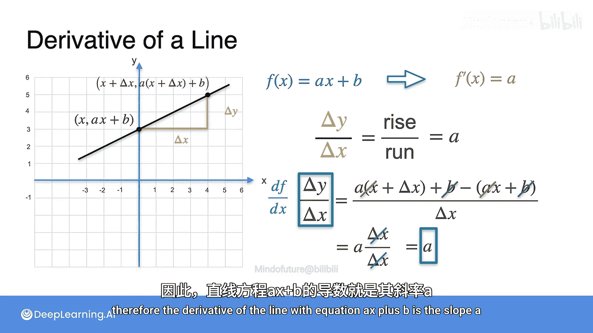

# 【Deeplearning】吴恩达：机器学习和数据科学微积分2 ｜ Machine Learning Calculus p08 P08_常见导数-线性函数_01_01_11 -BV19M6LBeEkZ_p8-

Our goal is to be able to calculate the derivatives of most of the functions that we know。

So let's start with the simple ones， what are the simple ones， constant functions， linear functions。

 quadratics， polynomial functions， exponential and logarithmic functions。

 and the trigonometric functions。You're going to be glad to know that these have very nice and simple derivatives。

So let's start with lines and the simplest line is actually a constant so a horizontal line。

 this function is such that the height at every point， for example x0 and x1 is always the same。

 some constant C， the c could be minus17，3。5 any number as long as it's always the same。

So now let's look for example at that derivative at x0 so this tangent line has the same slope as the entire line。

 what is this slope well the slope is delta y or delta x now the change in y is always0 because y is always c。

 so it's always c minus c。And therefore the numerator here is 0 and the denominator is not0 if we take x0 different than x1。

 so therefore this slope is always0 and we conclude that a horizontal line or a constant always has a derivative of 0。

Now let's consider some generic line that is not horizontal。

 so it can have the equation f of x equals ax plus B， where a is the slope and B is the y intercept。

What is the derivative for this function Well， this derivative is very simple。 Let's take a point。

 for example， this one。And we're going to calculate it by taking any other point and looking at deelta x。

 looking at delta y and calculating the slope， deelta y over deelta x， now this is rise overrun。

 so it's going to be a， which is the slope。Now notice that as the second point gets closer to the first one。

Well the tangent stays of the same slope for the same reason as what happened with a constant line。

 when you have a line， the tangent at every point has the same slope as the entire line。

 and this line has a slope of a， therefore the equation f of x equals a x plus b of a line has a derivative f prime x of a。

And if you want to see the math happening， well， let's look at the points， this point has equation。

X a X x plus B those are the coordinates， and this point has coordinates x plus delta x。

 A x plus delta x b plus B。Therefore， when we take the slope， it's delta y over delta x。

 and that's the difference between this number and this number， the delta y。

 so that's a x delta x plus B minus a B。And the denominator is delta x。

 so a lot of things cancel out here， this Ax cancels out with this Ax。

 this b cancels out with this B。And then we have a times delta x over delta x。

 the2 delta x is cancel out， and the slope is a， therefore。

 the derivative of the line with equation A X plus B is the slope A。

