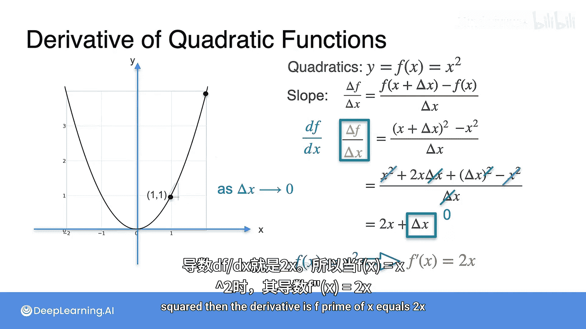

# 【Deeplearning】吴恩达：机器学习和数据科学微积分2 ｜ Machine Learning Calculus p09 P09_常见导数-二次函数_01_01_12 -BV19M6LBeEkZ_p9-

So now that you know lines let's take a look at a slightly more complicated function， quadratics。

 the simplest quadratic is this para with equation y equals x squared， let's look at the derivatives。

 notice that to the left of the y axiss， these are negative and to the right of the y axiss。

 these are positive。The formula for the derivative is Delta f over Delta x as delta x goes to 0。

Now Delta f is the change in y or the change in F， which is x plus delta x squared minus x squared。

So before we do this formally， let's take a look at an example， what happens when x equals 1。

 then y is x squared which is also 1， so let's take a look at some sequences calculate their slope and with that we calculate the slope of the tangent line。

So let's start with a delta x of 1， that means an interval of length one horizontally。

So what is Delta f when deelta x is 1， well is the difference between4 and 1？

4our is1+1 squared and one is one squared。So， this is3。And what's the slope。

 well it's going to be 3 over 1 because Delta f is 3， Delta x is 1。And so3 over one is3。

 so this slope is3， now let's make the interval smaller and see what happens。

If we make this interval of length 1 over 2 horizontally， then delta x is 1 over 2。

 what is delta y or delta f Well it's going to be 1 plus 0。5 squared minus1 squared， which is 2。

25 minus1， which is 1。25。And the slope is 1。25 over12。And that is a value of 2。5。

Now let's make an interval even smaller。Let's make it of length one quarter horizontally。

So what is Delta F now？Well， deelta f is 1 plus 0。25 squared， minus1 squared， which is 0。56。

 and the slope is 0。56 divided by one quarter。And that is。2。25。

Now let's continue making this interval smaller to see where this slope goes， it went from 3 to 2。

25 to 2。25， where do you think it's going to go？So let's look at an interval of length 1 over8。

The slope is going to be 2。125 at an interval of 1 over 16， the slope is 2。065 and let's go extreme。

 let's do an interval of 1 over 1000。The slope is going to be。2。

001 so it looks like the slope is going towards2， and that's actually the answer。

 the slope at the tangent at one is 2。And notice that two is two times 1。

 and that's actually the formula。Because the derivative of x squared is 2 x。

 so let's actually calculate it formally， what's Delta f。Over Delta x， Well， Dlta f just like above。

 it's x plus delta x squared minus x squared divided by delta x， so let's expand that。

And let's cancel some things out， the x squared goes with the minus x squared。

The delta x goes with the delta x and you get 2 x plus delta x Now what's the value of 2 x plus delta x as delta x goes to 0 Well the 2 x says say put and this delta x is 0 so therefore the derivative df over dx is going to be2 x so when f of x equals x squared then the derivative is f primos x equals 2 x。

