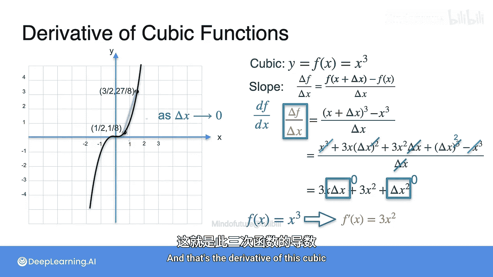

# 【Deeplearning】吴恩达：机器学习和数据科学微积分2 ｜ Machine Learning Calculus p10 P10_常见导数-高次多项式_01_01_13 -BV19M6LBeEkZ_p10-

So now that you know line some quadratics， let's go to cubics。

 the simplest cubic is the function y equals x cubed seen over here。

And here are some of the slopes of the tangents。Again， the formula is very similar one before。

 it's x plus delta x cubed minus x cubed divided by delta x， and then as delta x goes to0。

 then this value becomes the slope of the tangent line or the derivative。

So let's do a small example where x is equal to 0。5 when x is 0。5。

 then y is 18 because 1 half cubed is 18， so let's take some intervals and calculate the slope of the secant lines。

If deelta x is 1， then we have the 03/s， which is 1/2 plus 1 and 27 over 8。

 y27 over 8 because 1 half+ 1 cubed is 27 over 8， so we subtract 1/ half cubed and we get 3。25。

And the slope of this。Second line is going to be 3。25 divided by 1， so that's 3。25。

Now let's decrease the interval to length12 and do the same calculation。

So x plus delta x cubed is 1/2 plus 12 cubed， which is 1 minus a half cubed， which is 18。

 so we have 78s which is 0。86， and the slope is 0。86 divided by a2。Which is precisely 1。75。

Now let's go even smaller， let's go for one quarter。And I'll do the calculations quickly。

 but I invite you to do them on pen and paper if you'd like。Delta f here is 0。3 and delta。

 the slope is 1。188 for 18， then delta f is 0。12， and the slope is 0。12 divided by 18， which is 0。95。

For 116th， we have a slope of 0。85。For 101000， we have a slope of 0。752。

And as you see these values tend to conversege to 0。75 and that's actually the value F prime of 0。

5 is 0。75 that's actually 3 times 0。5 squared because the derivative of x cubed is actually 3 x squared。

But let's actually calculate it formally to see that this is the case。

So Delta f over deelta x is going to be x plus delta x cubed。

Minus x cubed as a change in y direction in the vertical direction divided by delta x。

 which is change in the horizontal direction Now expanding a cube is a little harder than expanding a square。

 but this is what you get。And if you cancel out the x cubed， if you divide。Top and bottom by Delta X。

Then you get 3 x delta x plus 3 x squared plus deelta x squared。

Now as delta x goes to0 what happens with 3x delta x plus 3x squared plus delta x squared well anything that has a delta x becomes 0。

 so the only thing that stays put is the 3x squared and that's the derivative。

 so if f of x equals x cubed， then f prime of x equals 3 x squared。

And that's the derivative of this cubic。

