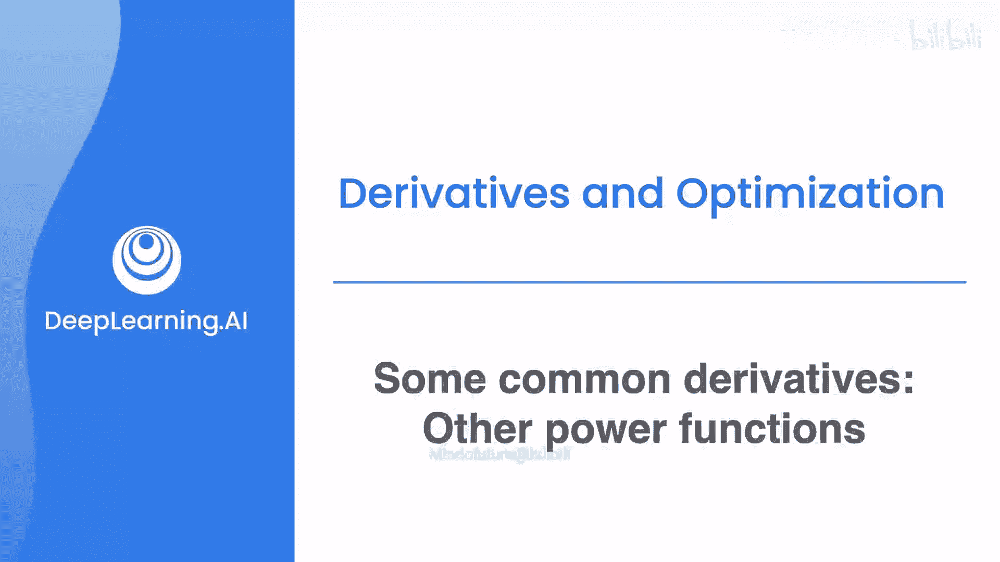
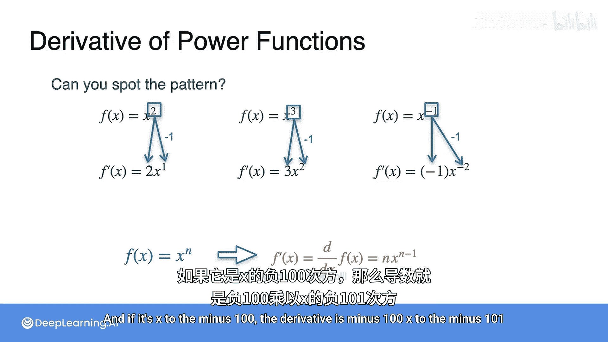

# 【Deeplearning】吴恩达：机器学习和数据科学微积分2 ｜ Machine Learning Calculus p11 P11_常见导数-其他幂函数_01_01_14 -BV19M6LBeEkZ_p11-

So now that you know lines and some polynomials， let's look at a complicated one，1 over x。

 this is a hyperbola that looks like this。And let's take a look at some of the tangent lines。

 the function looks more complicated， but actually the calculation is quite simple for the calculation one will do x plus delta x imverse minus x imverse divided by delta x。

 so let's look at the point x equals 1 and y equals 1。And let's take some interval just like before。

 so if the interval is of length 1 horizontally， delta x equals 1， then what is Delta f？

Well delta f is going to be the change in the vertical direction。

 so x plus delta x inverse minus x inverse for x equals 1， that means it's 12 minus1。

And that's minus 0。5， and so the slope is minus 0。5 divided by 1。

Which means that the slope here is minus 0。5。Now let's decrease the length of the interval。

 let's make it so that delta x is12。If Delta x is 12， then what's Delta f？

It's one plus1 half emverse minus1 emverse。Which is two3， minus1， which is minus a third。

And Delta x is simply going to be。1 half， so the slope is 0。33 divided by 0。5， which is minus 0。

67 or minus23。Now let's do some more and again I'll go a little fast with the calculations for1 quarter the slope is minus0。

8， for 18 is minus0。89， for 116th is minus0。94 and for 100，000 it's minus 0。

999 so as you can see this converges to minus1 and so the derivative here is negative 1。

This is negative 1 times1 squared， which is actually the value。Because when f of x equals x inverse。

 then the derivative is minus1 x to the minus2。Let's actually do the calculation to confirm this。

 so Delta f over Delta X。It's going to be x plus delta x inverse minus x inverse divided by deelta x。

So let's actually write this as 1 over x plus delta x minus1 over x over delta x。

 and let's expand the one on the top as x minus delta x plus x divided by x plus delta x times x。

 and some cancel out， this plus x and this minus x cancel out。

We can multiply and divide by delta x and we get minus1 over x squared plus delta x。

 and now as delta x goes to0， well the one on top stays put， the x squared stays put。

 but this goes to0， so therefore we have1 minus1 over x squared， so if f of x equals x inverse。

 then f prime of x equals minus1 times x to the minus2。

So let's take a look at what we've learned so far， the derivative of x squared x cubed and x inverse we've already calculated the first one is 2 x to the 1。

 the second one is 3 x squared。And the third one is minus 1 x to the minus2。

Now can you spot a pattern， these three actually follow a really nice pattern。

And that works for any power function， so take a look at the exponent。

The exponent goes here in the derivative。As a multiplication factor。

 and then you subtract one from the exponent and you get the new exponent。

 so x squared becomes 2 S to the minus1。X cube becomes 3 x squared。An x inverse。

 so x to the minus1 becomes minus1 x to the minus2。

 So what do you think happens with x to the n well with x to the n。

 the exponent of n comes down and it becomes n。X to the new exponent is n -1。 So n x to the n -1。

 So if you have。Any power function， for example， x to the 100， the derivative is 100 x to the 99。

And if it's x to the minus 100， the derivative is minus 100 x to the minus 1 and1。

