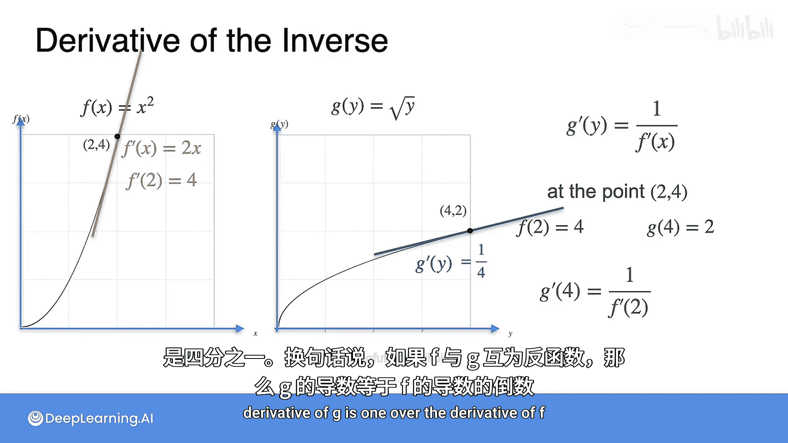

# 【Deeplearning】吴恩达：机器学习和数据科学微积分2 ｜ Machine Learning Calculus p12 P12_反函数及其导数_01_01_15 -BV19M6LBeEkZ_p12-

So now that you learn the derivatives of several functions。

 here's an important concept that's going to help you find the derivative of more functions。

 it's the concept of the inverse function。Now， what is an inverse function， Well。

 if your function does a certain thing， then the inverse function is the one that undoes that thing。

 So for example。If the function F sends the number three to the number five。

 then the inverse function sends the number five back to the number three。

And now you're going to learn that if you know the derivative function F。

 then the derivative of the inverse function is actually very easy to calculate because they are very well connected。

😊，So the mental image I have of an inverse function is the following let's say that you have a person and the function F does something to the person it puts a hat on them What would the function G have to do if it's the numbersverse well it would just remove the hat so that you get the original person back in other words。

The inverse does the opposite of what F does， so it undoes what F does。

In a more mathematical example， let's say you have the variable x and F puts on a hat on it。

 so it squares it， let's see。So what would G have to do well undo the square so remove the hat G is a function that takes us input X squared and returns x before we get to see what f and G are。

 let's take a look at some notation so if g of x and f x are inverses we write this as g of x equals f inverse of x with an exponent of minus1 but this is not one over f of x。

 this is purely notation。And if you take x and apply F and then apply G。

 you get back the x you started with， so basically G undoes what F does。

So what are f and g on the example in the left， while F is easy， it's simply x squared。

And G is the function that undoes a square， so it's basically square root of x。

 and the reason is that if you take x and square it and then take the square root， you get back x。

And this is only for x positive numbers， and also we're only taking the positive square root。

 not the negative， but in short， if F does something， G has to undo it to get your first input back。

Now the derivatives of mverse are really nice， let's take a look at the plot of x squared and now the plot of G of y equals square root of y。

Notice that in this plot， the units are different in the left on the right。

And also in the plot in the left， the horizontal axis is x， and in the plot on the right。

 the horizontal axis is y。But in short， if a point with coordinates aB appears on the left。

 then the point with coordinates BA appears on the right。

 so for example on the left we have the point a half a quarter on the right we have the point a quarter a half and this is because a quarter is the square of half and a half is the square root of a quarter。

So the point basically f12 is equal to one quarter and g of one quarter is equal to12。The 0。

11 also appears on both because f of 1 is 1 as one squared is 1 and g of 1 is 1 because the square root of 1 is 1。

The03 hs 94 also appears on the left and the 0943/ halves appears on the right and similarly0 square root of 33 appears on the left and the03 square root of 3 appears on the right。

Now I wanted to take a careful look at the tangents over these points in the left plot and in the right plot。

And let's question yourselves。Do you think there's a connection between the slopes on the tangents on the left and the slopes on the tangents up the right？

Well， consider that the plot on the right is the reflection of the plot on the left over the diagonal y equals x。

 so there's got to be a really nice connection between these slopes。Let's take， for example， a sec。

 before we draw tangents， let's draw a sec， so let's take the 011 which is on both plots and let's take the 0 1。

52。25 on the lab because 2。25 is the square of 1。5。And the  point 2。25， 1。5 on the right。

So let's calculate the slope of the C and line。😊，On the left， it's Delta f divided by Delta X。

 so the change in the vertical coordinate divided by the change in the horizontal coordinate。

And on the right， this is going to be Delta G over deelta y。

 where deelta G is the change in the vertical coordinate and Dlta y is the change in the horizontal coordinate。

However， these plots are a reflection of the other。

 so therefore any horizontal distance on the left is equal to the vertical distance on the right and vice versa in other words。

This deelta G is the same as this deelta x， and this delta y is the same as this delta f。

 so therefore the slope delta G over delta y is the same as deta x over deelta f。

Now notice that as deltas go to 0， f primeus f is delta f over deelta x。

And equally as delta y goes to 0， then g prime of y is delta G over delta y。

 so putting this together， we get the G prime of y is 1 over f prime of x。And this looks complicated。

 but it only says that if f and G are inverse functions。

 then the derivative of G is1 over the derivative of f。

 so let's look at a simple example and this time we have two plots of x squared and square root of y where the actual。

Units are going to be the same on the left and on the right， so each square is one by one。

So let's look at the tangents， so at the 0。11 we have that f of1 is 1 and G of1 is 1， so the 0。

11 appears on both plots。Now take a look at the tangent on the left。

 since f prime of x is 2 x because the derivative of x squared， then f prime 1 is 2。

 which means that this orange line has a slope of 2。Now let's take a look at the slope on the right。

 the tangent。G prime of y is what we want to find， we want to find the slope of that tangent。Well。

 since g prime of 1 is 1 over f prime of 1， then this is1 over2， which is a half。

 therefore a half is the slope of the tangent on the right。

 so it makes sense right if the slope of the tangent on the left the orange one is2。

Then the slope of the tangent on the right is1 half the reciprocal of2。Now let's do another example。

 the 0。24。So on the left， we have the 0。24 and on the right we have the 0。

42 because f of 2 is 4 and g of 4 is 2。Now the slope on the left， well。

 since the derivative f prime of x is 2 x， then f prime of 2 is 4， which is 2 times 2。

 so what do you think this slope is going to be？That's probably going to be one quarter， right。

 because it's one divided by the slope on the left。

And indeed it is because g prime of 4 is 1 over f prime of 2 and that's1 quarter， so in other words。

 if f and G are inverse functions， then the derivative of G is1 over the derivative of f。

