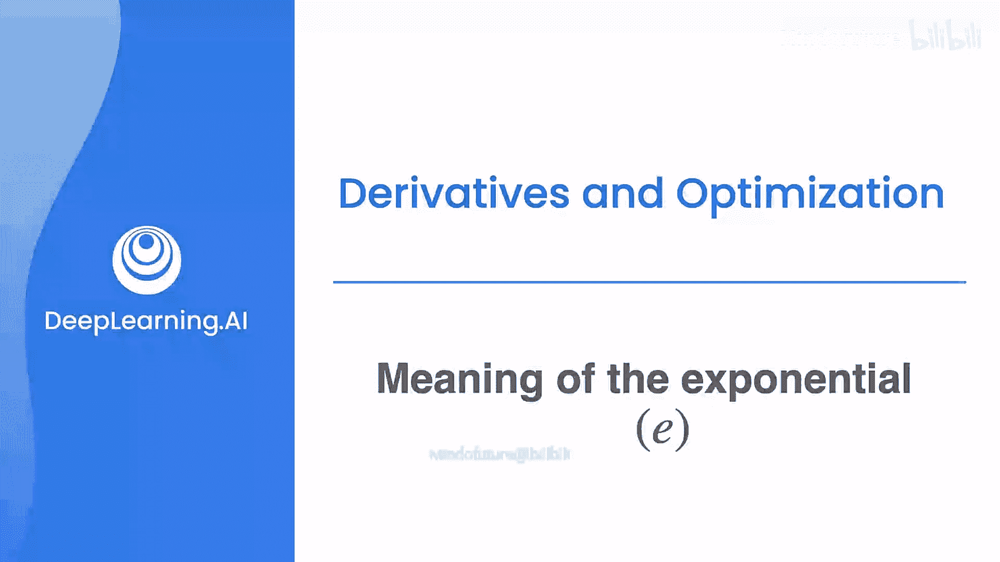
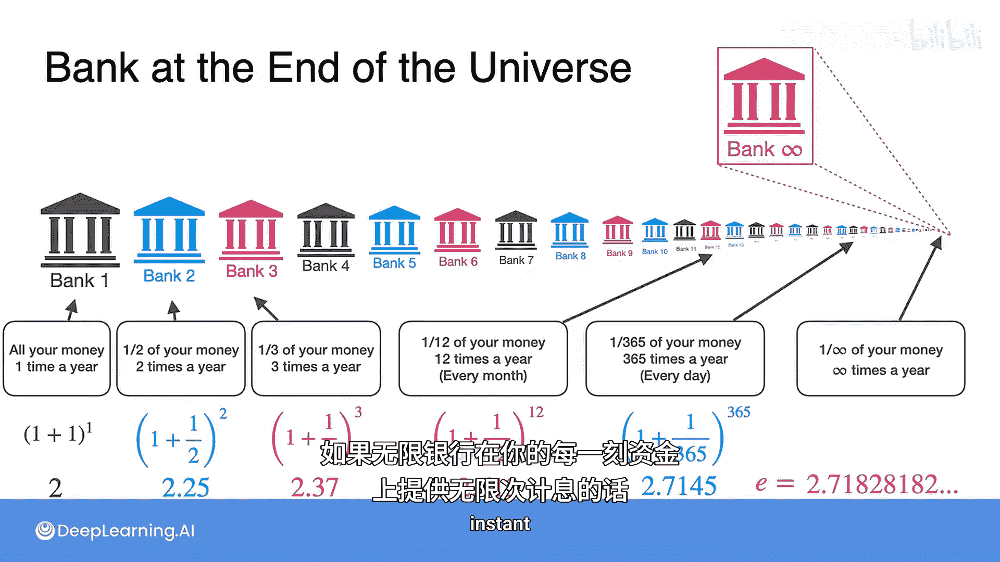

# 【Deeplearning】吴恩达：机器学习和数据科学微积分2 ｜ Machine Learning Calculus p14 P14_指数e的含义_01_01_17 -BV19M6LBeEkZ_p14-

So let's set our eyes in a very important function。

 the exponential function and for this we need to define Ouler's number Euler's number is quite a special number in mathematics。

 it appears in many many branches， and it can be defined in many ways。

 one of the is by the numerical value 2。71828182 etc。

 the decimal never terminates because the number is irrational which means it cannot be expressed as a ratio between two integers。

Another way to define it is using the expression 1 plus 1 n to the n。

 let's look at this expression for several values of n。For one， it's 1 plus1 over1 to the 1。

 which is 2 for 10 is 1 plus a 10th to the 10， which is 2。594， for 100 is 2。705 for 1000 is 2。717。

 and as you notice， the more we increase and the more these converges to a certain number。

 the actual number that this gets closer and closer is E2。71828182 etc。

So that's how we're going to define the number E。And e has a very particular property if you consider the function f of x equals e to the x。

 that function is its own derivative， so the derivative of f of x is also f of x。

And that particular property makes sure that it appears in many， many， many places in science。

 statistics， probability， etc。Now， the way I like to define E is using interest rates。So。

Let's look at the following problem， let's say that you're trying to find the best bank where to put your money。

So Bank1 says the following。Bank1 says I'm not going to give you any money for a year。

 but after a year， I will give you a interest 100% of your money。

 that means all your money once a year means if you put in $5 today in a year they give you another$5。

So that's pretty good， but you continue looking， let's go to bank number two， Bank number two says。

 well， I'm going to give you。50% of your money every six months。

 So if you put in $10 dollars today in six months， you're going to have $15。

Because Bank2 gives you half of your money twice a year。And bank3 is slightly different。

 This one says I'm going to give you one third of your money three times a year。

 so 33% every four months。 So in summary Bank one gives you all your money once a year。

 Bank 2 gives you half free money twice a year and bank 3 gives you a third of your money。

Three times a year the question is which bank is better。

 so let's have take five seconds for you to figure out and if you need more time feel free to positive video and think about it。

 this is a very important problem。So the answer is that bank 3 is the best bank of the three。Why？

Well let's say you have $1 so bank one after a year gives you another one so you end up with $2 Now the question is what are you going to end up with in bank2 and what are you going to end up with in bank3 in other words。

 what's the percentage that you end up getting in a year in bank two and bank3 so let's take a look。

Bank1。You have $1 now。And in a year， you're going to have your dollar plus the extra dollar that bank1 gives you of interest。

 That's $2。 We can express the two as  one plus one to the one。 that's going to be important later。

In bank two now you have $1。And in six months， you have a dollar plus a half。And in one year。

You're going to have。8 dollar。Plus a half， plus a half of that。

So in six months you end up with  one plus a half， which is 1。5， and in one year you end up with 2。

25， which is 1 plus a half squared， this is because you're adding half of your money。

 which means you're multiplying it by one plus1 half every time。And 2。25 is bigger than2 because。

Your dollar got doubled， but this amount of money that you earned actually earned more money later。

 so this is called accrued interest， the money that gains interest and then that interest gains interest and that's why you did better with Bank2 than with Bank 1。

Now let's take a look at Bank 3， so in Bank3 you start with a dollar right now in four months you have a dollar plus a third。

 which is 1。33。In eight months you have your one and a third plus a third of that， and that's 1。77。

 and in one year you have 1。77 plus a third of that， which is 2。37。And again。

 you did well because this interest over here accrued interest and accrued more interest。

 and this interest over here accrued more interest so your money is making more money。

At the beginning of the year you had $1， then you had one plus a third。

 then you had one plus a third squared， and then you had one plus a third cube。And that becomes 237。

 so in short。In Bank one after one year you have $2 in Bank  two after one year you have 2。

25 and in Bank 3 after one year you have 2。37。That's why the money is better in Bank 3。

And this money actually multiplies a lot， take a look at what happens in Bank one after four years。

 you're going to end up with $16 in Bank2 after four years， you're going to end up with more money。

 you're going to end up with $25。63。And in Bank 3， you're going to end up with quite a lot of money。

 you're going to end up with $31。57， so definitely bank 3 is much much better than bank 1 and bank 2。

And again， let's recall that after one year in bank one， you get one plus one to the one。Bank 2。

 you get one plus a half to the two and in bank 3， you get one plus a third to the three。

 and this is super important。Now， could you imagine a better bank than these three？

Well of course the more subdivisions you have the better let's look at Bank 12 Bank 12 gives you 112 of your money every month。

 so you start with $1 now in a month you have 1 plus 112 in two months 1 plus 112 squared and so on until in 12 months you have 1 plus 112 to the 12 and that's 2。

61 so you did much better。So in general， Bank N would have n subdivisions it subdvisized the year into n intervals and。

Every time it gives you one end of your money so you start with one on the first day and after the first interval。

 one plus one over n after the second interval 1 plus1 over n is squared and if this is not super clear。

 let me elaborate1 plus1 over n is the money you have and you add an end of that so you have one plus1 over n plus1 over n1 plus1 n and that is the money you have plus the interest you accrue。

And that factor is one plus1 of n square。After three controls， you have one plus one around cubed。

After K intervals， you have one plus1 or n to the K and eventually after the end of the year。

 you have。1 plus one of n to the n， and n can be really large。

 so you could potentiallycc money every second or every millisecond。And in summary。

 Bank end does the following， it gives you one plus one over n to the end of the end of the year because it returns one end of your money n times a year。

So now imagine that you go around looking for banks， there's Bank one。There's bank 2。There's Bank 3。

Bank 4 gives you a quarter of your money， four times a year。 Bank5 gives you a5 of your money。

 five times a year， and so on until the end of the years。 So here's Bank 12。 that gives you one。

12 of your money every month， heres bank 365 that gives you 1365th of your money every day。

And what's at the very， very， very end of the years， what is this bank well？This bank。

 let's call it bank infinity and what bank infinity does。Iす。😊。

It pretty much gives you instant interest， One infinity of your money， infinity times a year。

 So let's see how much money bank infinity would give you at the end of the year。

So Bank 1 ends up with one plus  one to the one。B two with one plus1 half to this two。

One3 is by3 is 1 plus 13 to the three。Pnk 12 is 1% 12 to the 12。

Bank 365 is 1 plus1 over 365 to the 365， which already is 2。7145。And bank infinity gives you， well。

 this is not a good mathematical expression 1 plus one over infinity to the infinity。

 but it's basically the number。That all these numbers converge to 2。25，2。37，2。613，2。7145， etca。

 et cea， cetera， gets closer and closer and closer to a particular number， and that number is 2。

71828182 or the number E So E is the amount of money that you get at the end of the year in bank infinity if bank infinity gives you an infinite test all of your money every single instant。

And that is one way to look at the number E。