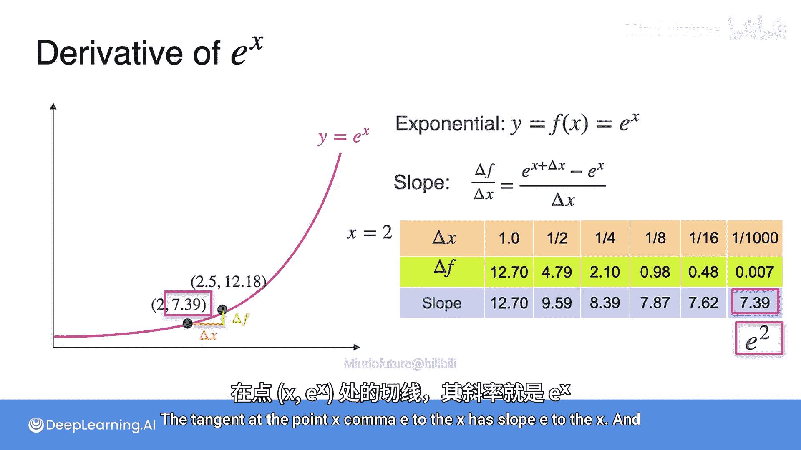

# 【Deeplearning】吴恩达：机器学习和数据科学微积分2 ｜ Machine Learning Calculus p15 P15_e^x的导数_01_01_18 -BV19M6LBeEkZ_p15-

In the previous video you learn something very interesting。

 the Euler number E and one very important property of the number E is that if you take the function y equals e to the x。

 this called the exponential function and this function is its own derivative in other words。

 if you take a point x， then the point in the graph is the point x comma e to the x for inference that that height is e to the x。

 Well， if you take the tangent at that point， the slope of that tangent is actually e to the x。

So e to the x is equal to its own slope。Now let's verify this numerically by taking some measurements。

 So here is y equals e to the x again， and we're going to calculate the slope of some sec lines in the same way that you've done it before。

 Let's take， for example， the number x equals 2。So the point in the graph is 2 comma 7。39 because 7。

39 is e squared。Now let's take some intervals and calculate the slopes of these sequences。

So for example， if we move to the right one unit， then deelta x is1 and Delta f is just going to be e to the3 minus e to the2。

And that's。Exactly 12。7， so the slope is 12。7， divided by 1 which is 12。7。

Now let's reduce the interval to length12。The delelta f is now 4。79 because it's e to the 2 plus 0。

5 minus e to the 2。And Delta x is 12， so the slope is 4。79 divided by a half， which is 9。59。

If we do it for a quarter， then deelta f is 2。1 and the slope is 8。39。You do it for an eighth。

 then the slope is going to be 7。87。For 116th， it's 7。62 for one over1000， it's going to be 7。39。

 and as you can see these numbers approach， a particular number。

 the number that it approaches is actually e squared 7。39。

And so here it verify numerically that the slope of the tangent line at the point2 e squared is precisely e squared。

 and this is what happens at every point。The tangent at the point x comma e to the x has slope e to the x。

 and that's a fascinating property of the function e to the x。

