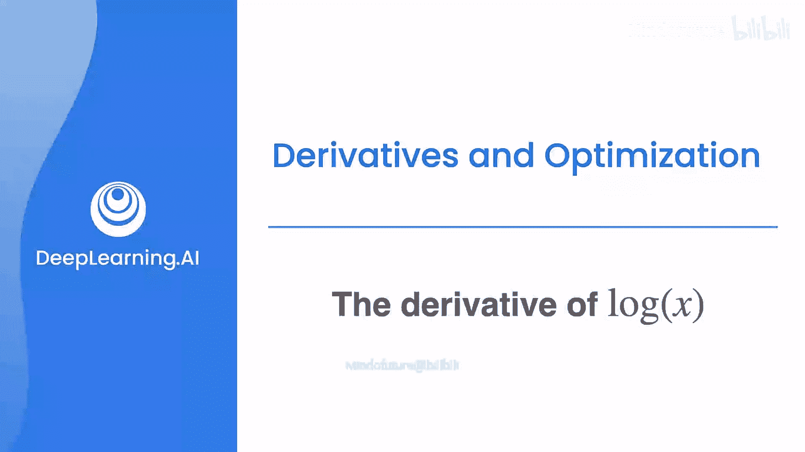
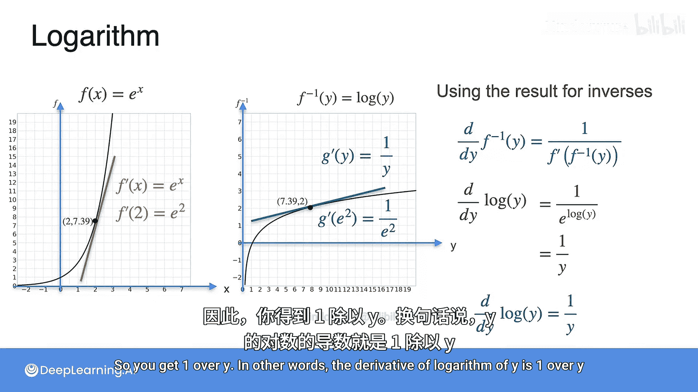

# 【Deeplearning】吴恩达：机器学习和数据科学微积分2 ｜ Machine Learning Calculus p16 P16_log_x的导数_01_01_19 -BV19M6LBeEkZ_p16-

In the previous video， you learn the exponential function e to the x where E is the Euler number。

And you learn the property that it has， which is that the derivative v to the x is e to the x。

In this video， you're going to use that and the inverse function rule in order to calculate the derivative of the logarithmic function。

 and you're going to see that it's actually very simple。😊，But before we get to derivatives。

 let's look at what's a logarithm， imagine that you want to find a number such that e to the that number equals 3 that number is precisely the logarithm of 3 and that actually works for any number X if I want to find the number such that e raiseds the that number is x。

 that number is logarithm of x we also call it the natural logarithm you may see in other places logariths in other basis such as 2 or 10。

 but in this course is always going to be based E or the natural logarithm。Now。

 the fact that e to a logarithm of x is x means that the function f of x equals e to the x has an inverse。

Which is logarithm of y F inverse of y is a logarithm of y。

 because e to the logarithm of x is x and logarithm of E to the y is y。Now let's plot them。

On the left we have the plot of e to the x， and on the right we have the plot of logarithm of y。

 so as usual， the left plot has as a horizontal axis x， and the right plot has a horizontal axis y。

And let's look at some points in the plot in the left and their corresponding points in the plot in the right。

 And these correspond to each other because recall that the fact that these functions are inverses means that if we reflect one about the。

Lying with equation y equals x， we get the other one because logar at thanom of x is the inverse of E to the x。

And now let's take a look at the derivatives。So we're going to use the results for inverses in order to calculate the derivative of logarithm of x and you're going to see that's actually very simple。

So let's take one point， for example， on the left we have two comms 7。89， recall that 7。

89 is e squared。That means that on the planda right， we're going to have the 0。7。89 comma 2。

 which is e squared comma 2。The derivative of this tangent。

 the slope of this tangent is the one we're going to find and we're going to use this one over here。

 so recall that the slope on the right is one over the slope on the left。

 that's what we're going to use。The slope on the left is f prime of x equals e to the x。

 That's the derivative because recall that the derivative v to the x is e to the x。 So therefore。

 because x is 2， the slope here is f prime of 2 which is E to the2 or e squared That's precisely 7。

89。 So the height at 2 is 7。89 and the slope at the tangent at 2 is also 7。

89 So now what's the slope on the graph in the right well。Because it's the reciprocal of e squared。

 then it's 1 over e squared， so this tangent on the line on the right， the slope is1 over e squared。

And notice that e squared is y。 So therefore， G prime of y is simply one over y。 Therefore。

 the derivative of logarithm is。1 over y。Let's do this mathematically。

 so using the result frame versus d over dy of f inverse of y is 1 or f prime of x。

 Now x is f inverse of y， so let's actually write it like this。

So if you take the logarithm function and you take the derivative with respect to y。

 then you get one over。F prime of F the inverse of y now f prime is e to the x and F inverse of y is logarithm of y。

 so you get1 over y。 In other words， the derivative of logarithm of y is 1 over y。

