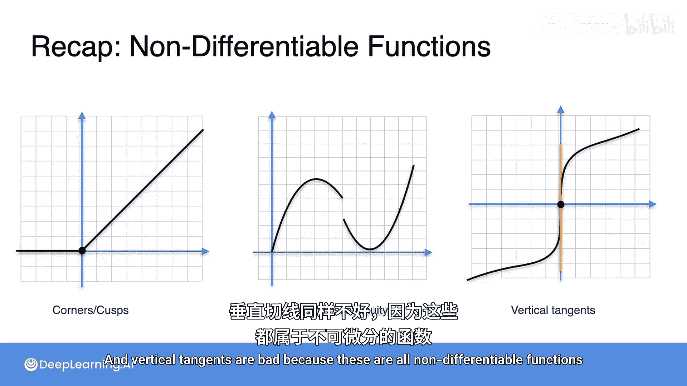

# 【Deeplearning】吴恩达：机器学习和数据科学微积分2 ｜ Machine Learning Calculus p17 P17_导数的存在性_01_01_20 -BV19M6LBeEkZ_p17-

In the previous videos you learned about some common functions and their derivatives， however。

 it's not always the case that you can find the derivative of a function at every point。

For these functions where you cannot find the derivative at every point are called non differentiable functions。

So in this video， I'm going to show you several non differential functions and how they can be identified visually。

So far you've learned that to find the derivative of a function at a point you draw a tangent line to the point on that line and find the slope to the tangent。

 so for example， at this point over here you would say that a function is differential at a point if the derivative exists for that point that means if you can draw a unique tangent to the curve at that point so for this curve for any point you pick you can draw a tangent and it's well defined。

And we also say that for a function to be differential at an entire interval。

 then the derivative has to exist for every single point in that interval。However。

 some functions don't satisfy this property， we call them non differentiable functions。

 let's take a look at1， for example， the function absolute value of x。

 what's the absolute value of x， well it's kind of a positive part of x so absolute value of 7 is 7。

 but the absolute value of negative 7 is 7。Can be defined like this。

 It's x for x because unable equal to 0 and negative x for x less than 0。

 So this function is differential almost everywhere， except for this point in the origin。

 because if you try to draw a tangent， Well it's not very well defined， all of this would work。

And it's not a well defined tangent。 So we say that at x equals 0， the derivative does not exist。

And this always happens when a function has a corner or a cusp， if that's the case。

 the function is not differentiable at that point。That means if you're drawing it with a pencil and at some point you have to stop and draw a corner。

 then you have a function that's not differentiable at that point。So here is a quiz。

 if I give you this function， can you tell me at which point is this function not differentiable。

 so at which which point does the derivative not exist。

And so if you said that derivative does not exist at x equals 1， then you were correct。

 because here we can draw multiple lines and neither one of them is well defined as the derivative at that point。

 so we say that the entire function is not differentiable because a derivative does not exist for every single point in the domain。

Now consider this function。The function is defined as2 for anything smaller than negative 1。

 and for anything bigger than negative 1 is this diagonal here defined by ys x plus 1。

So at which point in this function does the derivative not exist？

This is a step function or a piecewise function。 It has a jump discontinuity at x equals minus1。

Over here， as I mentioned， is defined as y equals 2 and over here is y equals x plus 1。

So we say that at the point minus-1 there is a jump discontinuity。

 If you try to draw this function with a pencil， what's going to happen is that you have to at some point lift the pencil and start drawing it somewhere else。

 so the function is not continuous and a function that is not continuous that has a jump like this is not differentiable because the derivative cannot be defined at this point。

 what line could you draw here that was the tangent that is not well defined So in general any function that has a discontinuity is not differentiable at that point。

And now let's do one more。This one is a little more subtle。

Let's say we have the function f of x equals x to the1 third。

It looks to be differential at every point， but what happens at the origin。

 the tangent is parallel to the vertical axis， it's a vertical tangent。

 and that is not good at x equal0 this has a tangent line that runs straight up to the y axis and that means it's not differentiable y well because a vertical line doesn't have a welldefined slope。

 it would be some number over0 because the rise is any number but the run is0。

 so it's not well definedfin one could say it's infinity or say it's undefined but the fact is that a function with a vertical tangent is not differentiable。

So as a small reup， there are three types of not differentiable functions。

Anything with a co per corner？Anything with a jump discontinuity and anything with a vertical tangent。

 So corners cus are bad， jump discontinuities are bad and vertical tangents are bad because these are all non differentialiable functions。

