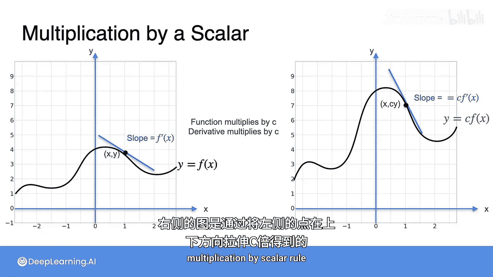

# 【Deeplearning】吴恩达：机器学习和数据科学微积分2 ｜ Machine Learning Calculus p18 P18_导数性质-与标量乘法_01_01_21 -BV19M6LBeEkZ_p18-

So far， you've learned derivatives of some simple functions in order to find the derivatives of more complicated functions。

 what you have to use is certain rules in order to piggy back from these simple ones into more complicated calculations。

The rules you're going to learn next are multiplication by scrs， some rule， product rule。

 and the chain rule for compositions of functions。So the first rule is multiplication by scals。

 let's say you have a function F and it's four times a function G if you want to take the derivative of f that means it's just going to be 4 times the derivative of G and that works for every value of4 so if there's actually a constant C can be any constant then if f is equal to c times G then f prime is equal to c times G prime let's take a look at why this happens。

So consider the function y equals x squared drawn over here， and let's take twice that function。

 so2 x squared。Therefore， the function gets multiplied by two。

So let's look at some points on the left， you have the 0。11 and the 0。24 because2 squared is4。

And so the slope of this second line， well it's rise over run， where the run is1。

 which is 2 minus1 and the rise is 3 because that's 4 minus1。

 so this slope is three over one which is3。 Now let's look at the corresponding points in the function in the right。

 which as we said it's double the function in the left。

The point corresponding to 11 is 12 and the point corresponding to 24 is 28 and let's calculate the slope well the run is the same as the run in the previous one which is 2 minus1 equals 1。

 but the rise is double the previous one because in the plot on the right everything gets doubled in the vertical direction。

So the 4 minus1 equals 3 on the left， which is the rise， becomes an 8 minus2 equals 6 on the right。

 and so the slope multiplies by 2 because the numerator multis by 2 and the denominator stay the same therefore if the function multiplies by 2。

 all these slopes get multiplied by 2 now if you take the limit if you let the point on the right move towards the point in the left。

You still have that all the slopes multiply by  two。

 therefore the derivative or the slope of the tangent， which over here is two as we saw before。

Now becomes four。In other words， if we take a function and multiplied by 2。

 the derivative gets multiplied by 2， and this happens for every value， so for example。

 if we have a function like this and we multiply it by c which means the height and the right is c times the height on the left at every point then the derivative gets multiplied by c so if we have a point over here x comma y with slope f prime of x for the tangent line。

On the right， the point corresponding to that is going to be x cy。

 and the slope is going to be c times f prime of x， because if you think about it。

 the plot in the right is obtained from the point left by basically putting your hands on top and bottom and stretching it by a factor of c。

So that is the multiplication by scalar rule。

