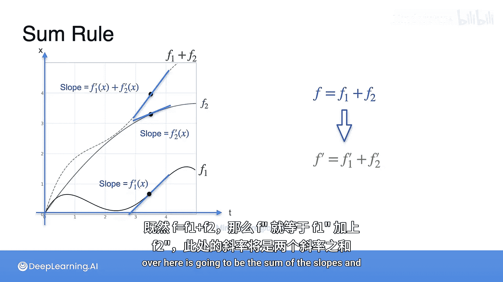

# 【Deeplearning】吴恩达：机器学习和数据科学微积分2 ｜ Machine Learning Calculus p19 P19_导数性质-求和法则_01_01_22 -BV19M6LBeEkZ_p19-

So now you know the scalar multiplication rule， the sum rule is just a symbol。

 imagine that you have a function F and it expresses the sum of two functions G and H。

 so what is the derivative of F well it's simply the derivative G plus the derivative of H。

I' like to imagine the summer rule in the following way。

 imagine that there's a boat and there's a kid inside the boat and the boat moves and the child also runs inside the boat so the boat moves a distance。

 let's say of 10 and the child moves a distance of2。

And we're going to keep track with variables Xb for the distance that the boat moves and Xc for the distance that the child moves。

 so if they're moving in the same direction， what is the distance that the child moves with respect to the Earth？

Well， that distance is 12 because it's 10 plus 2。It's the distance that the boat moves plus the distance that the child moves inside the boat。

Now that's with distances， but what happens with velocities， so let's do a quiz。

Let's say that the speed of the boat is 0。6 meters per second。

 and the speed of the child inside the boat is 0。05 meters per second。

 and they're both traveling in the same direction， so here is a question。

 what is the speed of the child with respect to the Earth？So if you answered 0。65 meters per second。

 then you are correct， because velocities can be added if they are taken in the same direction。

And that's pretty much the sum rule， it says if distances can be added。

 then velocities can also be added， means that if functions can be added。

 then their derivatives can be added。So lets look at it with the plot。

 here is a plot of time in the horizontal axis and distance in the vertical axis and this is how the child moves inside the boat。

 this is how the boat moves and this is the sum of the two which is how the child move with respect to the Earth。

So let's look at some slopes， here is some point in time and we're going to take some small interval delta t。

 and we're going to calculate the average velocity over that interval for the child。

For the boat and for the sum。 So for this。We take the horizontal step to be Delta T and the vertical step to be the distance。

So these distances are going to be xc for child， Xb for both and x total for the sum。

Now we know that x total is Xb plus X E， because these two distances add to x total。

So if we divide everything by the same delta T， we obtained that the velocity is add。

 so v total is equal to Vb for the boat plus Vc for the child。

And now all you need to do is let delta t go to0 and you get the derivatives。

 So if you have three functions， F1 F2 and F1 plus F2。

 the derivative of F1 at a point is F1 prime of x， the derivative of f2 at that same point x is f2 prime of x and what's the derivative of the sum。

 Well， since f is F1 plus F2。 then f prime is。F1 prime plus f2 prime and the slope over here is going to be the sum of the slopes and that's the sum rule。

