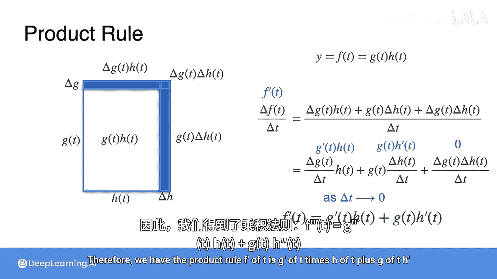

# 【Deeplearning】吴恩达：机器学习和数据科学微积分2 ｜ Machine Learning Calculus p20 P20_导数性质-乘法法则_01_01_23 -BV19M6LBeEkZ_p20-

So now that you've learned the sum rule， you're ready for the product rule。

 which is almost the same thing， except just a little bit more complicated。

Imagine that I have a function F and that's a product of functions GN H。

 so the question is what is the derivative of F with respect to the derivatives of G and H？

Well for this I like to imagine a derivative as hitting the function with a hammer so I want to hit F with a hammer and that means I need to hit G and H with a hammer but that's too much work so I have to do it by parts first I have to hit G with a hammer and leave H alone and then I have to hit H with a hammer and leave G alone in other words here's what happens。

F prime is like hitting F for the hammer。And if I hit only G with a hammer and leave H alone。

 I have G prime H， and if I hit H with a hammer and leave G alone， I have GH prime。

So the derivative of f is F prime equals GH prime plus G prime H。That is the product rule。

The way I like to imagine the product rule is by building a house。

 imagine that you're building a house and you have two groups of workers。

 one working on the front wall and one working on the side wall。And they work at different paces。

 so at a given time they will have different lengths of wall built。

G of T represents the length of the sidewall as a function of time。

 and h of T represents the length of the front wall as a function of time。

 so what is the resulting area of the house well it's the product of G of T and H of T so let's call that f of T F of T is the function of the area of a house with respect to time。

And now we want to find the derivative of F and we know the derivatives of G and H in other words。

We want the rate of change of the area with respect to time。So let's look at a house from the top。

Now what happens when the workers build a little bit ofwall， Delta G。

 and a little bit ofwall Delta H， that also builds a little bit over here on the top。

Now let's look at what these areas are。This area over here is going to be G of T times H of T。

The small area here， G of T times Delta h of T， this one here is Delta G of T times H of T。

 and this tiny one is deelta G of T times deelta h of T。Now the rate of change of the area。

With respect to time after some small time Delta T is going to be Delta f of T divided by deelta T。

What is Delta F of T， well， the change in area is this blue area over here。

 which is precisely the sum of the three blue rectangles。So on top。

 we have Delta G of T h of T plus G of T， Dlta h of T plus Delta G of T， Dlta h of T。

 and at the bottom we have Delta T。We can rewrite this in the following way。

 Dlta Gt over delta t times h of T plus deta ht over delta t times G of T plus delta G of T delta h of T divided by delta T。

 and now to take the derivative， we need to let deelta T go to 0。

So what happens with delta f of d over delta T？That becomes the derivative of F prime of D。

And each one of these becomes something interesting， this one becomes G prime of T of T。

This one becomes G of T h prime of T， and this one over here becomes0 because it's too tiny for us to care it really doesn't make a big difference because the limit of that is0 when delta t goes to 0。

Therefore， we have the product rule f prime of T is G prime of T times h of T plus G of T h prime of T。

