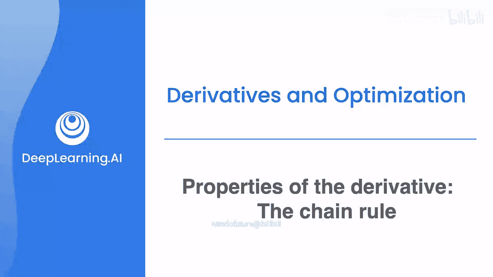
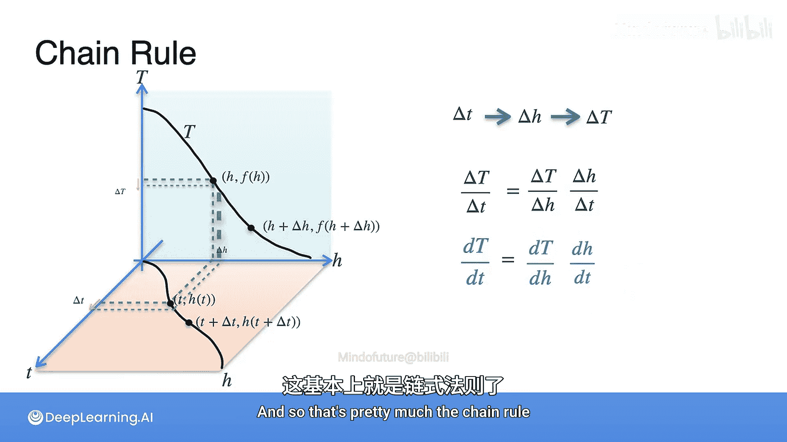

# 【Deeplearning】吴恩达：机器学习和数据科学微积分2 ｜ Machine Learning Calculus p21 P21_导数性质-链式法则_01_01_24 -BV19M6LBeEkZ_p21-

So now that you know the sum rule product rule and scalar rule， you are ready for the chain rule。

 it's probably the most complicated of these rules。

 but if you look at it from a certain angle it can be pretty simple。

Imagine that you have a function H of T and to the output of this function。

 you want to apply another function G ofT， so you have a composition of functions。

 and now you want to take the derivative of these composition of functions with respect to T。

So let's say you know T over dt， the derivative of h respect to T。

 and you also know the derivative of G with respect to H。

 so the derivative of the composition is simply the product of these two。

Now why is it called a chain rule because you continue composing functions。

 let's say you want to apply another function F to the output of G and you want to take this derivative。

 well you need to know the same derivative as before。

 in addition to Df over DG and the product is the desired derivative。And of course。

 as you can imagine， you can continue composing more and more functions and you're just going to get more terms in the product and that's the chain rule Now with the liveibness notation。

 the chain rule is pretty clear， but with the Larrange notation there's something to keep track of because it can be a little tricky Here it is again for two functions。

 Now what is the H over D T Larrange notation it's simply h prime of T。And what is D G over DH。

 well it would be lovely if it was G prime of T but it's not G prime of T。

 it's G prime of whatever you put into the function G， so it's G prime of H or T。

That's all you have to keep track of。 It's G prime times h prime。

 except that you have to put the correct input in the function。So what happens with three variables。

 well the same thing， D h over dt is h prime of d。The G over dH is G prime of the input to G which is h of T。

 and the f over d G is f prime of the input to F， which is G of H of T， so that is the chain。

So this is how I like to see Cha imagine that you're driving your car again and you feel adventurous so you're going to go up mounted。

 the base of the mountain is pretty hot but the top is pretty cold so as you drive up you notice that the temperature is changing with respect to height and the rate of changes d capital T over the H where capital T keeps track of temperature and H keeps track of height。

But also as time changes， you drive up the mountain。

 so therefore the height changes with respect to time and lowercase t keeps track of time。

 so the rate of change of height with respect to time is Dh over Dt。

Now notice that as time passes you drive up and as you drive up it gets colder， therefore。

 temperature also changes with respect to time and the rate of changes the T of the D lowercase D。

And what the chain rule says is that you can find the third one from the first and the second。

 so if you know the temperature over D height and the height over D time。

 then their product is the temperature over D time is pretty much what train rule says。

But let's look at a plot to understand this deeper。We're going to plot in three dimensions。

 one axis is going to be time， the other one height and the other one temperature。

So in the bottom plane， there is the function H which dictates how height changed with respect to temperature。

 and in this plane over here at the back， it's the function T that keeps track of how temperature keeps changing with respect to height。

Now。As time changes a small amount delta T， then height changes a small amount delta H。

 and then temperature changes a small amount delta T and the way to see it is like this。

 let's say you're at this point in time。So the bottom plot tells you that this point andine corresponds to this height and the top plot tells you that this height corresponds to this temperature。

And if you make a small change forwards in time， then now you're at a different time spot。

And that yields a higher altitude。And that higher altitude is changed by Delta H。

 a small amount of altitude。And that deelta H creates a small change deelta temperature。

Because now it gets colder because you drove up， and so Delta T implies Delta H implies deelta capital T。

Now these are numbers， these are very tiny numbers delta t delta H and delta capital T。

 so this expression holds delta T over delta lower case t is delta h over delta T times delta capital T over delta H again these are numbers so I can cancel deelta H on top and bottom。

But now as I let Delta t go to 0， delta H also goes to0 and deelta capital t goes to0。

 and so this number in the left becomes dt over dt。

This one over here becomes Dt over DH and this one over here becomes DH over Dt。

 and so that's pretty much the channel。

