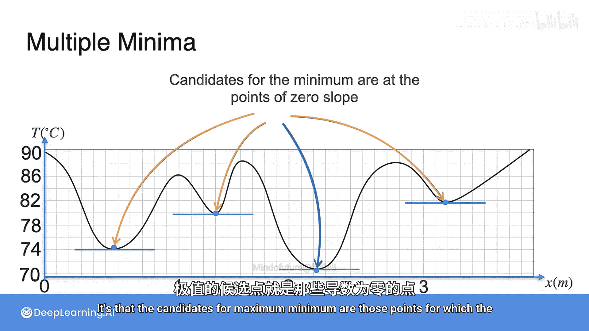

# 【Deeplearning】吴恩达：机器学习和数据科学微积分2 ｜ Machine Learning Calculus p22 P22_优化导论_01_03_01 -BV19M6LBeEkZ_p22-

So by now you have lots of tools to work with derivatives， but the question is。

 what are they useful for other than calculating rates of change？And more specifically。

 why are they useful in machine learning？Well， the main application here in machine learning of derivatives is that they are used for optimization optimization is when you want to find the maximum or the minimum value of a function。

😊，And this is very important in machine learning because in machine learning。

 you want to find a model that best fits your data set， and in order to find this model。

 what you do is you calculate an error function that tells you how far are you from an ideal model。

And when you are able to minimize this error function， then you have the best model。

 let me show you how。So consider the following example。

 imagine that you're sitting in a bench in a sauna and you start feeling too hot。

 so you're going to try to switch places to find the coldest spot on the bench。

 so with you you have a thermometer and it reads 85 degrees Celsius so you're going to try to move around and see where the temperature is colder。

So you try to lock by moving to the left and then the thermometer reads 90 degrees Celsiusius。

 so that's not good。 it got hotter， So you try moving in the other direction。

 and then the thermometer reads。80 degrees Celsius which is much better。

 so you continue moving the direction since the coldest spot seems to be in that direction。

 so you move move move always recording lower temperatures until you get to a point where in any direction that you move it gets hotter so you conclude that that must be the coldest spot in the sauna。

So now let's look at this curve and this curve represents the temperature at each point in the bench。

This was your initial point。This is the first try when you were trying to get colder。

 but instead got hotter。This is where you moved for the second try。And you continued moving。

Always finding a colder and colder spot。Until eventually。

 you reach this point over here where what you did which no matter which direction you moved。

 you would find a hotter place so you concluded that this must be the coldest place of the sauna。

Now this has to do with derivatives， let's look at the slope of the tangent at all these points。

Notice that for all the points where moving to the right led to a colder spot。

 the slopes are less than0。For the points where moving to the left leads to a colder spot。

The slope is bigger than  zero and for the coldest place。

 the one where no matter where you move you get hotter， the slope was 0。

 and that's a very interesting property of maximum and minimum points。

 the slope at those points is always0。Now it's not always true that a point with slope zero is a maximum or a minimum Take a look at this is a much more complicated sauna。

And the coldest spot is somewhere to the right of two。

 but there's a bunch of points where the derivative is0。

And unfortunately you you have to try them all and see which one is the actual called the spot。

 so these are all candidates， but at least you reduce it to a small number of points。

These candidates for the minimum are the points of zero slope， and those are called local minimum。

 and the absolute minimum is called the global minimum。So when you want to optimize a function。

 whether maximizing it or minimizing it， if the function is differentiable at every point。

 then you know one thing， it's that the candidates for maximum minimum are those points for which the derivative is0。

