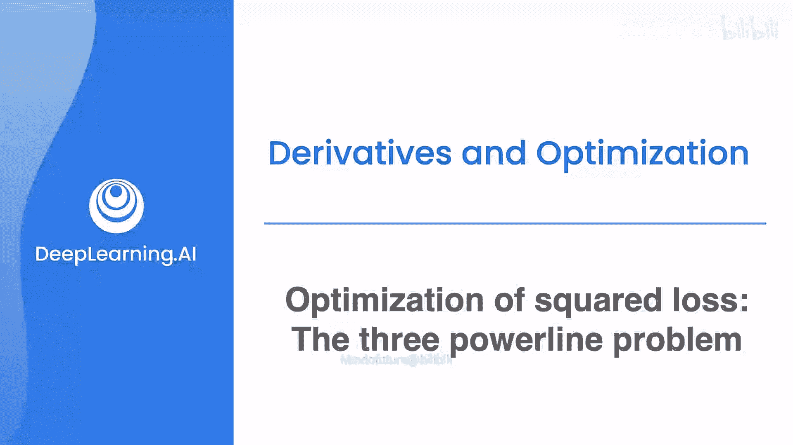
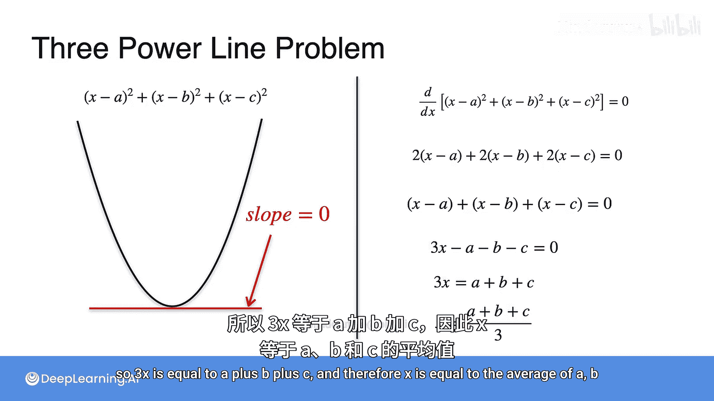
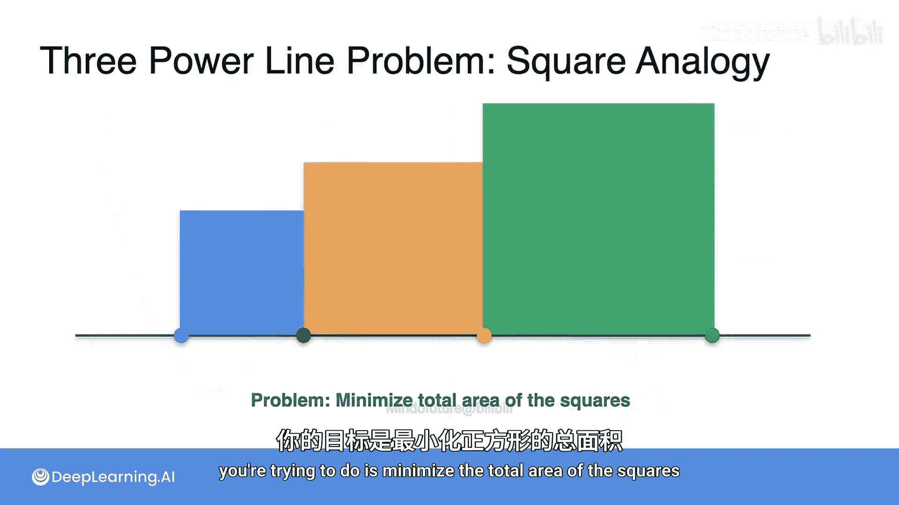
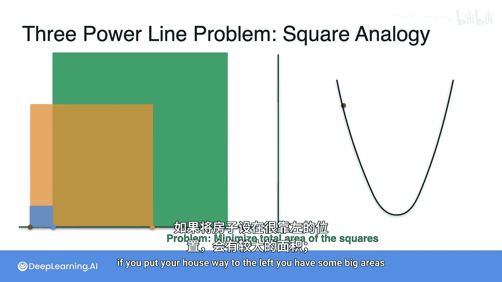
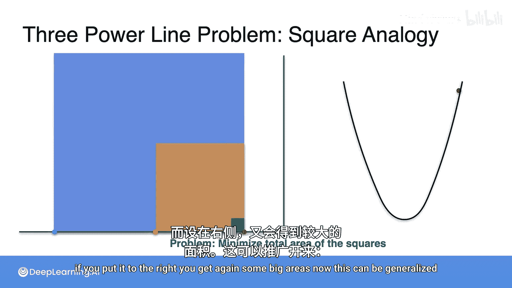
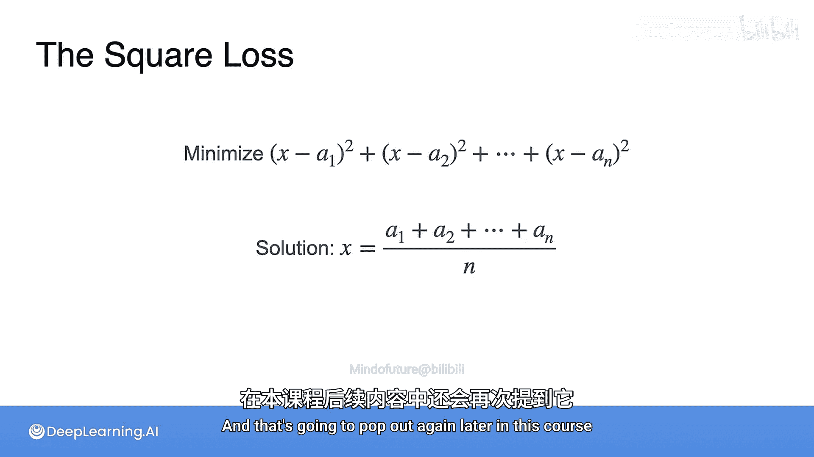

# 【Deeplearning】吴恩达：机器学习和数据科学微积分2 ｜ Machine Learning Calculus p25 P25_平方损失优化-三输电线问题_01_03_04 -BV19M6LBeEkZ_p25-

So now the problem gets harder because there are three power lines and the third one is at a distance C from the origin。

 so again the problem is where to locate the house to minimize the cost。

So recall that the distances to the power lines are x minus a for the first house。

B minus x for the second house and C minus x for the third house。 And again。

 we don't have to worry if it's x minus b or b minus x。

 if the house is to the right or to the left of power line， because when we square these numbers。

 we always get positive numbers。 If it's b minus x or x minus B is's still going be x minus b squared。

 So let's actually draw these as areas。 So this is x minus a squared The of this square over here。

 that's the cost of connecting to the first power line。

This one is the cost of connecting to the second power line x minus b squared。

 and this one is the cost of connecting to the third power line it' much more expensive because it's much farther than this x minus c squared。

And again， the goal is to minimize the cost of connecting to the power lines。

 and that's the same as minimizing the area。So I wanted to take a wild guess and tell me what do you think is the cost function of this whole problem that's in the next quiz。

If you said it's x minus a squared plus x minus b squared plus x minus c squared。

 then you are right because that is the cost function and that's the total area of the three squares so the question is where should we put the house to minimize the cost so now I'd like you to take a guess what do you think is the solution what do you think is the optimal x that will minimize this cost。

And so if you said that the solution is a plus b plus C over 3。

 so put the house in the average of the three coordinates of the power lines， then you were right。

 and now let me tell you why。So I like to see this geometrically in the following way。

Let's put a parabola over the blue power line and what does this problem mean well this is exactly the function x minus a is squared。

If you look at where the house is， the height in that parabola is the price of connecting to that power line because it's precisely the parabola x minus a squared。

Here we put the problembla x minus b squared on top of the orange power line and。

X minus c squared on top of the green power line， and the sum of these trees is parallelable over here。

 if you sum the heights of the three parabolas， you get the black parabola。

And the point is to find that minimum point in the black parala。

 the point where the slope of the tangent is0， and as you can see it hints to be the average of the three coordinates。

 but let's do some math just like before， in order to solve for that perfect X。And again。

 it's going to be the point where the slope of the tangent is zero。

So just some similar math time before， now we take the derivative of the cost function set that equal to zero。

 a derivative is this。And we can divide by2 and still get zero and reorganize this as 3 x minus a minus b minus c equals 0。

 so 3 x is equal to a plus v plus C， and therefore x is equal to the average of A， B， and C。

And so if you look at it from the area perspective。

 what you're trying to do is minimize the total area of the squares if you put your house way to the left。

 you have some B areas。

If you put your house somewhere in the middle， you get some small areas and if you put it to the right。

 you get again some big areas。Now， this can be generalized。 You can imagine that if you were to have。

N power lines， for example， and coordinates a1A2 up to AN。

 then the solution would be to put the house in the average of the coordinates of all the power lines。

 and this is actually the square loss of very important loss function in machine learning and that's going to pop out again later in this course。

