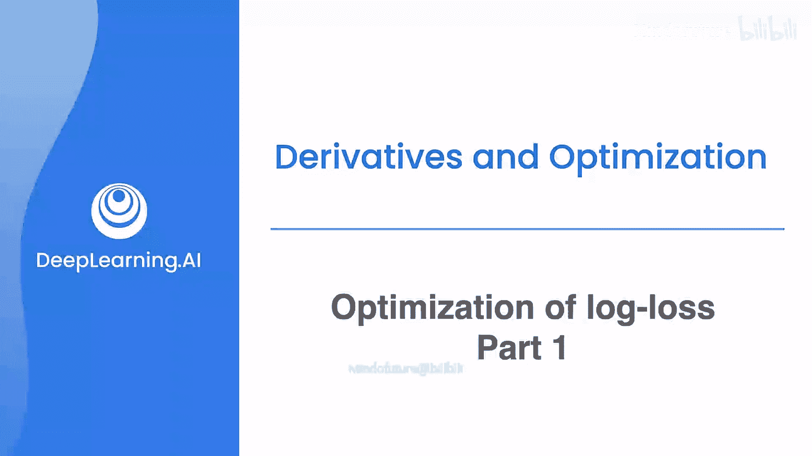
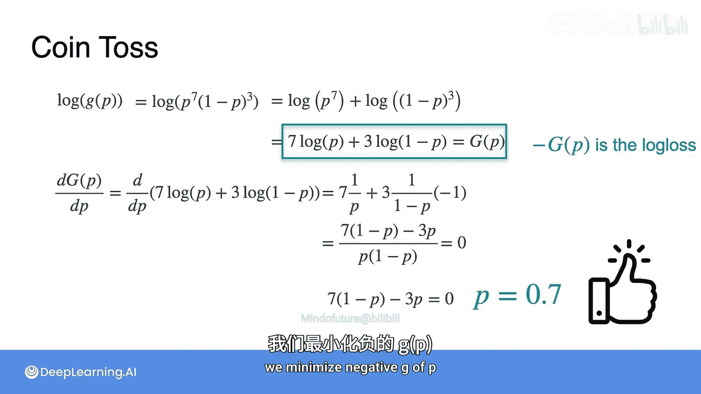

# 【Deeplearning】吴恩达：机器学习和数据科学微积分2 ｜ Machine Learning Calculus p26 P26_对数损失优化第一部分_01_03_05 -BV19M6LBeEkZ_p26-

In the previous video， you saw an optimizational example that led to the square loss。

Now there's another really important function in machine learning called the log loss and so in this video I'm going to show you that also with an example。

 and the way I like to see log loss is the same way I like to see most of machine learning and statistics。

Using coin flips。So let's play a game， I'm going to toss a coin 10 times and we're going to look at the results and if the results are seven heads followed by three tails。

 then you win a lot of money If they're not then you don't win any money so the chances of winning are pretty slim however you can pick the coin you want to use and it can be a bias coin so here's coin 1 it has a probability of landing in heads of 70% and for landing in tails of 30%。

Coin 2 is a fair coin， so it has probabilitybabilities of landing in heads and tails of 50%。

 and coin3 is also biased and is the opposite of coin 1。

 so this one has a probability of landing in heads of 30% and tails of 70%。So here is a quiz。

Which one of the three coins would you choose to maximize your chances of winning？Coin 1。

 coin 2 or coin 3， and remember that to win at this game。

 you have to land the coin in heads seven times and then entails the next three times。

So in order to pick the best coin， let's calculate the probability of winning at the game with each of the three coins。

For coin 1， the probability of landing in heads is 0。7 and for tails is 0。3。

 so to landing heads 7 times it's 0。7 to to 7 because these probabilities get multiplied as they are independent events。

 and for last three tails then you multiply by 0。3 to the 3。So 0。7 to the 7 times 0。3 to the 3 is 0。

00222， so that's quite a small probability， but let's calculate the other ones。For。2 is 0。

5 to the7 for the  seven heads times 0。5 to the3 for the three tails and that's 0。00097。And finally。

 for coin 3 is 0。3 to the 7 times 0。7 to the 3 and that's 0。00008， so those are even worse。

 as you can see Co 1 is the best one is the one that helps us win the game with the highest probability。

 so that's the one you can pick。However， here's a question。

Was Coin 1 the best coin among all the possible coins you could possibly create？Well for that。

 we need calculus， so let's pick a coin and say that the probability of landing in heads is p and the probability of landing entails is 1 minus p because they're supposed to have to 1。

And what we have to do is find the optimal value of P the one that helps us maximize the probability of winning。

So first， what is the probability of winning Well， to land the coin in heads7 times the probability is p to the 7 and to land it entails 3 times is 1 minus p cubed so let's say G of p is the probability of winning and that's p to the 7 times 1 minus p to the 3 and we need to use calculus to maximize G of p。

And how do we maximize GfP， Well， we can take that derivative and set it equal to0。

 so here is the derivative of G with respect to P。We're going to calculate the derivative of p to the 7 times 1 minus B cubed。

 so first we use the product rule to split the p to the 7 and the 1 minus B cubed。

 so we get derivative of p to the 7 times 1 minus B cubed plus p to the 7 times derivative of1 minus p cubed。

Now we're going to calculate each one of these separately。For the first one。

 remember that the derivative of p to the 7 is 7 p to the 6。

 and for the second one you can use the chain rule over here。

 the derivative of 1 minus p cubed is 3 times 1 minus p squared。

 but then you need to take the derivative of the inside and the derivative of 1 minus p with respect to p is minus1。

Now we can do some algebra reorganize it like this and factor it like this。

 and that needs to be equal to 0， so there's a product of three things needs to be0。

 so for a product of three things to be0， one of them has to be0 at least so if the first factor is0 p to the 6 that means p must be 0。

For the second factor to be 0， then 1 minus p must be 0 which means p is equal to 1。

 and for the third factor to be 0， we need p to be equal to 0。7。

 so these are the three candidates for the optimal point Now does the first one make sense。

 well if p equals 0 then the coin will always land in tails and it will have no chance of landing in head 7 times so that was discarded。

For the same reason the second was discarded as well because if p equals 1 then the coin always lands in heads and it has no chance of falling in tails three times。

 so therefore the answer is p equals 0。7， so indeed coin 1 was the best possible coin one could pick。

Okay， so that was a lot of work。Is there any easier way to do it？Well。

 next I'm going to show you a much easier way to do it。

And it's actually a bit counterintuitive because we have to take a step that makes it look harder and then it's going to look easier and the step is take the logarithm of GFB。

Because if G ofp is maximal， then so is the logarithm of GFP。

 so maximizing the logarithm of GFP is the same thing as maximizing GFP Now what is the logarithm of GFP Well it's the logarithm of p to the 7 times 1 minus p cubed。

Now logarithm has a really nice property， which is that the logarithm of a product is the sum of the logarithm。

 so this is logarithm of P to the 7 plus logarithm of 1 minus p cubed。

And it also has another really nice property， which is a logarithm of p2 the7 is 7 logarithm of p and logarithm of 1 B cubed is 3 logarithm of 1 minus B。

 so let's call that capital GFP， this is a simplified version。

This is the logarithm of the probability and we want to maximize capital G of P。

 So how do we do it Well now we take the derivative and this derivative is actually really nice because remember that the derivative logarithm of p is1 over p。

 So when we calculate the derivative of each one of the summons。

 we get7 times1 over p plus 3 times 1 over 1 minus p times minus1 that negative 1 comes from the chain rule because it's the derivative of 1 minus p with respect to p。

We can。Join the denominators to get 7 times 1 minus p minus 3 p divided by p times 1 minus p。

 and that's what's supposed to be equal to 0。 when we can solve for that equal to 0。

 we get the candidates for optimal P。Now notice that we've already ruled out the chances of p being 0 or 1。

 so therefore the denominator is never0， so setting this equal to 0 is the same as setting the topical 0。

 so 7 times 1 minus p minus3p has to be equal to 0 and we can solve for p to get that p is equal to 0。

7 so we get the same solution as before except in a much simpler way。Now。

 this trick of taking the logarithm is a pretty popular trick in machine learning。

 logarithms of probabilities are very， very， very common and very useful。 As a matter of fact。

 what we really want is the negative of GFB。 that is called the log loss and it's a very useful loss function in machine learning。

 You're going to see a lot in classification problems。

And the reason that we actually take negative GFP instead of GFP is that logarithm of p is actually a negative number when p is in between 0 and 1。

 so we want negative GFP to be a positive number and instead of maximizing it like we did here。

 we minimize negative GFP。

