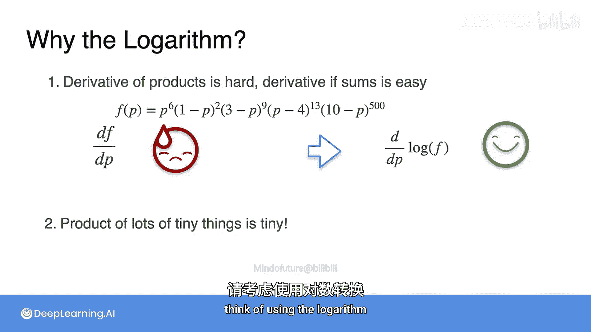

# 【Deeplearning】吴恩达：机器学习和数据科学微积分2 ｜ Machine Learning Calculus p27 P27_对数损失优化第二部分_01_03_06 -BV19M6LBeEkZ_p27-

In the previous video you found the optimal coin to win it again。

 but if you look closely what we did was exactly machine learning。

 it was finding the best model for a dataset， what was the data。

 the 10 coin flips which are seven heads followed by three tails and the model was the coin so the model is a coin that Lnen heads with probability P and entails with probability 1 minus B and what you did was finding the model that most likely fits the data set on the left。

And how you find that model， you minimize the log loss and obtained that the optimal P is 0。7。

Now the question is why did that log loss have a logarithm， why couldn't we？

Simply solve the derivative of a big product well， one reason is that derivative products are hard whereas the rare sums is easy。

Of course if it's a product of two things you can use a product rule。

 but what you do for three things or four things or many things like this。

 you have to iterate the product rule and it gets really messy the derivative of this function over here is actually this formula that's something that is too hard to work out。

If there's an easier way we should always take it and if we take the logarithm。

 then we get this derivative over here， 6 over p plus 2 over1 minus p， etc， that's much cleaner。

 We do get some denominators and that's because of the logarithm because the derivative of the logarithm of P is1 over P but denominators are a small price to pay to not have to work out the formula on the left。

But that's not the only reason we use logarithms。Another reason why we use logarithms is because the product of tiny things is tiny imagine if you have a probability that is the product of 1000 probabilities。

 that's the product of 1000 numbers between0 and1 that number could be really really really small and maybe a computer is not able to handle a number so small on the other hand if it's the logarithm the logarithm of a very small number is a very large negative number and computers can handle those numbers。

So in short， any time in machine learning that you have a very complicated product。

 think of using the logarithm， it may simplify it a lot， especially if you're taking derivative。

