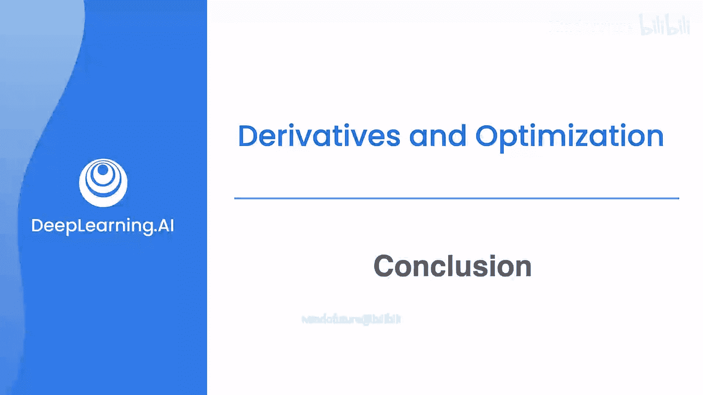

# 【Deeplearning】吴恩达：机器学习和数据科学微积分2 ｜ Machine Learning Calculus p28 P28_第一周总结_01_05_01 -BV19M6LBeEkZ_p28-

Congratulations you finish week1 this week you learn what a derivative is， how to calculate them。

 how to use them for optimization， and most importantly。

 how these optimization problems translate into machine learning problems。However。

 everything you've done so far is in one variable， as you may imagine large machine learning problems use lots and lots of variables。

 so that's what you're going to learn next， how to do all this derivative stuff。

 but in more variables， see you in week2。😊。