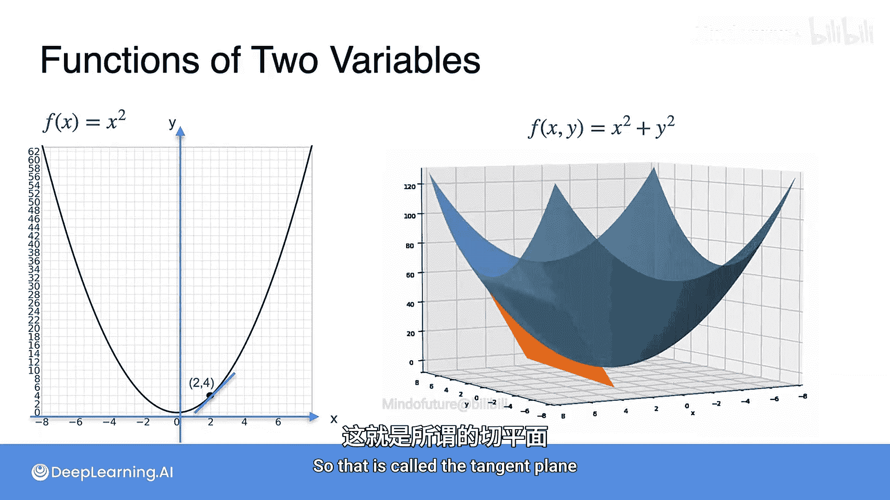
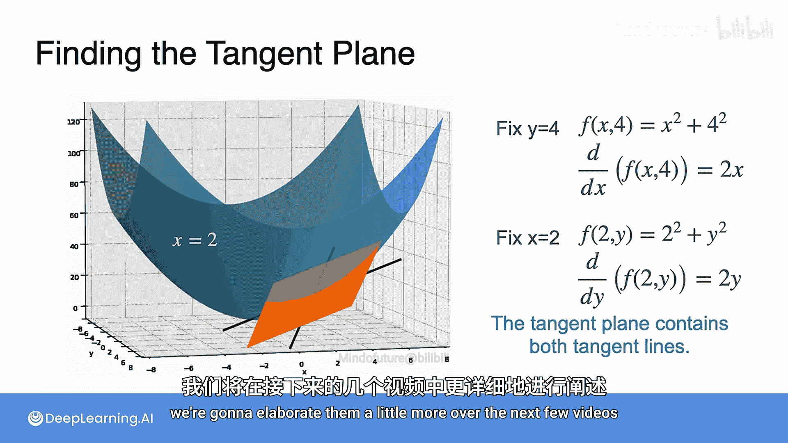

# 【Deeplearning】吴恩达：机器学习和数据科学微积分2 ｜ Machine Learning Calculus p29 P29_切平面导论_02_01_01 -BV19M6LBeEkZ_p29-

Welcome to week two in week one， you learn everything about functions with one variable Now you're going to learn everything about functions with two or more variables。

 So for example， things like a tangent line in one dimension will generalize to a tangent plane in two dimensions。

This can also be used in optimization in the exact same way and it also applies to machine learning in the same way。

 however， optimizing functions in two or more variables can get very complicated even for a computer。

So we're going to introduce methods that will speed this up。

One method that we' learn is called gradient descent。

Then I will show you how to use gradientding descent to optimize several functions。

 but for now let's start with a very important concept。A tangent plane。

So in week one you learn about derivatives of functions in one variable， for example。

 this one f of x equals x squared， which is a parabola。

And visually you can identify the derivative at each point as the slope of the tangent line of the point。

 for example， at the  point2 comma 4， the slope of the tangent is 4。

 so the tangent is this one over here。Now what happens if we have a function of two variables。

 well let's think of a simple one， let's think of f of x comma y equals x squared plus y squared。

 so now the function has two inputs and one output。Therefore it needs to be plot in three dimensions。

 so we're going to plotted over here X and y are the two horizontal axises in the floor and z or F xy is plot as the height。

 and now the tangents are not lines their planes like this plane over here。

 so that is called the tangent plane。

So how do we get this tangent plane well essentially it's the same as the 1 d case。

 except we have to take two cases， we have to actually cut the space into planes and then。

Calculate the tangents on these planes。Let's say we fix y equals 4。

 That means we're cutting the space here and we have a parabola the red parabola now let's cut the space with x equals2。

 so now we have another red parabola and in this parabola we can find a tangent a tangent line so once we have the two tangent lines then we have a plane because any two lines that cross actually represent a unique plane so that one over there is the tangent plane。

So what were the calculations we did here， well， when we fixed y equals 4。

 then we cut the space with a slice and we also let y equals4。

 so that's why this function f of x4 became x squared plus 4 squared because y is 4 and that function is easy to differentiate with respect to x。

 the derivative is 2 x， so that's the slope of one of the lines。

And when we fixed x equals 2 is when we slide the space with the other direction。

 so now you get the function f of 2 comma y， which is 2 squared plus y squared by replacing x equals 2。

 and you can differentiate that with respect to y， you get2 y。Now this calculation seems confusing。

 don't worry， we're going to elaborate them a little more over the next few videos。

