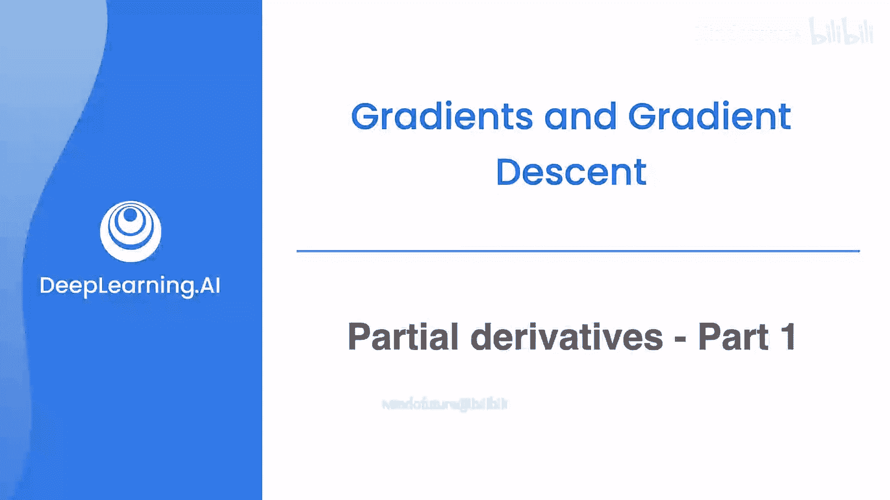
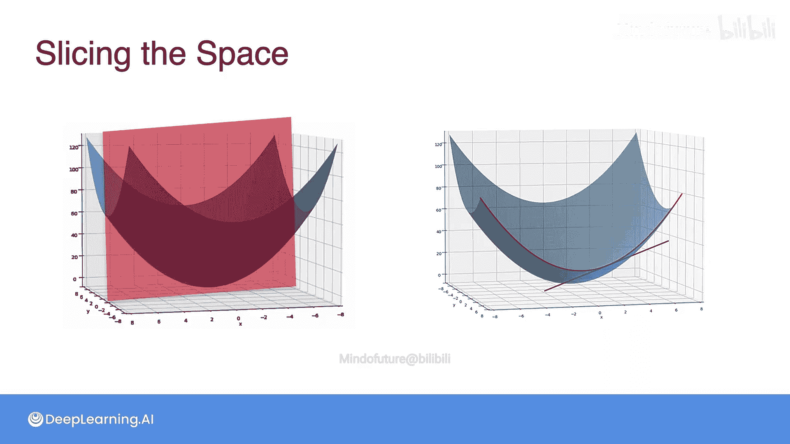
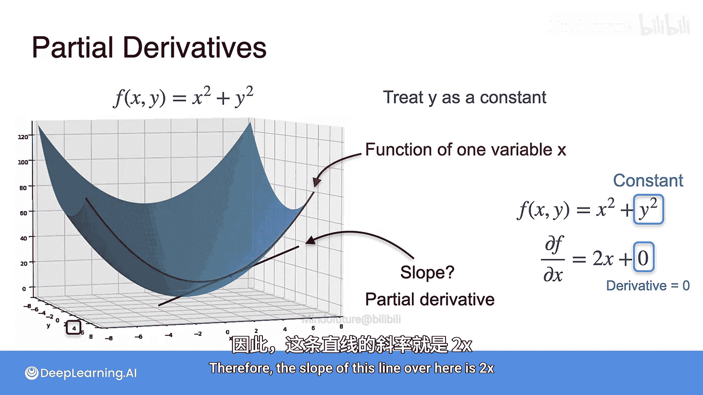
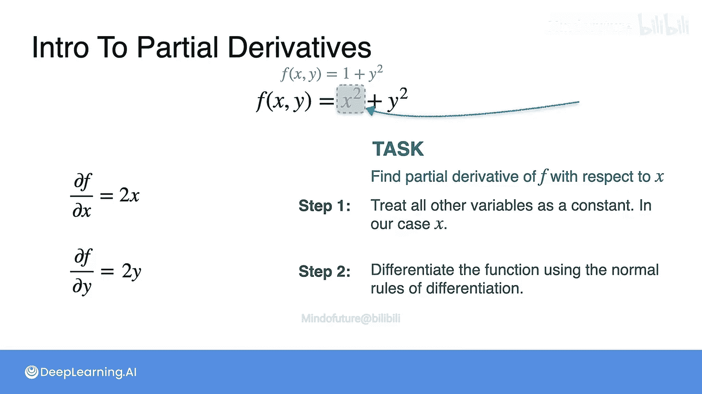

# 【Deeplearning】吴恩达：机器学习和数据科学微积分2 ｜ Machine Learning Calculus p30 P30_偏导数第一部分_02_01_02 -BV19M6LBeEkZ_p30-

Before we get to partial derivatives， I wanted to have the following mental picture。

 imagine that you have this function of two variables plotted in 3D space。

And that you cut it with a plane like this。What do you get， you get something like this。

 and in the cut， you can see this red parabola with a tangent over there。

That's the partial derivative。Now you can also cut it in another direction， you can cut it like this。

And then you get also a red parabola and that red parabola is a function of one variable so you can draw tangents like the black tangent over there。

So let me elaborate a little more。If we take our function in the variables X and y。

 which is plot in 3D， and let's say we fix a value of y， in this case it 4， but it can be anything。

 so we treat y as a constant。 all of a sudden if you treat y as a constant。

 this is no longer a function of two variables is now function of only one variable represented by this red parabola over here。

Now， let's take some point in that red parabola and let's draw a tangent like it's drawn here。

 that black line， what is the slope of this line， the slope of this line is the partial derivative。

So how do we calculate a partial derivative， well， it's very simple。

Let's take the formula for the function， F of xy equals x squared plus y squared。

Since we fixed Y and it doesn't really matter what value we fixed it to。

We are treating y as a constant。 So when you differentiate this function now。

 this function is only a function of x。 So when you take the derivative with respect to x。

 which we're going to call die F over di y where di is this symbol over here。

 that's partial derivative。Then it's going to be 2 x。

 which is the derivative of x squared with respect to x plus 0 because 0 is the derivative of a constant。

 remember that y squared is now a constant so its derivative with respect to x is 0。So therefore。

 the slope of this line over here is 2 x。

So you can take two partial derivatives with respect to x and with respect to y。

 so what happens when we treat y as a constant， well the partial derivative is2 x。

 and if we were to treat x as a constant， then the partial derivative is2 y because the derivative of x squared is 0 and the derivative in y squared is2 y。

In other words， if you have a function f of x comma y， you can take two partial derivatives。

There's two ways to denote it， one is f sub x and the other one is di f over di x。

 and you can also take the partial derivatives back to y and that's fy or di f over diy so these two are the two partial derivatives you can take of this function and as you can imagine if I have a function not of two variables but of late say 10 variables。

 then I can take 10 partial derivatives。One with respect to each of the variables。

Now if those calculations weren't super clear， let me do them in detail here。

 so let's say you have the function f of x comma y equals x squared plus y squared。

 and the task is to find the partial derivative of x with respect to x and y。So， let's do。

D F over di x first， we're going to try to find this2。And as I said before。

 that's the partial derivative notation over here。So when you want to find the partial derivative of f with respect to x。

 there are two steps， the first step is to treat all the variables as constants。

 so in this case y is the other variables so we're going to treat y as a constant and step2 says differentiate the function using the normal rules of differentiation so let's start。

です。😊，Y squared over here is a constant， so it might as well be a 1。

 We can think of this as f of x comm y equals x squared plus1 because the derivative of1 is0 because it's a constant。

 so die f over di x is simply2 x because that's the derivative of x squared。

And what's Ti f over di y， well now x is the one that behaves as a constant。

 so we can think of this as1 plus y squared or 7 plus y squared or anything you want and the derivative of1 plus y squared with respect to y is 2 y。

 so those are the partial derivatives。

