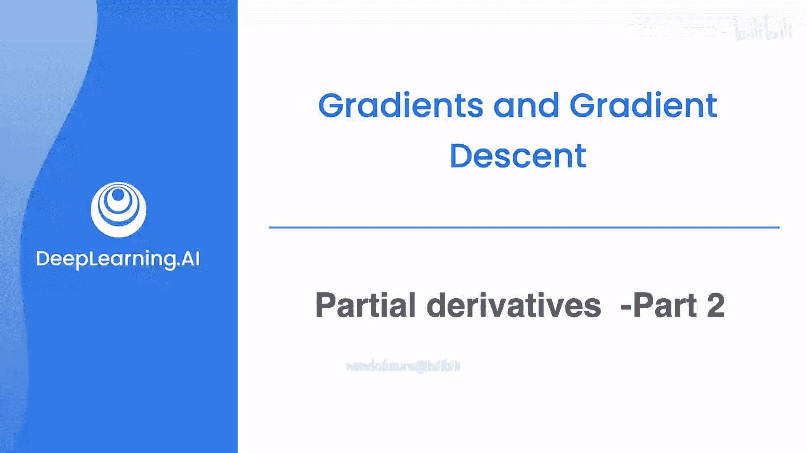
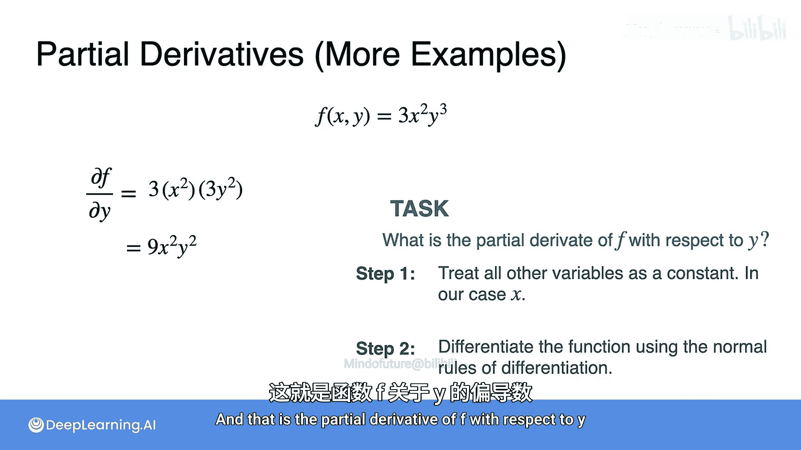

# 【Deeplearning】吴恩达：机器学习和数据科学微积分2 ｜ Machine Learning Calculus p31 P31_偏导数第二部分_02_01_03 -BV19M6LBeEkZ_p31-

So in order to really nail down the concept of a partial derivative， let's do one more example。

 let's say that the function now is f of xy equals 3x squared times y cubed。

 so the task is to find the partial derivative of f with respect to x。

 so in the following quiz calculate the partial derivative of f with respect to x or die f over di x。

So the way to do this is with the two previous steps that we learned step one is treat all the other variables as constant。

 so in this case is variable Y that means this y cubed is a constant。

 so we're going to cover it with a box to remember that it's a constant。

Step 2 says differentiate the function using the normal rules of differentiation so how do we do this Well this three is a constant so if you remember the multiplication by scalar rule we put this constant here。

And that will multiply the derivative。The next factor is x squared。

 so what's the derivative of x squared with respect to x is simply2 x。And finally。

 this gray box is another constant， so it multiplies in the derivative as the same content。

Now you remember that the gray box was y cubed， so all of a sudden we have the derivative is 3 times 2x times y cubed。

 simplifying its 6 xy cubed， and that's the partial derivative。Now let's do the other one。

 what is the partial derivative of F with respect to y， that's what the next quiz is about。

So for this one you do the exact same thing， except now you have to treat the x as a constant because you're taking the derivative with respect to y。

 so let's cover x squared with a box to remember that it's a constant。

And now let's take derivative derivative just like before， three is a constant， so it goes here。

Then the constant is a constant， so it goes here， and then the derivative of y cubed is 3 y squared。

 So now you remember that the constant was an x squared all along so。

The derivative is 3x squared times 3 y squared， which is 9 x squared y squared。

 and that is the partial derivative of f with respect to y。

