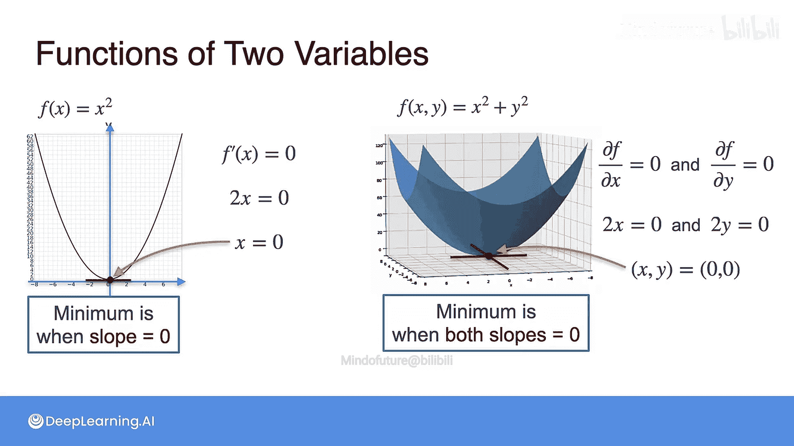

# 【Deeplearning】吴恩达：机器学习和数据科学微积分2 ｜ Machine Learning Calculus p33 P33_梯度与极值_02_01_05 -BV19M6LBeEkZ_p33-

So in this video， I'm going to show you something very interesting。

 The gradient is pretty useful to minimize functions of two or more variables in the same way as the derivative was useful to minimize function of one variable。

 So let's go back to a function of one variable。 This para f of x equals x squared。

 and now let's look at the function we've been studying in two variables。

 which is f of xy equals x squared plus y squared。 Now let's go back to the function of one variable。

 When you want to minimize this function。 The minimum point is this point over here。

 and the way to find it is to find the point in which the slope is equal to0。

 So we take the derivative solve that derivative equals0。

 and the solution is this minimum point over here at 0。 So what happens with more variables。 Well。

 something very similar。 The minimum point is this point over here and notice that。

Tent plane is actually parallel to the floor。And that's going to happen in every local minimum and maximum that the plane is parallel to the floor Now。

 since we're not dealing with planes， but we're dealing with partial derivatives。

 let's actually draw the two partial derivatives， notice that they are these two lines over here。

And both have slopes of zero because they're parallel to the floor。So in other words。

 the minimum of the function f on the right happens when both of the slopes of the tangent lines given by the partial derivatives are zero。

 and if you have a function of many， many more variables， say a function of 12 variables。

 then you're just going to need for 12。Slopes to be  zero。

 those corresponding to all the partial derivatives。So now let's do a little bit of math。On the left。

 you want to solve the slope equals 0 so the derivative equals 0。

 that means you want to solve for f prime of x equals 0。

 Now F prime of x for x squared is 2 x because that's the derivative of x squared and when you solve for 2 x equals 0。

 you're basically getting the solution x equals 0 and x equals 0 is precisely this point over here。

Now what happens when we do this in more variables Well， you want the two partial derivatives to be0。

 that means die over di x and die ofpho di y are both0。

Now what's die over d x that's 2 x and die f over di y is 2 y。

 so you want 2 x equals 0 and 2 y equals 0， that's the same as the point x comm y equals 00。

 which is this point over here。Now this time solving the system of equations 2 x equals 0 and2 y equal 0 was pretty easy to get the 0 x y equal 0。

 sometimes you may have to do a little bit of work。

 but basically to find the minimums and maximums all you have to do is set all the partial derivatives to zero and solve that system of equations。

