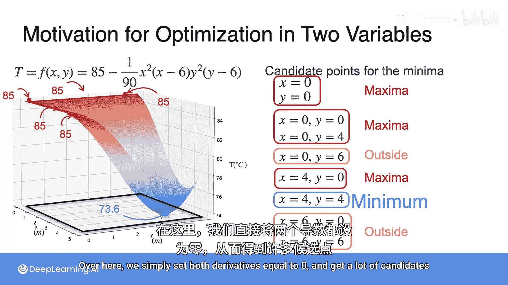

# 【Deeplearning】吴恩达：机器学习和数据科学微积分2 ｜ Machine Learning Calculus p34 P34_梯度优化示例_02_01_06 -BV19M6LBeEkZ_p34-

Now that you will learn how derivatives work in more than one dimension。

 I'm going to show you how to use them in optimization and the example we're going to use is the same one we used before of the sauna except now the sauna has two dimensions。

So in week one， you saw a simple example where you were in a sauna and wanted to get to the coolest point since you were starting to feel hot。

 but in the simple example， you were in the bench in the sauna and you could only move in two directions to the left on to the right。

Now let's look at a more realistic scenario where you can move in any direction because you're standing anywhere in this room。

So it's a two dimensional sauna。Now， let's consider that the sauna is this five by5 room。

And you're standing here， but you can walk in pretty much any direction that you want and again。

 you're starting to feel hot so you want to get to the coldest place in the room。

And the temperature looks like this， the red points are hot and the blue points are cold。

 and for each position x Y where x and y are the two coordinates。

 the temperature is the value of the function at that point which is represented by the height。

 so the red points are high because they represent hot points and the blue points are low because they represent cold points。

 and the goal is to find that coldest place that blue point over there at the right。

So first let's try the same approach you did on week one to get to the minimum let's say that you're standing over here and you're going to basically move around a little bit and see where does it get colder so let's say you want to take a step in this direction。

And in this direction and in this direction and from those you select which one was cold。

 so clearly it's the blue direction， so let's move one step here and now let's iterate。

 let's continue doing that。And moving in some random steps and checking out those steps。

 which one took us to a colder place and continue doing this so it's believable that if you do this for a while you will be able to take steps that take you to the coldest place in the room and how do you recognize the coldest place in the room well just like before it's a place where if you walk in any direction you get hotter。

 there's no way to get colder by taking a step in any direction。

Another way to look at it is if you were to take the tangent plane。2， the temperature function。

 this tangent plane is parallel to the floor because the two derivatives。

 the two partial derivatives。Are both zero， and these are given by die t over di x and die t over di y。

 where t is a temperature function and x and y are the two coordinates in the sauna。

So let's put some numbers here and see how things go let's say that the temperature is this function 85 minus1 over 90 times x squared times x minus6 times y squared times y minus6。

 so it's a little more complicated than the previous one we had of x squared plus y squared。

 but the math is very similar。So here is an exercise given this function。

 try to calculate the partial derivatives dief over di x and dif over di y。

 I encourage you to pause the video and take pen and paper and try to calculate them。

And I will give you the answers， the answers are di f over di x is minus1 over 90 times x times 3 x minus 12 times y squared times 1 y minus6 as the one you obtain by letting y behave as a constant and di f over di y is minus1 over 90 times x squared times x minus6 times y times 3 y minus 12 those two are the partial derivatives。

Now to find that minimum point， remember that you have to set them both equal0 and then solve for x and Y Now this is going to give us a lot of points。

And many of them won't be the minimum， only one of them will be。

 so we have to go to the slightly tedious approach of looking at all the pairs X Y for which these two partial derivatives are0。

But that can be done。Take a look at dieF over dix， it's a product of several things and for a product of several things to be0。

 one of them at least has to be0， so the possibilities here are that x is equal to 0 or that 3 x minus 12 is equal to 0 in which case x is equal to 4。

Or that y squared is equal to 0 in which case y is equal to 0。

 or that y minus 6 is equal to 0 in which case y equals 6。And similarly for di f over diy。

 either x is equal to0 or x is equal to 6。Or y is equal to 0。Or。

3 y minus 12 is equal 20 in which case y equals 4， so let's put all these candidates together。

So for this candidates， if x is equal to0 or y is equal to 0， then。

You have one point where the gradient is0 and the other points are all denoted over here。

So notice that some points are outside of the sauna， so we don't care about those。

Now for x equals0 or y equals 0， those are all maximum because as you can see all these points give 85 as the temperature。

 so those are not the minimum the only minimum is this one over here x equals 4 y equals4 which is the point we were looking for for this point the temperature is 73。

6 so this is the minimum。So as you can see， just like we did for one variable。

 you set the derivative equal to0 that gives you a bunch of candidates and then you check them individually over here we simply set both derivatives equal to0 and get a lot of candidates and then check them individually。

