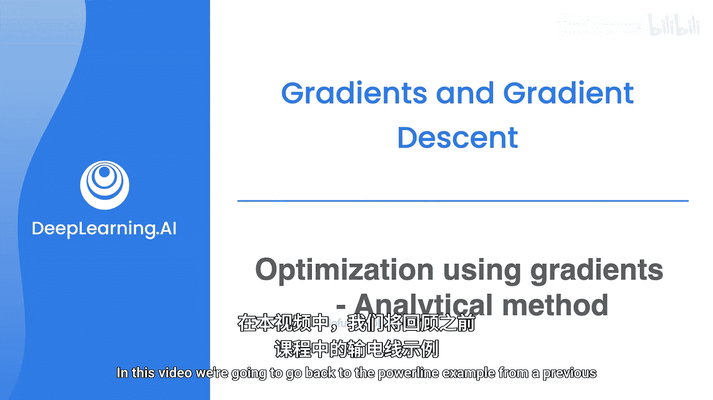
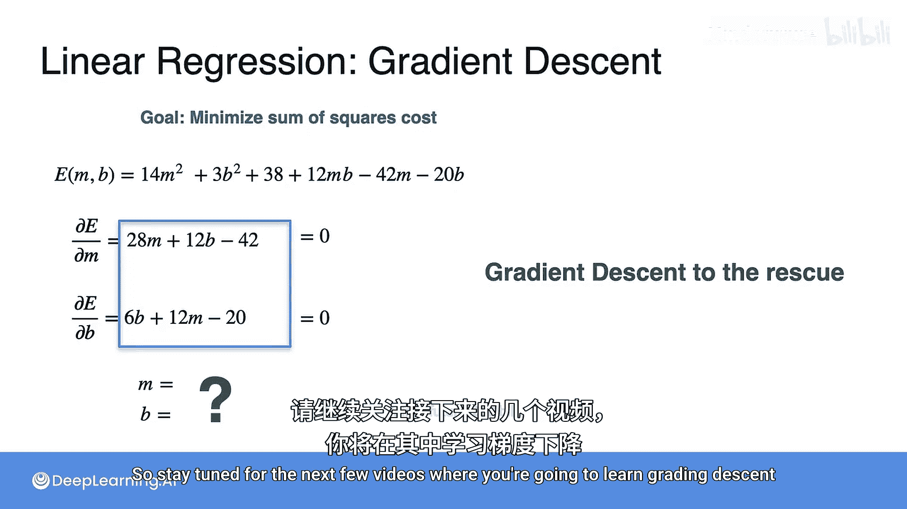

# 【Deeplearning】吴恩达：机器学习和数据科学微积分2 ｜ Machine Learning Calculus p35 P35_梯度优化解析法_02_01_07 -BV19M6LBeEkZ_p35-

In this video， we're going to go back to the power line example from a previous lesson。

 however this time the example is in two dimensions instead of one。

The reason I really like this example is because it introduces one of the most important machine learning models out there called linear regression。

And then you're going to see how to solve a linear regression problem using optimization。

So in a previous lesson you saw a power line problem in one dimension where you need to determine where to place your house in order to connect to three power lines with the least cost in this lesson we work with a similar problem but in two dimensions so now the power lines have coordinates and they're going to be located on an X Y plane like this one so here are the three positions of the power lines。

And the problem is the following you now want to find the optimal place for a fiber line connection that goes in a straight line。

In such a way that you reduce the total cost of connecting to the three power lines and how do you connect to the power lines you can connect to each power line by connecting a wire to touch the fiber line。

 but the wire needs to be parallel to the Y axis。And the cost for connection is the square of the length of the wires just like before。

 So here are。The three connections。And the three costs。

 so the costs are the area of the three squared， and the total cost is the sum of these areas。Now。

 the point is to find the perfect line that reduces this cost and minimizes it。

And that becomes a mathematical problem because if you look at the line。

 the line can have an equation such as y equals mx plus B where m is the slope and b is the y intercept。

 and the goal is to find the optimal M and b to minimize these sum of squares。

Now before we had a function with x and Y， now we have a function with M and B。

 but it's the same thing， we're minimizing a function of two variables。

 the function is the sum of the areas and the two variables are M and B。

So let's actually calculate the function that we want to minimize。

So focus your attention on the blue square Now the blue power line is located on the coordinate 1 comma 2。

 and it needs to connect to the fiber line。 Where does it connect in the 01 m plus B why is that the 0。

1 m plus B， because if we let x equals1， then mx plus b is equal to m plus B。

 so the y coordinate of the point of connection is m plus B and the y coordinate of the power line is 2。

 therefore the distance is m plus b minus2 and the cost is m plus b minus2 square。In a similar way。

 the cost for the yellow power line is 2 m plus b minus 5 square and for the green power line is 3 m plus b minus 3 squared。

 and therefore the total cost is the sum of these three numbers。Now let's expand this。The first one。

 m plus b minus2 squared expands as this。The second one expands as this and the third one expands as this。

And if we join similar terms， we get that E of M is 14 m squared plus 3b squared plus 38 plus 12 mmb minus 42 m minus 20b。

And that is the cost function that we want to minimize。

 so we want to find the M and B that make this expression E of M the minimum。

But we know how to do this already， all we have to do is calculate the two partial derivatives die e over di M and die e over di B。

 set them both equal to0 and then solve for M and B。So let's start with a quiz。

Please help me find the partial derivative of E with respect to M。

And the answer is 28 m plus 12b minus 42。 Now let's do another quiz。

 help me find the partial derivative of E with respect to B。And the answer is 6 b plus 12 m minus 20。

 so now that you have these two partial derivatives。

 all you have to do is set them to be equal to0 and solve for M and B you know how to do this from the linear algebra class so let's actually work it out and once we work it out that M and B are going to be the optimal values to minimize E of Mmb and they're going to give us the perfect line。

So how do we solve this？Well， let's start with the second equation and let's multiply it by two。

To get 12 b plus 24 m minus 40 equals0。Now let's subtract it from the first equation to get 4 m minus2 equals 0。

This is equivalent to m equals24， which is 0。5 or12。

Now let's take that m equals 12 and plug it back into the second equation to get 6b plus 12 times 0。

5 minus 20 equals 0 or 6b plus 6 minus 20 equals 0 or 6 b minus 14 equals 0。

 which gives us the solution b equals 14 over 6 or 7 over 3。If this seemed a little confusing。

 please check the linear algebra class where this is explained in detail。

So now we have the solution to the system， the solution to the system is m equals12 and b equals 7 over 3。

 those are the two values that make those two partial derivatives0。

And if you plug them back to the equation， you get that E of 127 third is 4。167。

 that is the minimum value of the cost and let's see how this looks in the graph。

If you plot the line of equation 1 x plus7 third， you get this line over here and notice that indeed this line gives some pretty small squares。

So that's it， that's how you minimize the square loss。

This problem is actually called linear regression， linear regression is a very。

 very important problem in machine learning where you have a bunch of points and you try to find the closest line to them and that's exactly what we did here。

Now notice one problem here。When we solve this equation of two variables and two unknowns。

 that can be pretty hard， especially if you were to have many variables。

 solving an M by N system of equations can be pretty expensive。

Is there a faster way to do it so the answer is yes and you're going to see it next in the class。

 it's a method called grading descent， which actually helps minimize functions in a pretty fast way。

So stay tuned for the next YouTube videos where you're going to learn grading descent。

