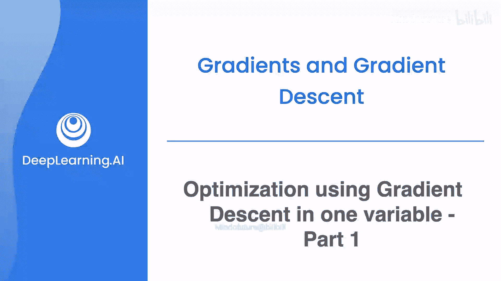
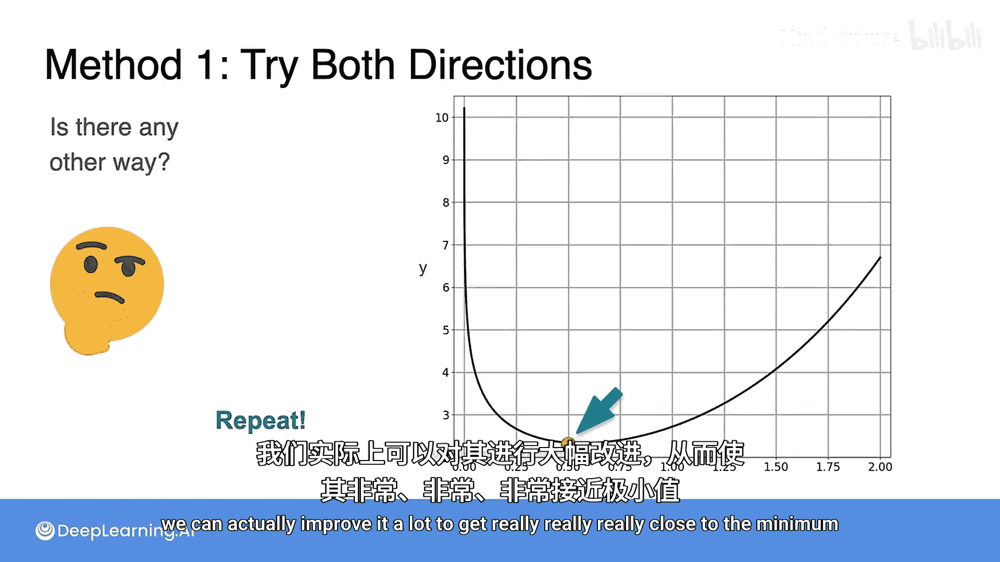

# 【Deeplearning】吴恩达：机器学习和数据科学微积分2 ｜ Machine Learning Calculus p36 P36_单变量梯度下降优化第一部分_02_02_01 -BV19M6LBeEkZ_p36-

So far you've learned how to solve optimization problems using derivatives and gradients， however。

 when you try to get exact solutions to these problems analytically。

 you're going to start noticing that these problems can get really complicated really fast。

 especially in higher dimensions。In this lesson， I'm going to show you a method that is iterative。

And that is really powerful for minimizing or maximizing functions， especially in many variables。

 The method is called gradient descent。😊，But let's start with grading descent in one variable in order to work our way up to grading descent in several variables。

So let's look at the following function， F of x equals e to the x minus logarithum of x。

 this is the plot of the function， so it's nice and smooth and the question is。

 can we find the minimum here？And the minimum is somewhere around here。

 and we know how to do it from previous lessons， all we have to do is calculate f prime of x and set it equal to 0。

And then solve for x， so what is the derivative of f of x？It's e to the x minus1 of x。

And the reason is because the derivative of e to the x is e to the x and the derivative of logarithm is 1 over x。

So all we have to do is solve for e to the x minus 1 or x equals 0。 however。

 this is pretty challenging， let me show you。Solving for e to the x minus1 over x equals 0 is equivalent to solving for e to the x equals 1 over x。

 and I challenge you to try it's actually pretty hard to do analytically the solution is 0。

5671 etc which is a famous number it known as the omega constant。However。

 the fact that this is really hard to solve analytically should not stop us from trying something the question is is there any other way。

 so here is one method， let's pick some random value， let's say somewhere around here。

And now let's give it a try and move to the left by a little bit and move to the right by a little bit。

And now we have two new points to try。Which of these two points is better， Well。

 since we're trying to minimize the function， let's go for the one on the right which has a smaller value in the function。

So now we are at this point and let's repeat， so we move in both directions。

And check to see which point is smaller and this one wins， so let's try it one more time。

We move in both directions and now something interesting happens。

 which is that both points on the two sides have a higher value， so therefore。

 let's settle for this point。And we say that this point well， it may not be the minimum。

 but it's close enough to the minimum。Now this method is not bad。

 but we can actually improve it a lot to get really， really， really close to the minimum。

 let me show you in the next video。

