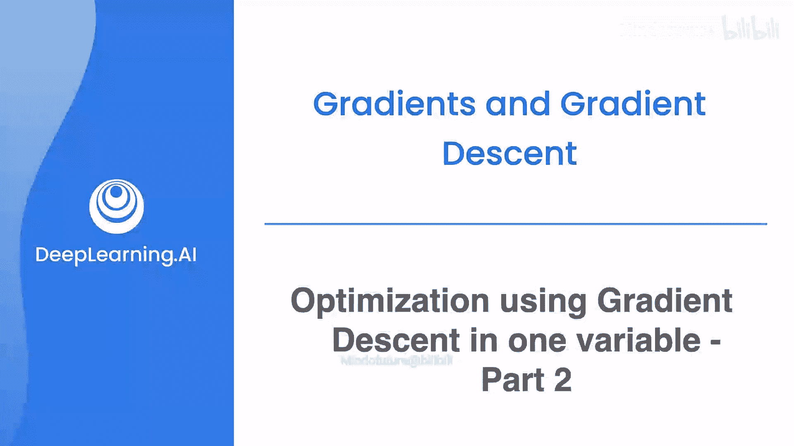
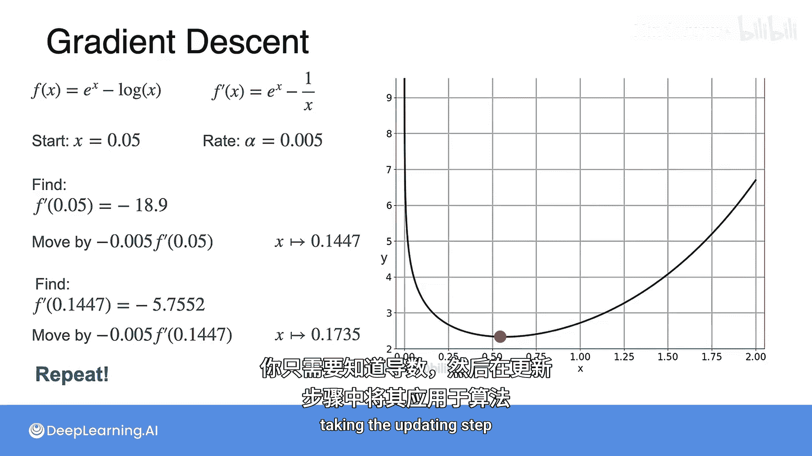

# 【Deeplearning】吴恩达：机器学习和数据科学微积分2 ｜ Machine Learning Calculus p37 P37_单变量梯度下降优化第二部分_02_02_02 -BV19M6LBeEkZ_p37-

In the previous video we learned an OK way to approximate the minimum function。

 however here we're going to try something smarter。

 so let's say you're over here and you want to get closer to the minimum what would you tell this point to do you would tell it to step to the right small amount。

What if the point is over here， well you would tell it to step to the left。Now。

 is there any information on the function that could help you make this decision quickly？

Well let's look at the derivative over here the slope is negative and you're moving to the right and over here the slope is positive and you're moving to the left。

 so that's the information you need。You actually need to subtract the slope because if you are at a point where the slope is negative。

 you need to add a little bit to the coordinate of the point。

 whereas if you're in a place where the slope is positive then you need to subtract a little bit to the coordinate of the point so in short if you want a new point that is closer to the minimum then that should be the old point minus the slope why because you refer to the left of the minimum the slope is negative so you're subtracting a negative number and moving to the right and if you're to the right of the minimum。

 then you subtract a positive number， the slope and move to the left。Now。

 if the new point is x1 and the old point is x0， then the formula is x1 equals x0 minus f prime x0。

 which is the slope。 However， there's a small caveat。

 imagine that you are over here at a very steep part of the curve because the function is steep。

Then the derivative is very large， so it' is making a really long jump Now long jumps can be pretty chaotic。

 and the reason is because you may actually miss the minimum and go pretty far away and get lost。

 We want to take small steps and be more secure in our path。

So how do we take into account a small step？Well， you simply modify the formula and put a small number。

 multiplying the slope， for example， 0。01， you can take any small number you like and that's called the learning rate and is denoted alphapha。

 there's a whole science in picking good learning rates。Now this。Formula has an added bonus。

 Imagine if you're over here far away from the local minimum and in a steep part of the curve。

 youll be taking a big step， obviously not big because you don't want to miss the point and go too far but relatively big。

 however， if you're really close to the minimum in a part that's more flat。

 you want to take a small step。Now this is included here in the formula because if you're in a steep part of the curve。

 the derivative is big， and you're taking a large step； however， if you're in a flat land。

 then the derivative is small and you're taking a small step。So imagine like in golf。

 if you're far away from the hole， you want to hit it really hard to get there closer。

 but if you're really close to it， you want to hit it with precision， so not a lot of strength。

 This method is called gradientd descent and it's really。

 really useful in machine learning and that's why it's so popular and it only consists in iterating this procedure。

So you start with x0 and from x0， you can get a point x1 using the formula。

 then you can get another point x2 based on x1 by just plugging x1 in the formula now and you can continue。

You can iterate it many times， 20 times， 100 times， thousands of times。

 this is a pretty fast algorithm so it can be iterated thousands of times quickly and its results are amazing。

 it can get us really， really close。Do the minimums of functions。

 and that's why it's so widely used in machine learning。So here is the algorithm in short。

 you start with a function F of x and the goal is to find the minimum of Fx。

 so first you define a learning rate and you choose a starting point and then you do the updating step。

Wwhich is xk equals xk minus 1 minus alpha times the derivative at xk minus1。

 and then you repeat this step until you're close enough to the true minimum。

 you can tell that you're close enough to the true minimum when your steps don't really change that much。

So now let's try it on the example， let's do a couple of iterations。

 recall that the function is e to the x minus logarithm of x and the derivative e to the x minus 1 over x。

 so let's pick a starting point of 0。05 and a learning rate of 0。005。

So the first iteration is we find the derivative and we move by learning rate times derivative。

 so we get a new 01。1447， which is closer to the minimum， and then we take another iteration。

 we find the derivative and subtract learning rate times derivative to get 0。

1735 and then we can repeat many， many， many times until we get pretty close to the minimum。

Notice something interesting。Which is that in this algorithm you never needed to solve E x minus1 of x equals0。

 you never need to solve for the derivative equal0。

 you only need to know the derivative and then apply it in the algorithm when you're taking the updating step。

 so that's a huge improvement。

