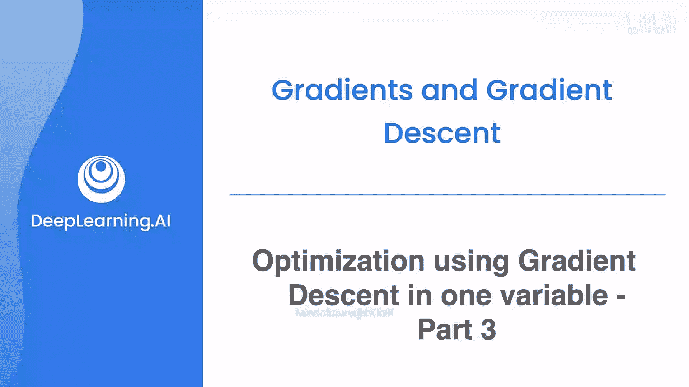
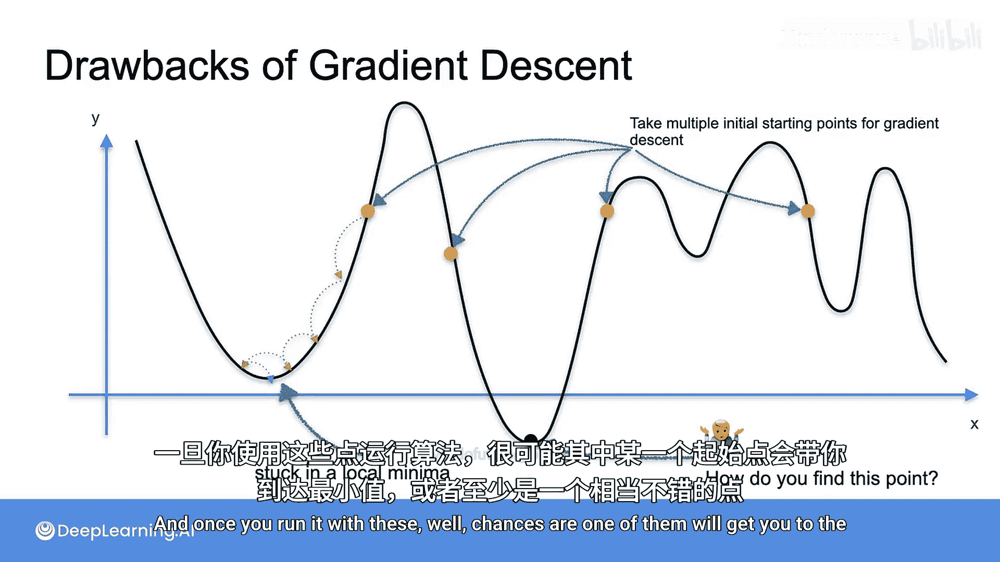

# 【Deeplearning】吴恩达：机器学习和数据科学微积分2 ｜ Machine Learning Calculus p38 P38_单变量梯度下降优化第三部分_02_02_03 -BV19M6LBeEkZ_p38-

In the previous video learn the learning rate， learning rate is a big deal in machine learning and finding a good learning rate can be pretty hard and it can also be pretty influential to how well your model does。

Let's say you have a learning rate that's too large Well。

 then you may miss the minimum and never be able to find it because your steps are just too big。

What if the learning rate is too small， well， then you may take forever to actually reach the minimum or perhaps never reach it。

What you want is a learning rate that is just right。 however。

 finding a learning rate that is just right can be pretty hard。

 It's actually a research problem to find a good learning rate。

 There are a lot of really good methods that change learning rate based on how the problem is doing。

 but there's no definite method to find a good learning rate。

Now here's another problem that gradientd the hascent may have。

 let's say that you have this function over here， so the minimum is actually this one。However。

 let's say that you start running your grad descent algorithm over here。Well。

 it's never going to take you to that minimum because it takes you to what's a local minimum。

 it's a point that looks like a minimum， but it's not。 So how do you overcome this problem。

 Well there's actually no secure way to overcome it。

 but a way to get pretty good results is to run the gradient in theelta algorithm many。

 many times with many different starting points。And once you run it with these， well。

 chances are one of them will get you to the minimum or at least to a pretty good point。

