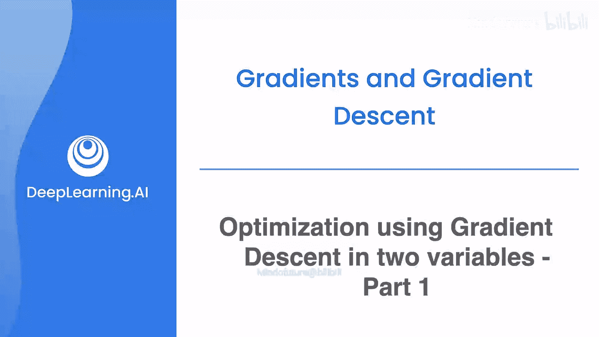
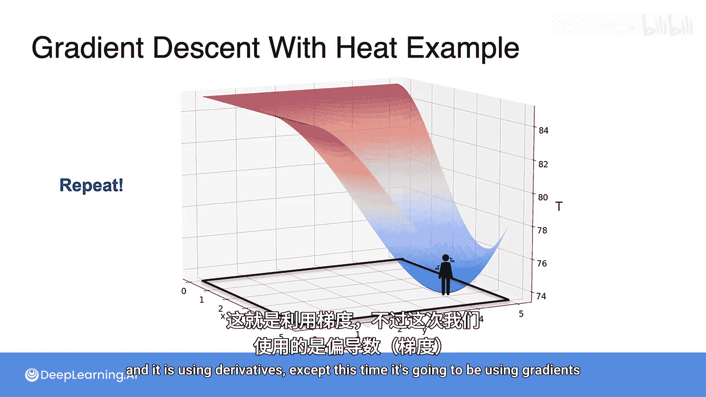

# 【Deeplearning】吴恩达：机器学习和数据科学微积分2 ｜ Machine Learning Calculus p39 P39_双变量梯度下降优化第一部分_02_02_04 -BV19M6LBeEkZ_p39-

Now that you learn gradientding descent for one variable， let's learn it for more variables。

 we're going to start in the bottom and work way up to the complete gradientding descent algorithm。

Now earlier this week used an example of temperature and Asa to introduce optimization with two variables。

 the goal is to move from your initial starting point to the coolest place in the room。

Now in the previous lesson you learn how to solve a problem analytically by calculating the partial derivatives and equating them to zero the goal now is to find some alternative way to solve this problem using ratings just as you did in the previous video for a one variable function。

So let's say that you start here in the sauna and you're going to take some random steps so you take four random steps in four directions and you're going to see which one of the four gets you to the coldest place。

So let's say it's this one， so you move a step in that direction。Now again。

 you take four random steps and see which one of the four takes you to a coldest place and you take that step and you can iterate。

 you can continue doing this until you get either to the coldest place or at least somewhere close to the coldest place。

However， this from some caveats， how do you pick the directions in which to take steps？

Is there any smart way to take these directions well just like in the previous video with one variable。

 there is a smart way to do it and it is using derivatives except this time it's going to be using gradients。

